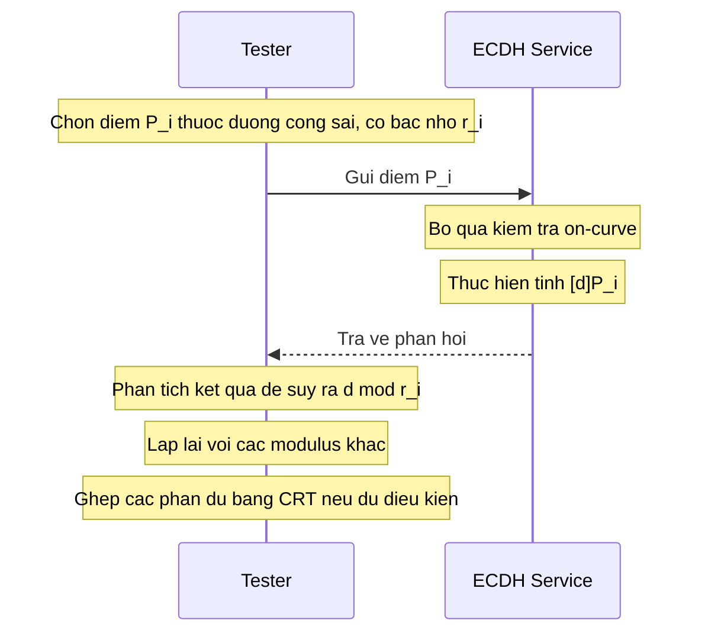

# Cơ sở toán học của ECC 

> [!note]
> **Phạm vi toán học:** 
> - Đường cong elliptic
> - Nhóm điểm
> - Phép nhân vô hướng (scalar multiplication)
> - Bậc `n`
> - Cofactor `h`
> - Bài toán logarit rời rạc (ECDLP).
>
> **Các track liên quan:**
> - Track A: Generic Search 
> - Track B: Unsafe Order/Pohlig–Hellman
> - Track C: ECDSA Nonce Reuse
> - Track D: Point Validation/Invalid-Curve
> - Track F: Side-channel.
>
> **Tài liệu chuẩn:** NIST SP 800-186, RFC 6090, FIPS 186-5, RFC 7748 và RFC 8032.

## Mục lục

- [I. Tọa độ Affine](#i-tọa-độ-affine)
  - [1. Khái niệm](#1-khái-niệm)
  - [2. Điều kiện không suy biến](#2-điều-kiện-không-suy-biến)
  - [3. Nhóm EC (EC Groups)](#3-nhóm-ec-ec-groups)
  - [4. Phép cộng theo hình học (Geometric Addition)](#4-phép-cộng-theo-hình-học-geometric-addition)
  - [5. Phép cộng theo đại số (Algebraic Addition)](#5-phép-cộng-theo-đại-số-algebraic-addition)
  - [6. Biểu diễn trên trường hữu hạn và điểm ở vô cực](#6-biểu-diễn-trên-trường-hữu-hạn-và-điểm-ở-vô-cực)
- [II. Tọa độ Jacobian](#ii-tọa-độ-jacobian)
  - [Công thức nhân đôi 2P](#ii-tọa-độ-jacobian)
  - [Công thức cộng P₁ + P₂](#ii-tọa-độ-jacobian)
- [III. Áp dụng EC vào ECC](#iii-áp-dụng-ec-vào-ecc)
  - [1. Các khái niệm nền tảng](#1-các-khái-niệm-nền-tảng)
  - [2. Định lý Hasse](#2-định-lý-hasse)
    - [2.1. Xác định chính xác cấp nhóm \#E(𝔽ₚ)](#2-định-lý-hasse)
    - [2.2. Các cấu trúc nhóm cần loại trừ khi chọn đường cong](#22-các-cấu-trúc-nhóm-cần-loại-trừ-khi-chọn-đường-cong)
  - [3. Cofactor](#3-cofactor)
  - [4. Thuật toán Double-and-Add](#4-thuật-toán-double-and-add)
  - [5. Ví dụ minh họa nhỏ](#5-ví-dụ-minh-họa-nhỏ)
- [IV. Bài toán Logarit rời rạc trên EC (ECDLP)](#iv-bài-toán-logarit-rời-rạc-trên-ec-ecdlp)
  - [1. Các thuật toán giải ECDLP và work factor](#1-các-thuật-toán-giải-ecdlp-và-work-factor)
    - [A. Exhaustive Search (Brute force)](#a-exhaustive-search-brute-forces)
    - [B. Baby-Step Giant-Step (BSGS)](#b-baby-step-giant-step-bsgs)
    - [C. Pollard's rho](#c-pollards-rho)
    - [D. Pohlig–Hellman (bậc hợp số trơn)](#d-pohlighellman-bậc-hợp-số-trơn)
- [V. 10 tiêu chí cấu trúc tham số an toàn (Domain Parameters)](#v-10-tiêu-chí-cấu-trúc-tham-số-an-toàn-domain-parameters)
- [VI. Validation điểm công khai và Invalid-Curve Attack](#vi-validation-điểm-công-khai-và-invalid-curve-attack)
  - [1. Nền tảng của Invalid-Curve Attack](#1-nền-tảng-của-invalid-curve-attack)
  - [2. Quy trình validation điểm công khai](#2-quy-trình-validation-điểm-công-khai)
  - [3. Cơ chế đại số của Invalid-Curve Attack](#3-cơ-chế-đại-số-của-invalid-curve-attack)
- [VII. Ánh xạ lý thuyết vào các track thực nghiệm và dữ liệu D1–D6](#vii-ánh-xạ-lý-thuyết-vào-các-track-thực-nghiệm-và-dữ-liệu-d1d6)
- [VIII. Giới hạn nghiên cứu và thực hành](#viii-giới-hạn-nghiên-cứu-và-thực-hành)
- [Tóm tắt nhanh](#tóm-tắt-nhanh)

---

### Ký hiệu thống nhất: 
- `G` là điểm gốc (base point)
- `n` là **bậc của G**
- `h` là cofactor
- `d` là **khóa bí mật**
- `Q = dG` là khóa công khai.

---

## I. Tọa độ Affine

### 1. Khái niệm

Đường cong Elliptic (Elliptic Curve – EC) là một lớp đường cong đại số. Dạng Weierstrass rút gọn (hợp lệ khi đặc số của trường khác 2 và 3, ví dụ $\colorbox{#f6f6f6}{p > 3}$ nguyên tố):

$$\colorbox{#f6f6f6}{$\displaystyle y^2 = x^3 + ax + b$}$$

- Hệ số $(a, b)$ là **hằng số**.
- Tọa độ $(x, y)$ phải thuộc một trường $K$ xác định (trong ECC thực tế là trường hữu hạn $\mathbb{F}_p$).

### 2. Điều kiện không suy biến

Đường cong không được có **điểm lùi (cusp)** hoặc **điểm tự giao (node)**. Điều kiện tương đương: đa thức $f(x) = x^3 + ax + b$ không có nghiệm bội, tức:

$$\colorbox{#f6f6f6}{$\displaystyle \Delta = 4a^3 + 27b^2 \neq 0$}$$

(Trên $\mathbb{F}_p$, phép kiểm tra thực hiện **mod p**)

***Ví dụ:***
$y^2 = x^3 - x + 1 => \Delta = 4(-1)^3 + 27 = 23 \neq 0$ → hợp lệ.

### 3. Nhóm EC (EC Groups)

Tập các điểm trên đường cong cùng điểm vô cùng $O$, với phép toán "cộng điểm" (Point Addition), tạo thành một **nhóm Abel**. Nhóm Abel thỏa 5 tính chất:

| Tính chất | Phát biểu |
|---|---|
| Khép kín (Closure) | $\colorbox{#f6f6f6}{P + Q = R}$ cũng nằm trên đường cong |
| Phần tử đơn vị (Identity) | Tồn tại $O$ (điểm vô cùng, tọa độ xạ ảnh $(0:1:0)$) sao cho $$\colorbox{#f6f6f6}{$\displaystyle P + O = P, \quad \forall P$}$$ |
| Phần tử nghịch đảo (Inverse) | Mọi $P = (x, y)$ có $-P = (x, -y)$ sao cho $$\colorbox{#f6f6f6}{$\displaystyle P + (-P) = O$}$$ |
| Kết hợp (Associativity) | $$\colorbox{#f6f6f6}{$\displaystyle P + (Q + R) = (P + Q) + R$}$$ |
| Giao hoán (Commutativity) | $$\colorbox{#f6f6f6}{$\displaystyle P + Q = Q + P$}$$ |

### 4. Phép cộng theo hình học (Geometric Addition)

Cho $P = (x_1, y_1)$ và $Q = (x_2, y_2)$ trên EC.

**Quy tắc "chord-and-tangent":**

1. Nếu $P \neq Q$: nối $P, Q$ thành một đường thẳng.
2. Tìm giao điểm thứ 3 của đường thẳng với EC, gọi là $R$.
3. Lấy $R'$ đối xứng với $R$ qua trục $x$. Khi đó $\colorbox{#f6f6f6}{P + Q = R'}$.

**Nguyên tắc:** 3 điểm thẳng hàng có tổng bằng $O$:

$$\colorbox{#f6f6f6}{$\displaystyle P + Q + R = O \iff P + Q = -R$}$$

**Các trường hợp đặc biệt:**

- $P = Q$ (nhân đôi): dùng **tiếp tuyến** tại $P$ thay cho đường thẳng $PQ$.
- $P = -Q$ (đường thẳng đứng, song song trục $y$): không có giao điểm thứ 3 hữu hạn $\implies P + (-P) = O$.
- $P = O$ hoặc $Q = O$: $P + O = P$.

**Phép nhân vô hướng (Scalar multiplication):** cộng điểm $P$ với chính nó $n$ lần:

$$\colorbox{#f6f6f6}{$\displaystyle nP = \underbrace{P + P + \dots + P}_{n\ \text{lần}}$}$$

### 5. Phép cộng theo đại số (Algebraic Addition)

Cho $P(x_P, y_P)$ và $Q(x_Q, y_Q)$.

**Trường hợp $P \neq Q$ ($x_P \neq x_Q$)** – hệ số góc đường thẳng qua hai điểm:

$$\colorbox{#f6f6f6}{$\displaystyle m = \frac{y_P - y_Q}{x_P - x_Q}$}$$

Giao điểm thứ 3 là $R = (x_R, y_R)$:

$$\colorbox{#f6f6f6}{$\displaystyle x_R = m^2 - x_P - x_Q, \qquad y_R = y_P + m(x_R - x_P)$}$$

Do $P + Q = -R$, kết quả của phép cộng là:

$$\colorbox{#f6f6f6}{$\displaystyle P + Q = (x_R,\ -y_R)$}$$

**Trường hợp $P = Q$ (nhân đôi)** – dùng đạo hàm làm hệ số góc tiếp tuyến:

$$\colorbox{#f6f6f6}{$\displaystyle m = \frac{3x_P^2 + a}{2y_P}$}$$

(Đạo hàm của $y = \pm\sqrt{x^3 + ax + b}$ tại $x_P$.) Công thức rút gọn:

$$\colorbox{#f6f6f6}{$\displaystyle x_{2P} = m^2 - 2x_P, \qquad y_{2P} = m(x_P - x_{2P}) - y_P$}$$

> [!tip]
>- Nếu $y_P = 0$ thì $2P = O$ (tiếp tuyến thẳng đứng).
>- Nếu $x_P = x_Q$ và $y_P = -y_Q$ thì $P + Q = O$.


### 6. Biểu diễn trên trường hữu hạn và điểm ở vô cực

Trong ECC thực tế, ta xét đường cong trên trường hữu hạn nguyên tố $\mathbb{F}_p$ với $p > 3$:

$$E(\mathbb{F}_p): y^2 \equiv x^3 + ax + b \pmod p, \qquad a,b \in \mathbb{F}_p.$$

Tập điểm bao gồm các nghiệm Affine và điểm ở vô cực $O$:

$$E(\mathbb{F}_p)=\{(x,y)\in\mathbb{F}_p^2: y^2\equiv x^3+ax+b\pmod p\}\cup\{O\}.$$

Trong tọa độ xạ ảnh, điểm ở vô cực thường được biểu diễn bởi $[0:1:0]$. Đây là phần tử đơn vị: $P+O=O+P=P$.

> [!attention]
**Lưu ý khi thực hiện phép chia:** Mọi phép chia trong công thức Affine trên $\mathbb{F}_p$ đều là phép nhân với nghịch đảo modulo $p$. Ví dụ $\frac{u}{v}\pmod p$ được tính bằng $u\cdot v^{-1}\pmod p$, với điều kiện $v\not\equiv0\pmod p$.

---

## II. Tọa độ Jacobian
>[!note]
> Mục đích: **giảm chi phí tính toán**.

Tọa độ Affine cần một phép nghịch đảo modulo (rất tốn kém) ở mỗi lần cộng/nhân đôi. Jacobian loại bỏ phép nghịch đảo này, chỉ cần **một lần nghịch đảo ở cuối** để đổi về Affine.

**Định nghĩa:** Điểm Jacobian $(X, Y, Z)$, $Z \neq 0$ biểu diễn điểm Affine:

$$\colorbox{#f6f6f6}{$\displaystyle x = \frac{X}{Z^2}, \qquad y = \frac{Y}{Z^3}$}$$

**Phương trình EC:**

$$\colorbox{#f6f6f6}{$\displaystyle Y^2 = X^3 + a\,X Z^4 + b\,Z^6$}$$

**Tính chất:**

- Một điểm có nhiều biểu diễn: $(X, Y, Z) \sim (\lambda^2 X, \lambda^3 Y, \lambda Z),\ \forall \lambda \neq 0$.
- Điểm vô cùng $O$: mọi $(\lambda^2, \lambda^3, 0)$, thường viết $(1 : 1 : 0)$.
- Affine → Jacobian: $(x, y) \mapsto (x, y, 1)$.
- Nghịch đảo: $-(X, Y, Z) = (X, -Y, Z)$.

### Công thức nhân đôi $2P$, với $P = (X_1, Y_1, Z_1)$

Ta có:
$$\colorbox{#f6f6f6}{$\displaystyle \begin{aligned}
S &= 4X_1Y_1^2 \\
M &= 3X_1^2 + aZ_1^4 \\
X_3 &= M^2 - 2S \\
Y_3 &= M(S - X_3) - 8Y_1^4 \\
Z_3 &= 2Y_1Z_1
\end{aligned}$}$$

### Công thức cộng $P_1 + P_2$, với $P_i = (X_i, Y_i, Z_i)$
Ta có:
$$\colorbox{#f6f6f6}{$\displaystyle \begin{aligned}
U_1 &= X_1Z_2^2, & U_2 &= X_2Z_1^2 \\
S_1 &= Y_1Z_2^3, & S_2 &= Y_2Z_1^3 \\
H &= U_2 - U_1, & R &= S_2 - S_1 \\
X_3 &= R^2 - H^3 - 2U_1H^2 \\
Y_3 &= R(U_1H^2 - X_3) - S_1H^3 \\
Z_3 &= H\,Z_1Z_2
\end{aligned}$}$$

>[!tip]
>**Xử lý trường hợp đặc biệt:**
>- $H = 0$ và $R = 0 \implies$ hai điểm trùng nhau $\implies$ dùng công thức nhân đôi.
>- $H = 0$ và $R \neq 0 \implies P_2 = -P_1 \implies$ kết quả là $O$.

---

## III. Áp dụng EC vào ECC

Trong ECC, đường cong được xét trên **trường hữu hạn $\mathbb{F}_p$** ($p$ nguyên tố, $p > 3$). Khi đó:

- Mọi phép tính đều **mod p**.
- Phép chia = nhân với nghịch đảo modulo: $a / b \equiv a \cdot b^{-1} \pmod p$.
- Điểm nghịch đảo: $-P = (x,\ p - y)$ (nếu $y = 0$ thì $-P = P$).
- Đường cong trở thành **tập các điểm rời rạc**, không còn là nét liền. Các công thức đại số vẫn đúng, còn hình ảnh "đường thẳng cắt đường cong" chỉ còn mang tính minh họa.

### 1. Các khái niệm nền tảng

- **Bậc của điểm (order):** số nguyên dương $n$ nhỏ nhất sao cho $\colorbox{#F6F6F6}{nP = O}$
- **Điểm gốc (generator / base point) $G$:** sinh ra nhóm con cyclic bậc $n$ (thường chọn $n$ là số nguyên tố).
- **Số điểm của đường cong:**  $\colorbox{#F6F6F6}{\#E}$ (tính cả $O$).
- **Cofactor:**  $\colorbox{#F6F6F6}{h = \#E / n}$.
- **Double-and-add:** tính $nP$ trong $O(\log n)$ phép toán thay vì cộng $n$ lần.

### 2. Định lý Hasse

Với đường cong elliptic $E$ trên $\mathbb{F}_p$, số điểm (tính cả $O$) là:

$$\colorbox{#f6f6f6}{$\displaystyle \#E(\mathbb{F}_p) = p + 1 - t, \qquad |t| \le 2\sqrt{p}$}$$

Tương đương: $\left|\#E - (p+1)\right| \le 2\sqrt{p}$. 
Trong đó $t$ là **vết Frobenius** (trace of Frobenius).

**Ý nghĩa:**

- Ước lượng kích thước nhóm: $\#E \approx p$, nên đường cong trên $\mathbb{F}_p$ 256-bit có nhóm cỡ 256-bit.
- Để biết $\#E$ cần tính chính xác $t$: **thuật toán Schoof** (và bản cải tiến **SEA** – Schoof–Elkies–Atkin) tính $t$ trong thời gian đa thức.
- **Chọn đường cong an toàn:** cần $\#E$ có một ước nguyên tố $n$ rất lớn (và cofactor $h$ nhỏ). Muốn kiểm tra điều này phải tính được $\#E$.


### 2.1. Xác định chính xác cấp nhóm $\#E(\mathbb{F}_p)$

- **Đường cong chuẩn có trường lớn:** thuật toán Schoof và biến thể Schoof–Elkies–Atkin (SEA) được dùng để xác định chính xác số điểm; đây là các thuật toán thời gian đa thức theo kích thước biểu diễn của $p$.
- **Toy curve với $p$ nhỏ:** có thể quét từng $x\in\{0,1,\ldots,p-1\}$, đặt $z=x^3+ax+b\pmod p$, rồi dùng ký hiệu Legendre để đếm số nghiệm $y$. Công thức tổng quát là:

$$\#E(\mathbb{F}_p)=1+p+\sum_{x\in\mathbb{F}_p}\left(\frac{x^3+ax+b}{p}\right).$$

Ở đây số $1$ là điểm vô cực; ký hiệu Legendre nhận giá trị $0$ khi $z=0$, $1$ khi $z$ là thặng dư bậc hai khác $0$, và $-1$ khi $z$ là bất thặng dư.

### 2.2. Các cấu trúc nhóm cần loại trừ khi chọn đường cong

- **Đường cong anomalous:** nếu $\#E(\mathbb{F}_p)=p$ (trace Frobenius $t=1$), ECDLP có thể bị phá bởi các biến thể tấn công Smart/Satoh–Araki. Vì vậy, đây là cấu trúc cần loại trừ khi chọn tham số.
- **Đường cong supersingular:** với trường nguyên tố có $p>3$, điều kiện supersingular tương ứng $p\mid t$ và trong phạm vi này dẫn đến $t=0$, tức $\#E(\mathbb{F}_p)=p+1$. Các đường cong này có thể có embedding degree nhỏ, khiến ECDLP bị chuyển sang DLP trên trường mở rộng qua MOV/Frey–Rück. Cần đánh giá embedding degree của nhóm con cụ thể.

> [!note]
Đây là các kiểm tra lựa chọn tham số ở cấp đường cong; chúng khác với kiểm tra điểm công khai nhận được từ bên ngoài.

### 3. Cofactor

**Nền tảng: định lý Lagrange.** 
Điểm $G$ sinh ra nhóm con cyclic kích thước $n$ ($n$ chính là bậc của $G$). Theo Lagrange, kích thước nhóm con luôn chia hết kích thước nhóm lớn:

$$\colorbox{#f6f6f6}{$\displaystyle n \mid \#E$}$$

**Định nghĩa:**

$$\colorbox{#f6f6f6}{$\displaystyle h = \frac{\#E}{n}$}$$

Cofactor cho biết nhóm điểm của đường cong lớn gấp bao nhiêu lần nhóm con do $G$ sinh ra.

**Ví dụ:** Nếu $\#E = 24$ và chọn $G$ có bậc $n = 3$ thì $h = 8$. Nhóm lớn có 24 điểm nhưng $G$ chỉ sinh ra 3 điểm.

**Ý nghĩa bảo mật:** 
khi $h > 1$, nhóm lớn chứa các nhóm con nhỏ ngoài nhóm con của $G$. Kẻ tấn công có thể gửi một điểm nằm trong nhóm con nhỏ đó (**small-subgroup attack**). Vì bậc của điểm này nhỏ nên bài toán logarit rời rạc trong nhóm con đó giải được dễ dàng, qua đó **rò rỉ thông tin về khóa bí mật** (cụ thể là $d \bmod$ (bậc nhóm con nhỏ), không phải toàn bộ khóa; nhiều lần thử với các nhóm con khác nhau có thể ghép lại bằng CRT).

**Biện pháp phòng chống:**

- Kiểm tra điểm nhận được **nằm trên đường cong** (chống invalid-curve attack) và **thuộc nhóm con bậc $n$** (kiểm tra $nQ = O$).
- Nhân với cofactor (cofactor clearing): dùng $hd$ hoặc $h \cdot Q$ trong ECDH. Curve25519 dùng kỹ thuật "clamping" để khóa bí mật luôn là bội của 8.

**Cofactor của một số đường cong thông dụng:**

| Đường cong | Cofactor $h$ |
|---|---|
| secp256k1 | 1 |
| NIST P-256 | 1 |
| Curve25519 / Ed25519 | 8 |
| Ed448 | 4 |


**Phân biệt nhóm đường cong và nhóm con:** 
Nhóm đầy đủ có $\#E=hn$ điểm, còn $\langle G\rangle$ chỉ có $n$ điểm. Nếu $h=1$ và $n$ nguyên tố thì mọi điểm khác $O$ trên đường cong đều có bậc $n$. Khi $h>1$, nhóm đầy đủ có thể chứa các điểm thuộc nhóm con nhỏ.

Với Ed25519, cấp nhóm con lớn thường được ký hiệu $\ell$:

$$\ell=2^{252}+27742317777372353535851937790883648493.$$

**Ví dụ toy curve bổ sung:** xét $E(\mathbb{F}_{97}):y^2\equiv x^3+2x+3\pmod{97}$. Với $p=97,a=2,b=3$, ta có

$$4a^3+27b^2=4\cdot 2^3+27\cdot 3^2=275\equiv81\not\equiv0\pmod{97},$$

cho nên đường cong không suy biến. Đếm được 99 điểm Affine, cộng thêm $O$ nên $\#E=100=2^2\cdot5^2$. Kiểm tra Hasse: $|100-(97+1)|=2\le2\sqrt{97}$.

| Điểm cơ sở | $n=\operatorname{ord}(G)$ | $h=100/n$ | Phân tích $n$ | Vai trò minh họa |
|---|:-:|:-:|:-:|---|
| $G_1=(3,6)$ | 5 | 20 | $5$ | Nhóm con nhỏ để kiểm thử generic search |
| $G_2=(0,10)$ | 50 | 2 | $2\cdot5^2$ | Minh họa Pohlig–Hellman |

Trên cùng một đường cong có thể chọn các điểm cơ sở với bậc khác nhau, từ đó tạo ra $n$ và $h$ khác nhau. Với $n=50$, thừa số nguyên tố lớn nhất chỉ là $5$, nên Pohlig–Hellman làm bài toán nhỏ hơn nhiều so với việc dùng generic search trên cả nhóm cấp 50.

### 4. Thuật toán Double-and-Add

Biểu diễn $n$ ở dạng nhị phân và dùng nhân đôi và cộng thay cho cộng lặp.

**Ví dụ:** $13 = 1101_2 = 8 + 4 + 1$

$$\colorbox{#f6f6f6}{$\displaystyle 13P = 8P + 4P + P$}$$

Chỉ cần tính $P \to 2P \to 4P \to 8P$ (3 lần nhân đôi), rồi cộng 2 lần, tổng cộng 5 phép toán thay vì 12 phép cộng.

**Độ phức tạp:** khoảng $\log_2 n$ phép nhân đôi và (trung bình) $\tfrac{1}{2}\log_2 n$ phép cộng.

**Lưu ý triển khai:** double-and-add thông thường có thời gian chạy phụ thuộc vào các bit của khóa → dễ bị tấn công kênh kề (timing / power analysis). Thực tế dùng **Montgomery ladder** hoặc các thuật toán constant-time.


**So sánh các cách nhân vô hướng thường gặp:**

| Thuật toán | Số lần nhân đôi (ước lượng) | Số lần cộng (ước lượng) | Điểm cần lưu ý về side-channel |
|---|:--:|:--:|---|
| Double-and-Add | $\lfloor\log_2d\rfloor$ | $\operatorname{HW}(d)-1$ | Nhánh điều kiện và số phép cộng phụ thuộc bit của khóa |
| NAF | $\lfloor\log_2d\rfloor$ | Xấp xỉ $\frac13\log_2d$ | Thưa phép cộng hơn nhưng vẫn cần kiểm soát truy cập phụ thuộc scalar |
| wNAF | $\lfloor\log_2d\rfloor$ | Xấp xỉ $\frac{1}{w+1}\log_2d$ | Bảng tiền tính có thể làm lộ truy cập qua cache |
| Montgomery Ladder | Xấp xỉ một vòng cố định cho mỗi bit | Mẫu thao tác cố định theo bit-length | Chỉ có lợi khi conditional swap và phép toán nền được triển khai constant-time |
| Scalar blinding | Phụ thuộc scalar đã làm mù | Có thêm chi phí | Dùng $[d+rn]G=[d]G$ với $r$ ngẫu nhiên để làm ngẫu nhiên biểu diễn scalar |

**Ví dụ:** Double-and-Add MSB-first với $d=(d_{m-1}\ldots d_0)_2$ và bit cao nhất bằng 1:

```text
R ← G
for i = m-2, m-3, ..., 0:
    R ← 2R
    if d_i = 1:
        R ← R + G
return R
```

Với $d=13=(1101)_2$, bắt đầu từ $R=G$, lần lượt nhận $2G$, $3G$, $6G$, $12G$, rồi $13G$. Tổng cộng 3 phép nhân đôi và 2 phép cộng. Nhánh `if d_i == 1` làm số phép cộng phụ thuộc vào khóa. <br>
Trong môi trường có thể đo thời gian, điện năng hoặc EM, đây là nguy cơ rò rỉ. Vì vậy, với scalar bí mật cần dùng triển khai constant-time đã được kiểm chứng.

### 5. Ví dụ minh họa nhỏ

Cho đường cong $E: y^2 = x^3 + 2x + 2$ trên $\mathbb{F}_{17}$, điểm gốc $G = (5, 1)$.

- $\#E = 19$ (thỏa Hasse: $|19 - 18| = 1 \le 2\sqrt{17} \approx 8.25$).
- 19 là số nguyên tố → mọi điểm khác $O$ đều có bậc $n = 19$ → $h = 19/19 = 1$.

**Tính $2G$:**

$$m = \frac{3 \cdot 5^2 + 2}{2 \cdot 1} = 77 \cdot 2^{-1} \equiv 9 \cdot 9 = 81 \equiv 13 \pmod{17}$$
$$x_{2G} = 13^2 - 2\cdot 5 = 159 \equiv 6, \qquad y_{2G} = 13(5 - 6) - 1 = -14 \equiv 3$$

→ $2G = (6, 3)$.

**Bảng các bội của $G$:**

| $k$ | $kG$ | $k$ | $kG$ | $k$ | $kG$ |
|---|---|---|---|---|---|
| 1 | (5, 1) | 7 | (0, 6) | 13 | (16, 4) |
| 2 | (6, 3) | 8 | (13, 7) | 14 | (9, 1) |
| 3 | (10, 6) | 9 | (7, 6) | 15 | (3, 16) |
| 4 | (3, 1) | 10 | (7, 11) | 16 | (10, 11) |
| 5 | (9, 16) | 11 | (13, 10) | 17 | (6, 14) |
| 6 | (16, 13) | 12 | (0, 11) | 18 | (5, 16) |

Và $19G = O$. Ta thấy $18G = (5, 16) = -G$ vì $16 = 17 - 1$, đúng với quy tắc $-P = (x, p - y)$.

---

## IV. Bài toán Logarit rời rạc trên EC (ECDLP)

Cho hai điểm $G$ và $Q$ với quan hệ:

$$\colorbox{#f6f6f6}{$\displaystyle Q = dG$}$$

- **Công khai:** đường cong, điểm gốc $G$ (cùng $n$, $h$), và $Q = dG$ (khóa công khai).
- **Khóa bí mật:** số nguyên $$\colorbox{#f6f6f6}{$\displaystyle d \in [1, n-1]$}$$

Tính $Q$ từ $d$ rất nhanh (double-and-add), nhưng tìm $d$ từ $G$ và $Q$ là bài toán **ECDLP** – chưa có thuật toán hiệu quả.

**Độ khó:**

- Thuật toán tấn công tổng quát tốt nhất (**Pollard's rho**) tốn khoảng $\sqrt{n}$ phép toán (chính xác hơn là $\approx \sqrt{\pi n / 4}$).
- Đường cong 256-bit ($n \approx 2^{256}$) cho mức an toàn khoảng **128-bit**.
- Do **Pohlig–Hellman**, ECDLP chỉ khó bằng ước nguyên tố lớn nhất của bậc nhóm, vì vậy $n$ phải là số nguyên tố lớn.
- Máy tính lượng tử chạy thuật toán Shor có thể giải ECDLP trong thời gian đa thức, nên ECC không an toàn trước máy tính lượng tử quy mô lớn.


### 1. Các thuật toán giải ECDLP và work factor

Cho $Q=[d]G$ trong nhóm con cấp $n$. Các thuật toán quan trọng có chi phí khác nhau về thời gian và bộ nhớ:

#### A. Exhaustive Search (Brute forces)

Thử lần lượt $j=1,2,\ldots$ và so sánh $[j]G$ với $Q$. Chi phí kỳ vọng xấp xỉ $n/2$ phép thử, trường hợp xấu nhất $O(n)$ và bộ nhớ $O(1)$. Đây không phải baseline generic tốt nhất khi $n$ lớn.

#### B. Baby-Step Giant-Step (BSGS)

Đặt $m=\lceil\sqrt n\rceil$ và viết $d=im+j$, với $0\le i,j<m$. Từ

$$Q-[i m]G=[j]G,$$

- **Baby steps:** lưu bảng băm các điểm $[j]G$ với $0\le j<m$.
- **Giant steps:** lần lượt tính $Q-[i](mG)$ và tra trong bảng. Khi trùng khớp, khôi phục $d=im+j$.

Độ phức tạp thời gian và bộ nhớ đều là $O(\sqrt n)$.

#### C. Pollard's rho

Pollard's rho tạo một hành trình giả ngẫu nhiên trong nhóm và biểu diễn mỗi điểm dưới dạng $R_k=[a_k]G+[b_k]Q$. Khi tìm được va chạm $R_u=R_v$ với hệ số thích hợp, ta có:

$$ (b_u-b_v)d\equiv a_v-a_u\pmod n, $$

$$ d\equiv(a_v-a_u)(b_u-b_v)^{-1}\pmod n. $$

Chi phí kỳ vọng là $O(\sqrt n)$ phép toán nhóm. Có thể dùng thuật toán phát hiện chu trình hoặc distinguished points để giảm bộ nhớ và hỗ trợ song song hóa. Hằng số trước $\sqrt n$ phụ thuộc mô hình bước đi và cách đếm phép toán. 
Do đó nên so sánh các triển khai bằng cùng metric thay vì trộn các hằng số lý thuyết khác quy ước.

#### D. Pohlig–Hellman (bậc hợp số trơn)

Nếu

$$n=\prod_{i=1}^{k}q_i^{e_i},$$

Pohlig–Hellman chia bài toán thành các bài toán con modulo $q_i^{e_i}$, giải từng phần bằng **BSGS/Pollard rho** hoặc các kỹ thuật tương ứng, rồi ghép các kết quả bằng **Định lý Số dư Trung Hoa (CRT)**:

$$d\equiv d_i\pmod{q_i^{e_i}}.$$

Với $M_i=n/q_i^{e_i}$, nghiệm CRT có dạng

$$d\equiv\sum_{i=1}^{k}d_iM_i(M_i^{-1}\bmod q_i^{e_i})\pmod n.$$

Chi phí bị chi phối bởi các ước nguyên tố lớn nhất, thường được tóm tắt theo $O(\sum_i e_i\sqrt{q_i})$ trong mô hình sử dụng thuật toán generic cho các nhóm con.
Đặt $q_{\max}=\max_i q_i$, tham số có $q_{\max}$ nhỏ sẽ làm ECDLP yếu dù $n$ có thể lớn.

**Mức an toàn generic:** nếu $n$ xấp xỉ $2^{256}$ và không có cấu trúc yếu khác, Pollard rho cần cỡ $2^{128}$ phép toán nhóm, tương ứng mục tiêu an toàn khoảng 128-bit. Máy tính lượng tử đủ quy mô với thuật toán Shor có thể giải ECDLP trong thời gian đa thức, nên ECC cổ điển không kháng được mô hình lượng tử quy mô lớn.

---

## V. 10 tiêu chí cấu trúc tham số an toàn (Domain Parameters)

Bảng dưới đây tổng hợp các kiểm tra quan trọng khi lựa chọn hoặc nạp domain parameters. Một vài phép kiểm tra (chẳng hạn kiểm tra nguyên tố xác suất) cần được hiểu theo đúng mức bảo đảm của thuật toán; với hệ thống sản phẩm nên dùng thư viện và bộ tham số chuẩn đã được kiểm chứng.

| # | Hạng mục | Điều kiện / tiêu chí | Cách kiểm tra | Rủi ro nếu thất bại |
|:--:|---|---|---|---|
| 1 | Đường cong không suy biến | $\Delta=-16(4a^3+27b^2)\not\equiv0\pmod p$ | Tính modulo $p$ | Đường cong kỳ dị, cấu trúc nhóm không còn là elliptic curve thông thường |
| 2 | Trường nền hợp lệ | $p$ nguyên tố, $p>3$ | Dùng kiểm tra nguyên tố phù hợp; phân biệt probable-prime với chứng minh nguyên tố | Phép tính trường không đúng |
| 3 | Điểm cơ sở nằm trên đường cong | $y_G^2\equiv x_G^3+ax_G+b\pmod p$ | Thay tọa độ vào phương trình | Điểm cơ sở không hợp lệ |
| 4 | Cấp điểm cơ sở đúng | $G\ne O$ và $[n]G=O$; xác minh $n$ là cấp chính xác theo phân tích các ước của $n$ | Nhân vô hướng và kiểm tra các ước nguyên tố của $n$ | Giả định sai về nhóm con |
| 5 | Cấp nhóm con đủ lớn, khó phân tích | $n$ nguyên tố lớn hoặc có ước nguyên tố lớn đủ mạnh | Kiểm tra nguyên tố / phân tích thừa số | Pohlig–Hellman làm giảm độ khó theo ước nguyên tố lớn nhất |
| 6 | Không anomalous | $\#E(\mathbb F_p)\ne p$ | Đối chiếu trace / cấp nhóm | Smart-type attack |
| 7 | Embedding degree đủ lớn | Đánh giá số nhỏ nhất $k$ sao cho $n\mid(p^k-1)$ | Tính embedding degree theo $n,p$ và mức an toàn mục tiêu | MOV/Frey–Rück đưa bài toán sang trường mở rộng |
| 8 | Cofactor được kiểm soát | $h=\#E/n$ nhỏ và được giao thức xử lý đúng | Tính chính xác $h$ | Small-subgroup / invalid-subgroup issues |
| 9 | Twist security | Kiểm tra cấp của quadratic twist có ước nguyên tố lớn phù hợp | Phân tích twist theo mô hình đường cong | Twist/small-subgroup attack, đặc biệt với thiết kế x-only |
| 10 | Nguồn gốc tham số rõ ràng | Dùng tham số chuẩn hóa hoặc quy trình sinh có thể kiểm toán | Đối chiếu RFC/NIST/SECG và tài liệu sinh tham số | Rủi ro tham số bị lựa chọn có chủ đích hoặc thiếu minh bạch |

> [!note]
**Ghi chú:** embedding degree là số nhỏ nhất $k\ge1$ sao cho $n\mid(p^k-1)$ (khi điều kiện tồn tại phù hợp). Không nên coi việc kiểm tra một giới hạn $k$ cố định là bằng chứng độc lập cho toàn bộ độ an toàn và cần đối chiếu chuẩn và kích thước trường mở rộng với mức an toàn yêu cầu.

---

## VI. Validation điểm công khai và Invalid-Curve Attack

### 1. Nền tảng của Invalid-Curve Attack

Dựa vào công thức cộng và nhân đôi điểm ở mục I.5, hệ số góc và tọa độ kết quả chỉ dùng $a$ cùng tọa độ các điểm. Vì vậy, nếu một thư viện thực hiện nhân điểm mà không xác minh điểm đầu vào nằm trên đường cong đã cấu hình, một điểm thuộc đường cong khác

$$E': y^2\equiv x^3+ax+b'\pmod p, \qquad b'\ne b$$

đôi khi vẫn được xử lý bởi cùng công thức số học. 
Đây là nền tảng đại số của Invalid-Curve Attack.

### 2. Quy trình validation điểm công khai

Khi nhận điểm $P=(x,y)$ từ đối tác qua ranh giới tin cậy, quy trình kiểm tra thường bao gồm:

1. **Kiểm tra điểm vô cực:** từ chối $P=O$ nếu giao thức không cho phép.
2. **Kiểm tra miền tọa độ:** xác nhận $0\le x,y<p$ trước khi đưa vào phép tính trường.
3. **Kiểm tra on-curve:** xác minh $y^2\equiv x^3+ax+b\pmod p$.
4. **Kiểm tra subgroup:** khi giao thức yêu cầu, xác minh $[n]P=O$ hoặc áp dụng phương án xử lý cofactor đã được giao thức quy định.
5. **Kiểm tra điều kiện riêng của giao thức:** ví dụ, với một số luồng X25519 dựa trên RFC 7748, ứng dụng có thể cần phát hiện và xử lý shared secret toàn zero theo yêu cầu an toàn của giao thức bao quanh.

- Nếu $h=1$ và đường cong có nhóm cyclic cấp nguyên tố, một điểm khác $O$ đã on-curve nằm trong nhóm con mong muốn. 
- Nếu $h>1$, on-curve không tự động chứng minh subgroup membership. Cofactor clearing $P^*=[h]P$ chỉ nên dùng khi giao thức được thiết kế để làm như vậy.

### 3. Cơ chế đại số của Invalid-Curve Attack

Một lỗi triển khai nghiêm trọng xảy ra khi thư viện nhận tọa độ điểm nhưng không xác minh phương trình đường cong đã cấu hình. Do công thức Affine chỉ sử dụng $a$ và tọa độ điểm, đầu vào thuộc đường cong sai

$$E': y^2\equiv x^3+ax+b'\pmod p, \qquad b'\ne b$$

đôi khi vẫn được đưa qua phép nhân vô hướng. Nếu điểm đầu vào $P_i$ có bậc nhỏ $r_i$, kết quả của phép nhân bí mật thỏa

$$[d]P_i=[d\bmod r_i]P_i.$$

Khi có oracle hoặc kết quả phản hồi đủ để phân biệt đầu ra, một bên tấn công có thể suy ra phần dư $d\bmod r_i$. 
Lặp với các bậc phù hợp, đôi một nguyên tố cùng nhau, rồi ghép bằng CRT.
Tích các modulus cần đủ lớn để xác định duy nhất khóa trong miền khóa.



> [!tip]
**Các điều kiện quan trọng:** các $r_i$ phải được chọn sao cho thông tin thu được có thể ghép. CRT cổ điển cần modulus đôi một nguyên tố cùng nhau. Để khôi phục duy nhất $d$ trong miền $0\le d<n$, tích các modulus phải lớn hơn miền cần phân biệt (thường lấy ít nhất $n$). <br>
Trong hệ thống thực tế, validation đầy đủ, xử lý lỗi đồng nhất và thiết kế giao thức đúng là các lớp phòng vệ trọng yếu.

---

## VII. Ánh xạ lý thuyết vào các track thực nghiệm và dữ liệu D1–D6

| Cơ sở toán học / chủ đề | Track | Tệp mã nguồn tham chiếu | Bộ dữ liệu | Metric có thể quan sát |
|---|---|---|---|---|
| Cấp nhóm $\#E,n,h,q_{\max}$ | Độ bền tham số | `curves/gen_smooth_curves.py` | `data/D1_curves.csv` | `largest_prime_factor`, `cofactor_h`, tỷ lệ tham số đạt tiêu chí |
| Generic ECDLP: brute force, BSGS, Pollard rho | Track A | `curves/bsgs.py`, `curves/pollard_rho.py` | `data/D2_ecdlp_benchmarks.csv` | Số phép toán nhóm, CPU cycles, xu hướng tăng theo $n$ |
| Pohlig–Hellman / unsafe order | Track B | `curves/pohlig_hellman.py` | `data/D2_ecdlp_benchmarks.csv` | Thời gian khôi phục theo $q_{\max}$, so sánh với BSGS trên $n$ |
| Nonce reuse trong ECDSA | Track C | `signatures/nonce_reuse_attacker.py` | `data/D3_signatures.csv` | Phát hiện `repeated_r`, trạng thái khôi phục khóa trong môi trường mô phỏng |
| Point validation / Invalid-Curve | Track D | `validation/gen_invalid_curves.py`, `validation/crt_solver.py` | `data/D4_validation.csv` | Trạng thái `on_curve`, số truy vấn oracle, tỷ lệ kiểm thử thành công/thất bại |
| Scalar multiplication timing leakage | Track F | `scripts/measure_harness.py` | `data/D6_timing.csv` | Phân phối cycles, kiểm định Welch's t-test giữa các lớp đầu vào |

---

## VIII. Giới hạn nghiên cứu và thực hành

> [!CAUTION]
> **Giới hạn học thuật:**
> 1. Các đường cong nhỏ như $p=17$ hoặc $p=97$ chỉ để minh họa phép toán và kiểm chứng chương trình; không suy diễn rằng P-256, Curve25519 hoặc các đường cong chuẩn khác có thể bị phá bằng công cụ tính toán thông thường.
> 2. **P-256 và Ed25519** có thể được dùng làm mẫu đối chứng âm: với cấu hình chuẩn và thư viện đã được vá lỗi, các thử nghiệm generic, invalid-curve hoặc nonce-extraction được thiết kế đúng phải không khôi phục được khóa.
> 3. Kết quả benchmark phụ thuộc phần cứng, thư viện, biên dịch, cách đo và thiết kế thí nghiệm. Cần ghi lại môi trường, seed, số lần lặp và metric, tránh lấy một lần chạy làm kết luận.
> 4. Phần mềm thực tế cần thư viện mật mã được duy trì, phép toán constant-time và kiểm thử theo giao thức.

--- 

## Tóm tắt nhanh

| Ký hiệu | Ý nghĩa |
|---|---|
| $p$ | Số nguyên tố xác định trường $\mathbb{F}_p$ |
| $E$ | Đường cong $y^2 = x^3 + ax + b$, $\Delta \neq 0$ |
| $\#E$ | Số điểm trên đường cong, $\#E = p + 1 - t$ |
| $G$ | Điểm gốc (generator) |
| $n$ | Bậc của $G$ (số nguyên dương nhỏ nhất sao cho $nG = O$), thường là số nguyên tố |
| $h$ | Cofactor, $h = \#E / n$ |
| $d$ | Khóa bí mật |
| $Q = dG$ | Khóa công khai |