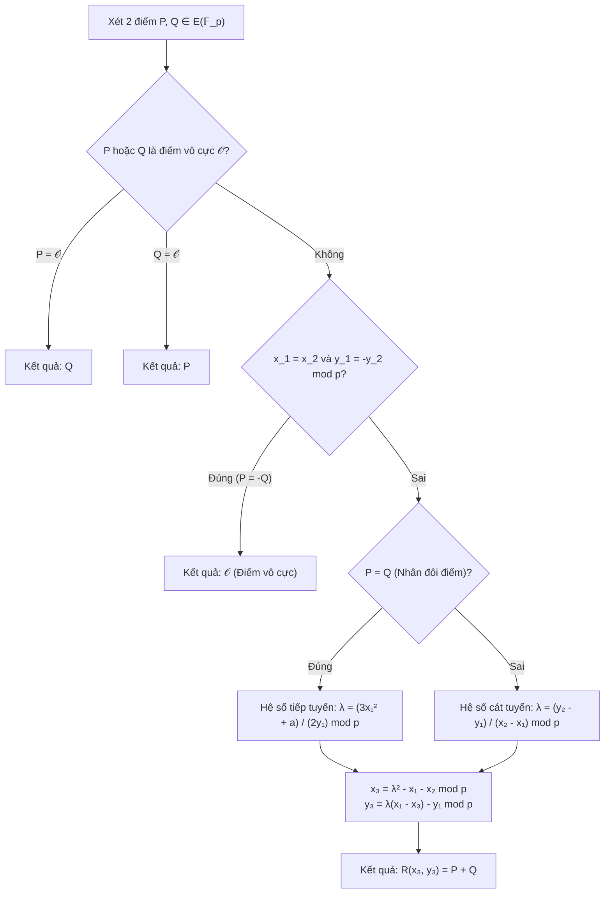
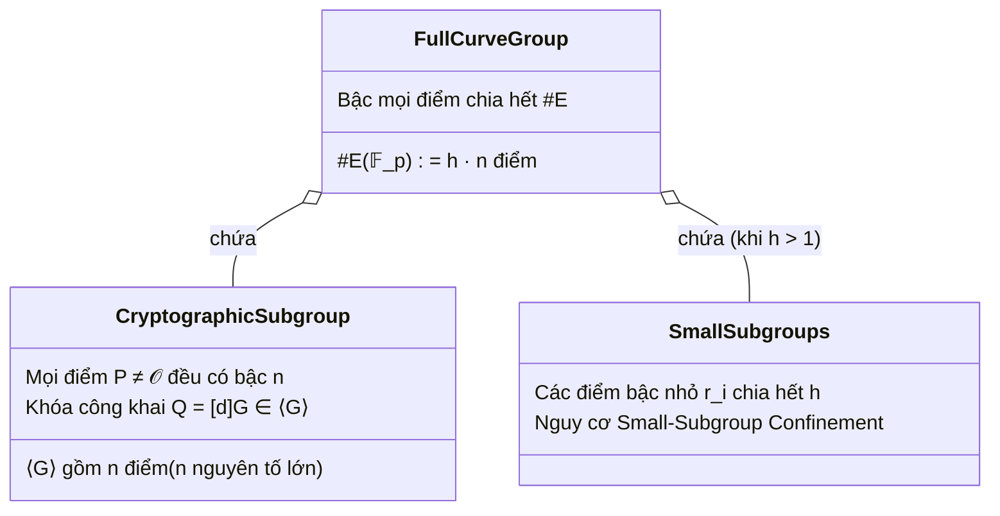
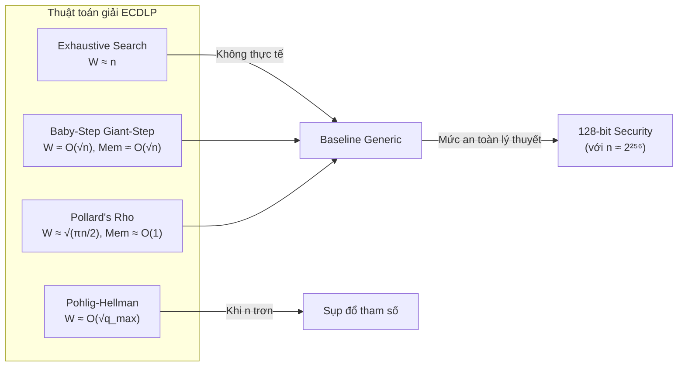
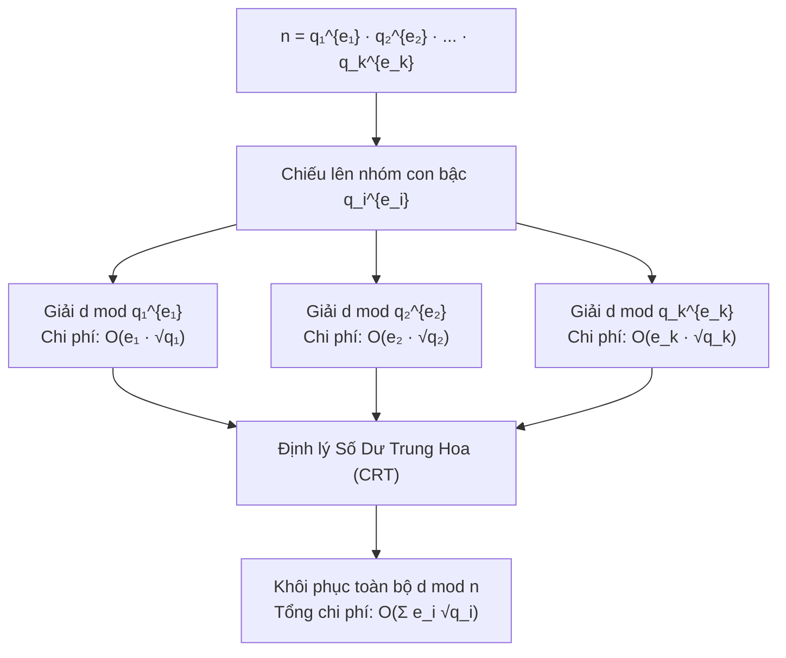
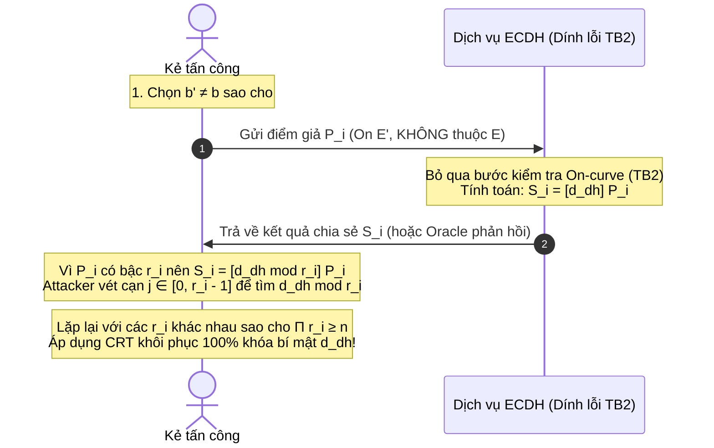

# Math Notes — Cơ Sở Toán Học ECC
## Group Order $n$, Cofactor $h$, Scalar Multiplication & Work Factor Analysis

> [!NOTE]
> **Metadata Đề Tài & Phiên Bản**
> - **Chủ đề:** Topic 14 — ECC Cryptanalysis & Implementation Failure Engineering
> - **Phạm vi tài liệu:** Task 2 · Nền tảng toán học cho Track A (Generic Search), Track B (Unsafe Order), và Track D (Invalid-Curve / Small-Subgroup).
> - **Phương pháp luận:** Kết hợp giải tích đại số chuẩn mực, mô hình độ phức tạp thuật toán và thực nghiệm kiểm chứng trên **toy curve** có thể tái lập 100% bằng mã nguồn đính kèm (§8).
> - **Đối chiếu tiêu chuẩn:** NIST SP 800-186, RFC 6090, FIPS 186-5, RFC 7748.

---

## Mục Lục
1. [Khung Cảnh Đường Cong và Cấu Trúc Nhóm Điểm](#1-khung-cảnh-đường-cong-và-cấu-trúc-nhóm-điểm)
2. [Cấp của Nhóm Điểm $\#E$ và Định Lý Hasse](#2-cấp-của-nhóm-điểm-e-và-định-lý-hasse)
3. [Bậc Điểm, Subgroup Order $n$ và Cofactor $h$](#3-bậc-điểm-subgroup-order-n-và-cofactor-h)
4. [Phép Nhân Vô Hướng (Scalar Multiplication) $Q = [d]G$](#4-phép-nhân-vô-hướng-scalar-multiplication-q--dg)
5. [Bài Toán Logarithm Rời Rạc (ECDLP) & Đánh Giá Work Factor](#5-bài-toán-logarithm-rời-rạc-ecdlp--đánh-giá-work-factor)
6. [Checklist 10 Tiêu Chí Cấu Trúc Tham Số An Toàn (Domain Parameters)](#6-checklist-10-tiêu-chí-cấu-trúc-tham-số-an-toàn-domain-parameters)
7. [Quy Trình Validation Điểm & Cơ Chế Invalid-Curve Attack](#7-quy-trình-validation-điểm--cơ-chế-invalid-curve-attack)
8. [Mã Nguồn Kiểm Chứng Thực Nghiệm Toy Curve (Python 3)](#8-mã-nguồn-kiểm-chứng-thực-nghiệm-toy-curve-python-3)
9. [Bảng Ánh Xạ Lý Thuyết Vào Các Track Thực Nghiệm & Bộ Dữ Liệu D1–D6](#9-bảng-ánh-xạ-lý-thuyết-vào-các-track-thực-nghiệm--bộ-dữ-liệu-d1d6)
10. [Giới Hạn Nghiên Cứu & Khuyến Nghị Thực Hành](#10-giới-hạn-nghiên-cứu--khuyến-nghị-thực-hành)

---

## 1. Khung Cảnh Đường Cong và Cấu Trúc Nhóm Điểm

### 1.1 Phương trình Short Weierstrass
Trên trường hữu hạn nguyên tố $\mathbb{F}_p$ với đặc trưng $\operatorname{char}(\mathbb{F}_p) = p > 3$, mọi đường cong elliptic đều có thể đưa về dạng rút gọn **Short Weierstrass**:

$$E(\mathbb{F}_p): y^2 \equiv x^3 + ax + b \pmod{p}, \quad a, b \in \mathbb{F}_p$$

Điều kiện cần và đủ để đường cong trơn (không có điểm kỳ dị) là biệt thức đại số (discriminant) $\Delta$ khác $0$:

$$\Delta = -16\left(4a^3 + 27b^2\right) \not\equiv 0 \pmod{p}$$

> [!WARNING]
> Khi $\Delta \equiv 0 \pmod{p}$, phương trình $x^3 + ax + b = 0$ có nghiệm bội:
> - **Cusp (Điểm nhọn):** Khi $4a^3 + 27b^2 \equiv 0$ và $a \equiv b \equiv 0 \pmod{p}$ $\implies y^2 = x^3$. Nhóm điểm suy biến thành nhóm cộng của trường $(\mathbb{F}_p, +)$, bài toán DLP giải được trong thời gian $\mathcal{O}(1)$.
> - **Node (Điểm tự cắt):** Khi $4a^3 + 27b^2 \equiv 0$ với $a, b \not\equiv 0 \pmod{p}$. Nhóm điểm suy biến thành nhóm nhân $(\mathbb{F}_p^\times, \cdot)$ hoặc $(\mathbb{F}_{p^2}^\times, \cdot)$, DLP quy về tính toán chỉ mục (index calculus) thời gian dưới-hàm-mũ $\mathcal{O}\left(L_p[1/2]\right)$.
>
> Do đó, kiểm tra $\Delta \not\equiv 0 \pmod{p}$ là bước tiên quyết số 1 của mọi bộ parser tham số.

### 1.2 Tập hợp điểm và Phần tử đơn vị
Tập hợp các điểm hữu tỉ của $E$ trên $\mathbb{F}_p$, ký hiệu là $E(\mathbb{F}_p)$, bao gồm các nghiệm Affine cùng với một điểm duy nhất ở vô cực $\mathcal{O}$:

$$E(\mathbb{F}_p) = \left\{ (x, y) \in \mathbb{F}_p \times \mathbb{F}_p : y^2 \equiv x^3 + ax + b \pmod{p} \right\} \cup \{\mathcal{O}\}$$

Trong hệ tọa độ xạ ảnh đồng nhất $[X : Y : Z] \in \mathbb{P}^2(\mathbb{F}_p)$ với $x = X/Z, y = Y/Z$, điểm ở vô cực tương ứng với nghiệm duy nhất khi cắt đường thẳng $Z = 0$:

$$\mathcal{O} = [0 : 1 : 0]$$

$\mathcal{O}$ đóng vai trò là **phần tử trung hòa (identity element)** của nhóm:

$$\forall P \in E(\mathbb{F}_p): \quad P + \mathcal{O} = \mathcal{O} + P = P$$

### 1.3 Luật cộng điểm (Chord-and-Tangent Group Law)
Cấu trúc nhóm cộng Abel $(E(\mathbb{F}_p), +)$ được thiết lập qua quy tắc dây cung và tiếp tuyến hình học:



Cho hai điểm hữu hạn $P = (x_1, y_1)$ và $Q = (x_2, y_2)$:

1. **Phần tử nghịch đảo:**
   $$-(x_1, y_1) = (x_1, -y_1 \bmod p) = (x_1, p - y_1)$$
   Nếu $x_1 = x_2$ và $y_1 \equiv -y_2 \pmod{p}$, thì:
   $$P + Q = \mathcal{O}$$

2. **Cộng hai điểm phân biệt ($P \neq \pm Q$):**
   Hệ số góc của cát tuyến nối $P$ và $Q$:
   $$\lambda = \frac{y_2 - y_1}{x_2 - x_1} \pmod{p}$$
   Tọa độ điểm tổng $R(x_3, y_3) = P + Q$:
   $$x_3 = \lambda^2 - x_1 - x_2 \pmod{p}$$
   $$y_3 = \lambda(x_1 - x_3) - y_1 \pmod{p}$$

3. **Nhân đôi điểm ($P = Q$ với $y_1 \not\equiv 0$):**
   Hệ số góc của tiếp tuyến tại $P$:
   $$\lambda = \frac{3x_1^2 + a}{2y_1} \pmod{p}$$
   Tọa độ điểm nhân đôi $2P = (x_3, y_3)$:
   $$x_3 = \lambda^2 - 2x_1 \pmod{p}$$
   $$y_3 = \lambda(x_1 - x_3) - y_1 \pmod{p}$$

> [!IMPORTANT]
> **Điểm mấu chốt kiến trúc mật mã (Nền tảng của Track D — Invalid Curve Attack):**
> Nhìn vào các công thức trên, hệ số góc $\lambda$ và tọa độ $(x_3, y_3)$ chỉ phụ thuộc vào $a$, $x_1, y_1, x_2, y_2$ mà **hoàn toàn không chứa tham số $b$**. 
> Một điểm $P' = (x', y')$ thuộc một đường cong sai lệch:
> 
> $$E': y^2 \equiv x^3 + ax + b' \pmod{p} \quad (b' \neq b)$$
> 
> khi đưa vào hàm nhân vô hướng của thư viện không validate điểm sẽ vẫn thực hiện phép cộng trơn tru mà không vấp phải bất kỳ ngoại lệ số học nào.

---

## 2. Cấp của Nhóm Điểm $\#E$ và Định Lý Hasse

### 2.1 Định lý Hasse (Hasse's Theorem)
Cấp của nhóm điểm $\#E(\mathbb{F}_p)$ (tổng số nghiệm hữu tỉ bao gồm $\mathcal{O}$) bị giới hạn chặt chẽ quanh giá trị $p + 1$:

$$\left| \#E(\mathbb{F}_p) - (p + 1) \right| \le 2\sqrt{p}$$

Đại lượng sai phân $t = p + 1 - \#E(\mathbb{F}_p)$ được gọi là **vết của Frobenius (Trace of Frobenius)**, thỏa mãn:

$$-2\sqrt{p} \le t \le 2\sqrt{p} \iff p + 1 - 2\sqrt{p} \le \#E(\mathbb{F}_p) \le p + 1 + 2\sqrt{p}$$

### 2.2 Thuật toán xác định cấp nhóm
- **Đường cong chuẩn công nghiệp (256–521 bit):** Cấp $\#E$ được tính toán thông qua thuật toán Schoof hoặc biến thể Schoof–Elkies–Atkin (SEA) với độ phức tạp đa thức $\widetilde{\mathcal{O}}(\log^4 p)$.
- **Đường cong mô phỏng (Toy Curve, $p$ nhỏ):** Cấp $\#E$ có thể đếm chính xác bằng cách quét $x \in [0, p-1]$, kiểm tra xem $z = x^3 + ax + b \pmod{p}$ có phải thặng dư bậc hai (Euler's criterion $z^{(p-1)/2} \equiv 1$) và tính tổng số nghiệm:
  $$\#E(\mathbb{F}_p) = 1 + p + \sum_{x \in \mathbb{F}_p} \left(\frac{x^3 + ax + b}{p}\right)$$

### 2.3 Phân loại các cấu trúc cấp đặc biệt nguy hiểm
- **Đường cong Anomalous:** $\#E(\mathbb{F}_p) = p$ (tức vết $t = 1$). Bị phá vỡ hoàn toàn bởi tấn công Smart / Semaev / Satoh–Araki. Tấn công này nhúng nhóm $E(\mathbb{F}_p)$ vào nhóm cộng $p$-adic $\mathbb{Q}_p$, chuyển ECDLP thành phép chia số học thời gian đa thức $\mathcal{O}(\log^3 p)$.
- **Đường cong Supersingular:** $\operatorname{char}(\mathbb{F}_p) \mid t$. Với $p > 3$, điều này tương đương $t = 0 \implies \#E(\mathbb{F}_p) = p + 1$. Nhóm có bậc nhúng (embedding degree) nhỏ $k \le 6$, cho phép tấn công rút gọn MOV (Menezes–Okamoto–Vanstone) hoặc Frey–Rück chuyển bài toán ECDLP sang DLP trên trường mở rộng $\mathbb{F}_{p^k}^\times$, giải được bằng Index Calculus.

---

## 3. Bậc Điểm, Subgroup Order $n$ và Cofactor $h$

### 3.1 Định nghĩa và Định lý Lagrange
- **Bậc của điểm $P$:** Ký hiệu $\operatorname{ord}(P)$, là số nguyên dương $m$ nhỏ nhất thỏa mãn:
  $$[m]P = \underbrace{P + P + \dots + P}_{m \text{ lần}} = \mathcal{O}$$
- Theo **Định lý Lagrange** cho nhóm hữu hạn:
  $$\forall P \in E(\mathbb{F}_p): \quad \operatorname{ord}(P) \mid \#E(\mathbb{F}_p)$$

### 3.2 Nhóm con Cyclic chính và Cofactor
Trong các ứng dụng mật mã, hệ thống chọn một điểm cơ sở chuẩn $G \in E(\mathbb{F}_p)$ (Base Point / Generator) sinh ra một nhóm con cyclic $\langle G \rangle$:

$$\langle G \rangle = \{ [k]G : k \in \{0, 1, \dots, n - 1\} \} \cong \mathbb{Z}/n\mathbb{Z}$$

Khi đó:
- **Cấp nhóm con (Subgroup Order):** $n = \operatorname{ord}(G)$ (phải là số nguyên tố lớn).
- **Thừa số đồng hành (Cofactor):** Tỉ số giữa tổng số điểm và cấp nhóm con:
  $$h = \frac{\#E(\mathbb{F}_p)}{n} \in \mathbb{Z}^+ \implies \#E(\mathbb{F}_p) = h \cdot n$$



### 3.3 Phân loại Cofactor trong các chuẩn thực tế
1. **Prime-order Curves ($h = 1$):**
   - Tiêu biểu: NIST P-256, P-384, P-521, SECG secp256k1.
   - Đặc tính: Toàn bộ đường cong là nhóm cyclic cấp nguyên tố $n = \#E$.
   - Ý nghĩa an ninh: Mọi điểm $P \in E(\mathbb{F}_p) \setminus \{\mathcal{O}\}$ đều tự động có bậc $n$. Không tồn tại nhóm con bậc nhỏ không tầm thường.
2. **Composite-order Curves ($h > 1$):**
   - Tiêu biểu: Curve25519 / Ed25519 ($h = 8$, RFC 7748, RFC 8032), Curve448 / Ed448 ($h = 4$).
   - Ví dụ bậc nhóm của Ed25519:
     $$\ell = 2^{252} + 27742317777372353535851937790883648493$$
   - Ý nghĩa an ninh: Tồn tại các điểm bậc $2, 4, 8$. Nếu giao thức ECDH không thực hiện **cofactor clearing** (tính $[h \cdot d]P$) hoặc kiểm tra tích $[n]P = \mathcal{O}$, đối phương có thể gửi điểm bậc nhỏ để rò rỉ $d \pmod 8$.

---

### 3.4 Minh họa thực nghiệm trên Toy Curve (Đã kiểm chứng toán học)

Xét đường cong $E(\mathbb{F}_{97})$:
$$y^2 \equiv x^3 + 2x + 3 \pmod{97}$$

- **Tham số:** $p = 97$, $a = 2$, $b = 3$.
- **Biệt thức:**
  $$\Delta = -16(4(2)^3 + 27(3)^2) = -16(32 + 243) = -16(275) \equiv -16(81) \equiv -1296 \equiv 62 \not\equiv 0 \pmod{97}$$
  *(Hoặc tính rút gọn: $4a^3 + 27b^2 = 275 \equiv 81 \not\equiv 0 \pmod{97}$)* $\implies$ Đường cong trơn hoàn toàn.
- **Tổng số nghiệm Affine:** Có 99 cặp $(x, y) \in \mathbb{F}_{97}^2$ thỏa mãn phương trình.
- **Cấp nhóm điểm:**
  $$\#E(\mathbb{F}_{97}) = 99 + 1 = 100 = 2^2 \cdot 5^2$$
- **Kiểm tra Hasse:**
  $$|100 - (97 + 1)| = |100 - 98| = 2 \le 2\sqrt{97} \approx 19.697 \quad \text{(Thỏa mãn)}$$

| Điểm cơ sở được chọn | Cấp nhóm con $n = \operatorname{ord}(G)$ | Cofactor $h = 100/n$ | Cấu trúc phân tích thừa số của $n$ | Ý nghĩa trong kiểm thử bảo mật |
| :--- | :---: | :---: | :---: | :--- |
| **$G_1 = (3, 6)$** | **$5$** | **$20$** | $5$ (nguyên tố nhỏ) | Nhóm con đồ chơi, dùng test generic search |
| **$G_2 = (0, 10)$** | **$50$** | **$2$** | $2 \cdot 5^2$ (**Smooth Order**) | **Mẫu Unsafe Order cho Track B (Pohlig–Hellman)** |

> [!TIP]
> **Nhận xét quan trọng:** Trên cùng một đường cong đại số $E$, việc lựa chọn điểm cơ sở $G$ khác nhau quyết định trực tiếp cấp $n$ và cofactor $h$. Điểm $G_2 = (0, 10)$ có cấp $n = 50$ là số trơn (ước nguyên tố lớn nhất $q_{\max} = 5$). Kẻ tấn công dùng Pohlig–Hellman chỉ mất chi phí $\approx \mathcal{O}(\sqrt{5})$ phép tính thay vì $\mathcal{O}(\sqrt{50})$.

---

## 4. Phép Nhân Vô Hướng (Scalar Multiplication) $Q = [d]G$

Phép nhân vô hướng là phép toán hạt nhân của mọi giao thức ECC:
$$[d]G = \underbrace{G + G + \dots + G}_{d \text{ lần}}$$
với $d \in \mathbb{Z}_n^* = \{1, 2, \dots, n-1\}$.

### 4.1 Bảng so sánh các giải thuật nhân vô hướng

| Thuật toán | Số phép nhân đôi (Doubling) | Số phép cộng (Addition) | Tổng chi phí phép toán | Kênh rò rỉ Side-channel (Track F) |
| :--- | :---: | :---: | :---: | :--- |
| **Double-and-Add (MSB/LSB)** | $\lfloor \log_2 d \rfloor$ | $\operatorname{HW}(d) - 1$ | $\approx 1.5 \log_2 d$ | **Timing & Branch:** Rò rỉ trọng số Hamming $\operatorname{HW}(d)$ qua thời gian thực thi |
| **Non-Adjacent Form (NAF)** | $\lfloor \log_2 d \rfloor$ | $\approx \frac{1}{3} \log_2 d$ | $\approx 1.33 \log_2 d$ | **Timing:** Số phép cộng giảm nhưng vẫn phụ thuộc giá trị bit |
| **Windowed NAF (wNAF)** | $\lfloor \log_2 d \rfloor$ | $\approx \frac{1}{w+1} \log_2 d$ | Phụ thuộc cửa sổ $w$ | **Cache-timing:** Truy cập bảng tiền tính toán (precomputed table) phụ thuộc bí mật |
| **Montgomery Ladder** | $\lfloor \log_2 d \rfloor$ | $\lfloor \log_2 d \rfloor$ | Cố định $2 \log_2 d$ | **Kháng Timing:** Số phép toán độc lập hoàn toàn với giá trị từng bit của $d$ |
| **Scalar Blinding** | - | - | Thêm phụ phí nhỏ | **Kháng DPA/CPA:** Tính $[d + r \cdot n]G$ với $r \in_R \mathbb{Z}$ làm ngẫu nhiên hóa biểu diễn |

### 4.2 Thuật toán Double-and-Add (MSB-first)
```
Input:  Điểm G ∈ E(𝔽_p), số nguyên d = (d_{m-1} d_{m-2} ... d_1 d_0)₂ với d_{m-1} = 1
Output: Q = [d]G

1: R ← G
2: for i from m - 2 down to 0 do:
3:     R ← [2]R                     // Điểm nhân đôi (Double)
4:     if d_i == 1 then:
5:         R ← R + G                // Điểm cộng (Add) - Chỉ thực hiện khi bit bằng 1
6: return R
```

**Ví dụ tính toán:** $d = 13 = (1101)_2$:
$$\begin{aligned}
\text{Khởi tạo: } & R = G \\
\text{Bit } 1: & R \leftarrow 2(G) = 2G, \quad \text{bit}=1 \implies R \leftarrow 2G + G = 3G \\
\text{Bit } 0: & R \leftarrow 2(3G) = 6G, \quad \text{bit}=0 \implies \text{không cộng} \\
\text{Bit } 1: & R \leftarrow 2(6G) = 12G, \quad \text{bit}=1 \implies R \leftarrow 12G + G = 13G
\end{aligned}$$
Tổng cộng: 3 phép nhân đôi và 2 phép cộng điểm.

> [!WARNING]
> Nếu nhánh `if d_i == 1` được thực thi bởi CPU có tính năng branch prediction hoặc instruction cache, kẻ tấn công đo lường thời gian (cycles) hoặc phân tích EM/năng lượng có thể tái dựng chính xác từng bit của khóa riêng $d$ (hoặc nonce $k$).

---

## 5. Bài Toán Logarithm Rời Rạc (ECDLP) & Đánh Giá Work Factor

### 5.1 Định nghĩa bài toán
Cho đường cong $E(\mathbb{F}_p)$, điểm cơ sở $G$ có bậc nguyên tố $n$, và điểm công khai $Q \in \langle G \rangle$. **Bài toán Logarithm Rời rạc trên Đường cong Elliptic (ECDLP)** yêu cầu tìm số nguyên duy nhất $d \in \{0, 1, \dots, n-1\}$ sao cho:

$$Q = [d]G$$

### 5.2 Các thuật toán giải ECDLP tổng quát và Work Factor



#### A. Tìm kiếm vét cạn (Exhaustive Search / Brute Force)
- Thử lần lượt $d' = 1, 2, \dots$ tính $[d']G$ và so sánh với $Q$.
- Độ phức tạp thời gian: Kỳ vọng $n/2$ phép thử, trường hợp xấu nhất $\mathcal{O}(n)$.
- Độ phức tạp bộ nhớ: $\mathcal{O}(1)$.
- **Khẳng định phương pháp luận:** Vét cạn $\mathcal{O}(n)$ **không phải** là baseline thực tế của an toàn mật mã; kẻ tấn công luôn sử dụng các thuật toán generic $\mathcal{O}(\sqrt{n})$.

#### B. Baby-Step Giant-Step (Shanks - BSGS)
- Đặt $m = \lceil \sqrt{n} \rceil$. Biểu diễn khóa bí mật dưới dạng:
  $$d = i \cdot m + j, \quad 0 \le j < m, \quad 0 \le i < m$$
- Phương trình $Q = [d]G$ tương đương:
  $$Q - [i \cdot m]G = [j]G$$
- **Baby steps:** Tính và lưu bảng băm $\mathcal{T} = \{ [j]G : 0 \le j < m \}$.
- **Giant steps:** Với mỗi $i = 0, 1, \dots, m-1$, tính $Q - [i](mG)$ và tra cứu trong $\mathcal{T}$. Khi tìm thấy trùng khớp, nghiệm là $d = i \cdot m + j$.
- Độ phức tạp thời gian: $\mathcal{O}(\sqrt{n})$ phép tính điểm.
- Độ phức tạp bộ nhớ: $\mathcal{O}(\sqrt{n})$ điểm nhóm.

#### C. Thuật toán Pollard's Rho
- Sử dụng hàm bước đi giả ngẫu nhiên $f: \langle G \rangle \to \langle G \rangle$ chia nhóm thành 3 tập con rời nhau $S_1, S_2, S_3$:
  $$R_{k+1} = \begin{cases} R_k + G & \text{nếu } R_k \in S_1 \\ [2]R_k & \text{nếu } R_k \in S_2 \\ R_k + Q & \text{nếu } R_k \in S_3 \end{cases}$$
- Biểu diễn mỗi điểm dưới dạng $R_k = [a_k]G + [b_k]Q \pmod n$.
- Theo nghịch lý ngày sinh (Birthday Paradox), va chạm $R_u = R_v$ xuất hiện sau kỳ vọng:
  $$W_\rho \approx \sqrt{\frac{\pi n}{2}} \approx 1.2533 \sqrt{n} = \mathcal{O}(\sqrt{n}) \text{ phép cộng điểm}$$
- Khi va chạm xảy ra với $(a_u, b_u) \not\equiv (a_v, b_v) \pmod n$:
  $$[a_u]G + [b_u]Q = [a_v]G + [b_v]Q \implies (b_u - b_v) d \equiv (a_v - a_u) \pmod n$$
  $$d \equiv (a_v - a_u) \cdot (b_u - b_v)^{-1} \pmod n$$
- Độ phức tạp bộ nhớ: $\mathcal{O}(1)$ khi dùng giải thuật tìm chu trình của Floyd hoặc phương pháp Distinguished Points (cho phép song song hóa tuyến tính).

#### D. Thuật toán Pohlig–Hellman (Giải quyết bậc hợp số trơn)
Khi bậc nhóm $n$ phân tích thành tích các thừa số nguyên tố:
$$n = \prod_{i=1}^k q_i^{e_i}$$



1. Với mỗi ước nguyên tố $q_i$, đặt $G_i = \left[\frac{n}{q_i^{e_i}}\right]G$ và $Q_i = \left[\frac{n}{q_i^{e_i}}\right]Q$. Cả hai điểm đều có bậc $q_i^{e_i}$.
2. Giải bài toán logarithm trên nhóm con bậc $q_i$ bằng BSGS hoặc Pollard's rho để tìm từng chữ số $q_i$-adic của $d \pmod{q_i^{e_i}}$:
   $$d \equiv d_i \pmod{q_i^{e_i}}, \quad \forall i \in \{1, 2, \dots, k\}$$
3. Khôi phục lại $d \pmod n$ duy nhất thông qua Định lý Số dư Trung Hoa (CRT):
   $$d \equiv \sum_{i=1}^k d_i M_i \left(M_i^{-1} \bmod q_i^{e_i}\right) \pmod n, \quad \text{với } M_i = \frac{n}{q_i^{e_i}}$$
- **Work factor thực tế:**
  $$W_{\text{PH}} \approx \sum_{i=1}^k e_i \left( \log_2 n + \sqrt{q_i} \right) \implies W_{\text{eff}} \approx \mathcal{O}\left(\sqrt{q_{\max}}\right), \quad q_{\max} = \max_{1 \le i \le k} q_i$$

---

## 6. Checklist 10 Tiêu Chí Cấu Trúc Tham Số An Toàn (Domain Parameters)

Mọi đường cong elliptic sử dụng trong sản phẩm thương mại hoặc phòng lab an toàn đều phải vượt qua 10 kiểm tra toán học nghiêm ngặt:

| # | Hạng mục kiểm tra | Biểu thức toán học / Điều kiện | Phương pháp thực thi | Nguy cơ bảo mật nếu thất bại |
| :-: | :--- | :--- | :--- | :--- |
| **1** | **Biệt thức không suy biến** | $\Delta = -16(4a^3 + 27b^2) \not\equiv 0 \pmod p$ | Tính lũy thừa modular | Đường cong kỳ dị (Cusp/Node), DLP giải trong $\mathcal{O}(1)$ hoặc đa thức |
| **2** | **Tính nguyên tố của trường** | $p \in \mathbb{P}$, $p > 3$ | Miller–Rabin ($k \ge 64$ vòng) | Số học trường không bảo toàn tính khả nghịch |
| **3** | **Điểm cơ sở thuộc đường cong** | $y_G^2 \equiv x_G^3 + a x_G + b \pmod p$ | Thay tọa độ vào phương trình | Điểm không hợp lệ, không sinh nhóm điểm |
| **4** | **Cấp điểm cơ sở hợp lệ** | $[n]G = \mathcal{O}$ và $G \neq \mathcal{O}$ | Nhân vô hướng | $G$ không có cấp $n$ |
| **5** | **Tính nguyên tố của cấp $n$** | $n \in \mathbb{P}$ (hoặc $q_{\max} \ge 2^{256}$) | Kiểm tra nguyên tố hóa Baillie–PSW / Miller–Rabin | Pohlig–Hellman bẻ gãy ECDLP với chi phí $\mathcal{O}(\sqrt{q_{\max}})$ |
| **6** | **Kháng tấn công Anomalous** | $\#E(\mathbb{F}_p) \neq p$ (tức vết $t \neq 1$) | So sánh trực tiếp cấp nhóm với $p$ | Smart attack bẻ gãy khóa riêng trong thời gian đa thức $\mathcal{O}(\log^3 p)$ |
| **7** | **Kháng tấn công MOV / Frey–Rück** | Bậc nhúng $k$ đủ lớn sao cho $n \nmid (p^k - 1)$ với mọi $k \le 100$ | Tính $p^k \pmod n$ | Giảm bài toán ECDLP về DLP trường hữu hạn $\mathbb{F}_{p^k}^\times$ |
| **8** | **Cofactor nhỏ & kiểm soát** | $h = \frac{\#E}{n} \in \{1, 2, 4, 8\}$ | Phép chia số nguyên | Tấn công Small-subgroup Confinement rò rỉ $d \pmod h$ |
| **9** | **Twist Security (An toàn đường xoắn)** | $\#E^t(\mathbb{F}_p) = 2p + 2 - \#E(\mathbb{F}_p)$ có ước nguyên tố lớn | Đếm cấp đường cong xoắn bậc hai | Tấn công Twist attack (đặc biệt nguy hiểm với Montgomery ladder $x$-only) |
| **10** | **Xuất xứ tham số (Provenance)** | Tham số chuẩn hóa hoặc sinh qua hàm băm ngẫu nhiên cứng (Rigid) | Đối chiếu RFC/NIST/SECG | Đường cong chứa cửa sau toán học (Backdoored Curve) |

---

## 7. Quy Trình Validation Điểm & Cơ Chế Invalid-Curve Attack

### 7.1 Năm bước kiểm tra điểm công khai (Public Key Validation)
Khi nhận một điểm $P = (x, y)$ từ đối tác truyền thông qua biên mạng (Trust Boundary TB2), hệ thống bắt buộc phải thực thi 5 bước:

1. **Kiểm tra điểm vô cực:** Xác nhận $P \neq \mathcal{O}$.
2. **Kiểm tra biên tọa độ trường:** Xác nhận $x, y \in \mathbb{F}_p$, tức $0 \le x < p$ và $0 \le y < p$.
3. **Kiểm tra phương trình đường cong (On-curve Check):**
   $$y^2 \equiv x^3 + ax + b \pmod p$$
4. **Kiểm tra nhóm con (Subgroup Membership Check):**
   $$[n]P = \mathcal{O}$$
   - Nếu $h = 1$: Bước 3 đảm bảo $P \in \langle G \rangle$ (vì mọi điểm $\neq \mathcal{O}$ đều có bậc $n$).
   - Nếu $h > 1$: Bắt buộc phải tính $[n]P \stackrel{?}{=} \mathcal{O}$ hoặc áp dụng **cofactor clearing**: sử dụng điểm $P^* = [h]P$ cho các bước trao đổi tiếp theo.
5. **Quy tắc đặc thù giao thức:** Ví dụ trên Curve25519 (RFC 7748), kiểm tra bí mật chia sẻ không được là điểm toàn $0$ (All-zero Shared Secret).

---

### 7.2 Cơ chế đại số của Invalid-Curve Attack (Minh họa cho Track D)



#### Bước 1: Lựa chọn đường cong mục tiêu
Kẻ tấn công giữ nguyên trường $\mathbb{F}_p$ và hệ số $a$, nhưng chọn một hệ số $b' \neq b$ sao cho đường cong $E': y^2 = x^3 + ax + b'$ có cấp $\#E'(\mathbb{F}_p)$ chứa các ước nguyên tố nhỏ $r_1, r_2, \dots, r_m$.

#### Bước 2: Tìm điểm bậc nhỏ
Trên đường cong $E'$, kẻ tấn công xác định các điểm $P_i$ có cấp đúng bằng $r_i$:
$$[r_i]P_i = \mathcal{O}$$

#### Bước 3: Khai thác lỗ hổng xử lý
Kẻ tấn công gửi $P_i$ vào API thỏa thuận khóa ECDH. Do mã nguồn bị lỗi không kiểm tra phương trình đường cong:
$$\text{Server tính: } \quad Q_i = [d]P_i$$
Vì công thức nhân điểm chỉ dùng $a$ và tọa độ Affine, toàn bộ quá trình tính toán diễn ra chính xác trên nhóm điểm của đường cong sai $E'(\mathbb{F}_p)$!

#### Bước 4: Trích xuất thặng dư (Residue Extraction)
Do $P_i$ có cấp $r_i$:
$$Q_i = [d]P_i = [d \bmod r_i]P_i$$
Kẻ tấn công chỉ cần thử $j \in \{0, 1, \dots, r_i - 1\}$ sao cho $[j]P_i = Q_i$. Vì $r_i$ rất nhỏ (thường $r_i < 1000$), phép tìm kiếm này mất thời gian thực thi tức thì:
$$d \equiv d_i \pmod{r_i}$$

#### Bước 5: Ghép khóa bằng Định lý Số Dư Trung Hoa (CRT)
Sau khi thu thập đủ các quan hệ đồng dư với các $r_i$ đôi một nguyên tố cùng nhau sao cho:
$$\prod_{i=1}^m r_i \ge n$$
Khóa bí mật $d$ được tái tạo hoàn toàn:
$$d \equiv \sum_{i=1}^m d_i M_i \left(M_i^{-1} \bmod r_i\right) \pmod{\prod_{i=1}^m r_i}, \quad \text{với } M_i = \frac{\prod_{j=1}^m r_j}{r_i}$$

> [!IMPORTANT]
> **Đánh giá độ phức tạp:**
> - Độ phức tạp generic ECDLP ban đầu: $\mathcal{O}(\sqrt{n})$ (ví dụ $2^{128}$ phép toán).
> - Độ phức tạp của Invalid Curve Attack: $\sum_{i=1}^m r_i$ truy vấn (chỉ vài trăm đến vài ngàn phép tính điểm).
> Không gian tìm kiếm sụp đổ hoàn toàn từ hàm mũ xuống thời gian thực thi gần như tức thì.

---

## 8. Mã Nguồn Kiểm Chứng Thực Nghiệm Toy Curve (Python 3)

Đoạn mã sau thực thi toàn bộ cấu trúc đại số của đường cong $E(\mathbb{F}_{97}): y^2 \equiv x^3 + 2x + 3 \pmod{97}$, kiểm tra tính trơn, đếm điểm, phân tích cấp nhóm, và xác thực cấp của hai điểm $G_1, G_2$:

```python
#!/usr/bin/env python3
"""
curves/toy_check.py
Mục đích: Kiểm chứng cơ sở toán học ECC trên Toy Curve p = 97.
Được thiết kế phục vụ Topic 14 (ECC Cryptanalysis).
"""

def factorint(n: int) -> dict:
    """Phân tích thừa số nguyên tố (thuần Python, không phụ thuộc thư viện ngoài)."""
    factors = {}
    d = 2
    temp = n
    while d * d <= temp:
        while temp % d == 0:
            factors[d] = factors.get(d, 0) + 1
            temp //= d
        d += 1
    if temp > 1:
        factors[temp] = factors.get(temp, 0) + 1
    return factors

# Tham số đường cong Short Weierstrass
p = 97
a = 2
b = 3

def compute_discriminant(a_param: int, b_param: int, prime: int) -> int:
    """Tính biệt thức Delta = -16(4a^3 + 27b^2) mod p."""
    return (-16 * (4 * pow(a_param, 3, prime) + 27 * pow(b_param, 2, prime))) % prime

def point_add(P, Q):
    """Cộng hai điểm Affine P, Q trên E(F_p). None đại diện cho O."""
    if P is None:
        return Q
    if Q is None:
        return P
    
    x1, y1 = P
    x2, y2 = Q

    # P + (-P) = O
    if x1 == x2 and (y1 + y2) % p == 0:
        return None

    # Xác định hệ số góc lambda
    if P == Q:
        # Tiếp tuyến (Point Doubling)
        if y1 == 0:
            return None
        lam = ((3 * x1 * x1 + a) * pow(2 * y1, -1, p)) % p
    else:
        # Cát tuyến (Point Addition)
        lam = ((y2 - y1) * pow(x2 - x1, -1, p)) % p

    x3 = (lam * lam - x1 - x2) % p
    y3 = (lam * (x1 - x3) - y1) % p
    return (x3, y3)

def scalar_mult(k: int, P):
    """Nhân vô hướng [k]P bằng Double-and-Add (LSB-first)."""
    R = None
    addend = P
    while k > 0:
        if k & 1:
            R = point_add(R, addend)
        addend = point_add(addend, addend)
        k >>= 1
    return R

def compute_point_order(P) -> int:
    """Xác định cấp của điểm P: số nguyên m nhỏ nhất sao cho [m]P = O."""
    if P is None:
        return 1
    m = 1
    curr = P
    while curr is not None:
        curr = point_add(curr, P)
        m += 1
    return m

if __name__ == "__main__":
    print("=" * 60)
    print(f"XÁC THỰC TOÁN HỌC ĐƯỜNG CONG E(F_{p}): y^2 = x^3 + {a}x + {b}")
    print("=" * 60)

    # 1. Kiểm tra biệt thức
    delta = compute_discriminant(a, b, p)
    short_disc = (4 * pow(a, 3, p) + 27 * pow(b, 2, p)) % p
    print(f"[1] Biệt thức Δ = {delta} (mod {p}), Rút gọn (4a³+27b²) = {short_disc}")
    assert short_disc != 0, "LỖI: Đường cong suy biến!"
    print("    -> Đường cong trơn hoàn toàn (Nonsingular).\n")

    # 2. Liệt kê tập hợp điểm hữu tỉ
    rational_points = []
    for x in range(p):
        rhs = (pow(x, 3, p) + a * x + b) % p
        for y in range(p):
            if pow(y, 2, p) == rhs:
                rational_points.append((x, y))

    total_order = len(rational_points) + 1  # Cộng thêm điểm ở vô cực O
    factors = factorint(total_order)
    print(f"[2] Cấp nhóm #E(F_p) = {total_order} điểm")
    print(f"    Phân tích thừa số nguyên tố: {total_order} = {dict(factors)}")

    # 3. Kiểm định cận Hasse
    hasse_diff = abs(total_order - (p + 1))
    hasse_bound = 2 * (p ** 0.5)
    print(f"[3] Kiểm tra định lý Hasse: |{total_order} - {p+1}| = {hasse_diff} <= 2√{p} ≈ {hasse_bound:.3f}")
    assert hasse_diff <= hasse_bound, "LỖI: Vi phạm định lý Hasse!"
    print("    -> Cận Hasse thỏa mãn tuyệt đối.\n")

    # 4. Kiểm định hai điểm cơ sở G1 và G2
    test_points = [((3, 6), "G1"), ((0, 10), "G2")]
    print("[4] Kiểm định cấp các nhóm con:")
    for pt, name in test_points:
        n = compute_point_order(pt)
        h = total_order // n
        print(f"    - Điểm {name} = {pt}:")
        print(f"        * Subgroup Order n = {n} (Phân tích: {dict(factorint(n))})")
        print(f"        * Cofactor h = {h}")
        # Kiểm tra [n]G == O
        assert scalar_mult(n, pt) is None, f"LỖI: [{n}]{name} != O"
        print(f"        * Xác nhận [{n}]{name} == O: ĐÚNG")

    print("\n=> TOÀN BỘ PHÉP TÍNH TOÁN HỌC KHỚP VỚI ĐẶC TẢ.")
```

---

## 9. Bảng Ánh Xạ Lý Thuyết Vào Các Track Thực Nghiệm & Bộ Dữ Liệu D1–D6

| Cơ sở toán học | Track ứng dụng | Tệp mã nguồn kiểm chứng | Bộ dữ liệu thực nghiệm (Corpus) | Đại lượng / Metric đo lường thực tế |
| :--- | :---: | :--- | :--- | :--- |
| **Cấp nhóm $\#E$, $n$, $h$, $q_{\max}$** | Bền vững tham số | `curves/gen_smooth_curves.py` | `data/D1_curves.csv` | Tỷ lệ thặng dư, `largest_prime_factor`, `cofactor_h` |
| **Generic ECDLP ($W_{\text{brute}}$ vs $W_{\text{BSGS}}$ vs $W_\rho$)** | **Track A** | `curves/bsgs.py`<br/>`curves/pollard_rho.py` | `data/D2_ecdlp_benchmarks.csv` | Số phép cộng điểm (`operations`), `cpu_cycles`, hệ số góc $\log(\text{ops}) / \log(n)$ |
| **Pohlig–Hellman ($W_{\text{eff}} \approx \mathcal{O}(\sqrt{q_{\max}})$)** | **Track B** | `curves/pohlig_hellman.py` | `data/D2_ecdlp_benchmarks.csv` | Thời gian khôi phục theo hàm của $q_{\max}$, so sánh đối chứng với BSGS trên $n$ |
| **Nonce Reuse trong ECDSA** | **Track C** | `signatures/nonce_reuse_attacker.py` | `data/D3_signatures.csv` | Phát hiện trường `repeated_r`, khôi phục khóa riêng $d$ trong $\mathcal{O}(1)$ |
| **Point Validation & Invalid-Curve** | **Track D** | `validation/gen_invalid_curves.py`<br/>`validation/crt_solver.py` | `data/D4_validation.csv` | Trạng thái `on_curve`, số lượng truy vấn Oracle, xác suất khôi phục khóa |
| **Scalar Mult Timing Leakage** | **Track F** | `scripts/measure_harness.py` | `data/D6_timing.csv` | Phân phối thời gian thực thi (cycles), kiểm định Welch's t-test giữa bit $0$ và bit $1$ |

---

## 10. Giới Hạn Nghiên Cứu & Khuyến Nghị Thực Hành

> [!CAUTION]
> **Giới hạn nghiên cứu (Academic Scope Guardrails):**
> 1. **Nguyên tắc Toy Curve:** Các đường cong tham số nhỏ ($p = 97$, v.v.) được sử dụng trong tài liệu này chỉ nhằm mục đích minh họa trực quan bản chất cơ chế toán học và kiểm chứng thuật toán. Tuyệt đối **không** suy diễn rằng các đường cong tiêu chuẩn công nghiệp (như NIST P-256 hay Curve25519) có thể bị phá vỡ bằng các công cụ tính toán thông thường.
> 2. **Negative Controls:** Đường cong P-256 và Ed25519 được đưa vào đề tài với vai trò **mẫu đối chứng âm (Negative Control)**: khi cấu hình chuẩn xác và thư viện đã được vá lỗi, mọi cuộc tấn công Generic, Invalid-Curve, hay Nonce Extraction đều phải ghi nhận kết quả thất bại.
> 3. **Cảnh báo triển khai:** Mọi nỗ lực tự viết hàm nhân vô hướng (self-made scalar multiplication) trong môi trường sản xuất đều tiềm ẩn nguy cơ rò rỉ kênh kề nghiêm trọng. Luôn sử dụng các thư viện mật mã đã qua kiểm toán độc lập (như libsodium, libsecp256k1, hoặc pyca/cryptography bản vá).