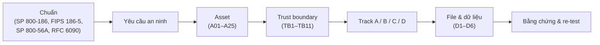

# CÁC CHUẨN MẬT MÃ LIÊN QUAN

> [!NOTE]
> **Rà soát các chuẩn:**
> - **NIST SP 800-186**
> - **FIPS 186-5**
> - **NIST SP 800-56A Rev.3**
> - **RFC 6090**

## Mục lục

- [**Phạm vi & quy ước**](#phạm-vi--quy-ước): mục tiêu, quy ước độ tin cậy, chuỗi truy vết
- [**I. NIST SP 800-186**](#i-nist-sp-800-186): tham số miền, đường cong, trạng thái
- [**II. FIPS 186-5**](#ii-fips-186-5): ECDSA, EdDSA, nonce, giới hạn của chuẩn
- [**III. NIST SP 800-56A Rev.3**](#iii-nist-sp-800-56a-rev3): kiểm tra khóa công khai, cofactor ECDH
- [**IV. RFC 6090**](#iv-rfc-6090)
- [**V. Tài liệu hỗ trợ**](#v-tài-liệu-hỗ-trợ): RFC 6979, 7748, 8032
- [**VI. Ánh xạ - chuẩn → asset → ranh giới → track → file**](#vi-ánh-xạ---chuẩn--asset--ranh-giới--track--file)
- [**VII. Lỗ hổng / bằng chứng thực tế**](#vii-lỗ-hổng--bằng-chứng-thực-tế)
- [**VIII. Tài liệu tham khảo**](#viii-tài-liệu-tham-khảo)

---

# PHẠM VI & QUY ƯỚC

> [!NOTE]
> **Quy định của từng tiêu chuẩn**

## Quy ước độ tin cậy

| Nhãn | Ý nghĩa |
|:-:|---|
| `[G]` | Lấy từ Guideline Topic 14 |
| `[V]` | Đã đối chiếu trực tiếp với văn bản gốc (NIST / IETF / NVD) |
| `[K]` | Kiến thức nền, **chưa** đối chiếu lại với văn bản gốc |

## Chuỗi truy vết

## Vai trò của từng chuẩn

| Chuẩn | Cơ quan | Câu hỏi | Dùng cho |
|---|:-:|---|---|
| **NIST SP 800-186** (02/2023) | NIST | Đường cong và tham số miền nào được chấp thuận? | Allow-list đường cong, TB1, Track B, đối chứng |
| **FIPS 186-5** (02/2023) | NIST | Chữ ký số nào được chấp thuận, quy tắc thực thi ra sao? | Track C, nonce, verifier |
| **NIST SP 800-56A Rev.3** (04/2018) | NIST | Thỏa thuận khóa phải kiểm tra điểm peer thế nào? | Track D, TB2–TB3, T8, T9 |
| **RFC 6090** (02/2011) | IETF (Informational) | Thuật toán ECC nền tảng hoạt động ra sao? | Track A |

---

# I. NIST SP 800-186

> [!NOTE]
> ***Recommendations for Discrete Logarithm-based Cryptography: Elliptic Curve Domain Parameters***
> **DOI:** https://doi.org/10.6028/NIST.SP.800-186 `[V]`

## 1. Nội dung cốt lõi

- Quy định **tham số miền** `(p, a, b, G, n, h)` của các đường cong được chấp thuận `[V]`.
- Đường cong Weierstrass trên Fp: **P-224, P-256, P-384, P-521**, dạng `y² = x³ − 3x + b`, `h = 1` `[V]`.
- Đường cong Montgomery / Edwards (nguồn gốc RFC 7748, RFC 8032): **Curve25519 / Ed25519** (`h = 8`), **Curve448 / Ed448** (`h = 4`) `[V]`.
- Đường cong trên trường nhị phân (B-, K-) không còn được khuyến nghị cho hệ thống mới `[K]`. "Không còn khuyến nghị" **không** có nghĩa là đã bị phá về toán học.

## 2. Bảng đường cong

| Đường cong | Dạng | `h` | Mức an toàn | Vai trò trong lab |
|---|---|:-:|:-:|---|
| P-256 | Short Weierstrass | 1 | ~128 bit | Negative control (A19), Track C (ES256) |
| P-384, P-521 | Short Weierstrass | 1 | 192 / 256 bit | Tham khảo |
| Curve25519 / Ed25519 | Montgomery / Edwards | 8 | ~128 bit | Negative control X25519 (A19) |
| Curve448 / Ed448 | Montgomery / Edwards | 4 | ~224 bit | Tham khảo |
| secp256k1 | Short Weierstrass, `a = 0, b = 7` | 1 | ~128 bit | Chỉ S3; **ngoài** danh sách chính của SP 800-186 `[K]`, thuộc SEC 2 |

## 3. Đối chiếu với 10 tiêu chí chọn tham số

| Tiêu chí | Ý nghĩa trong SP 800-186 | Toy curve của lab |
|---|---|---|
| `Δ ≢ 0 (mod p)` | Tham số chuẩn đã thỏa | Phải tự kiểm trong `toy_curve_gen.py` |
| `n` nguyên tố lớn | Chuẩn dùng `n` nguyên tố | **Cố ý vi phạm** ở smooth curve (T4) |
| `h` nhỏ | `h ∈ {1, 4, 8}` | Toy curve có thể có `h` lớn (T3, T9) |
| Không anomalous, embedding degree đủ lớn | Chuẩn đã loại | Cần loại trừ khi sinh D1 |
| Nguồn gốc tham số rõ ràng | Tham số có tên, có seed công bố | Toy curve ghi seed (TB7) |

## 4. Ý nghĩa cho thiết kế

- **Allow-list đường cong có tên** tại TB1, ghim `alg` và `crv`. Từ chối tham số tường minh (explicit parameters).
- Đường cong có `h > 1` (Ed25519, Ed448) cần xử lý cofactor khác Weierstrass `h = 1`.

> [!attention]
> **Quan hệ với Track B:** SP 800-186 cho thấy chuẩn luôn chọn `n` nguyên tố lớn. Smooth curve ở T4 là phản ví dụ có chủ đích, **không** phải đường cong chuẩn.

---

# II. FIPS 186-5

> [!NOTE]
> ***Digital Signature Standard (DSS)***
>**DOI:** https://doi.org/10.6028/NIST.FIPS.186-5 `[V]`

## 1. Nội dung cốt lõi

- Chấp thuận **ECDSA** trên các đường cong nguyên tố của SP 800-186 và **EdDSA** (Ed25519, Ed448, theo RFC 8032) `[V]`.
- Cho phép **ECDSA tất định** (nonce theo RFC 6979) bên cạnh nonce ngẫu nhiên `[K]`.
- Verifier phải kiểm tra `r, s ∈ [1, n−1]` và kiểm tra khóa công khai trước khi dùng `[K]`.

## 2. Nonce và chữ ký số (Track C)

| Yếu tố | Nội dung | Liên hệ lab |
|---|---|---|
| `k` duy nhất, không đoán được | Hai chữ ký cùng `k` thì cùng `r`, lộ `k` rồi lộ `d` | A20, TB8 |
| RFC 6979 | Nonce xác định từ `d` và `H(m)`, loại rủi ro trùng lặp do RNG | Bản vá của S1 |
| Chữ ký `(r, s)` và `(r, n−s)` | Cả hai đều hợp lệ về toán | Malleability, xem mục 3 |

## 3. Giới hạn của chuẩn

> [!attention]
> 1. **Tuân thủ FIPS 186-5 không đảm bảo triển khai an toàn.** Chuẩn mô tả thuật toán, không chặn side-channel hay lỗi bias do cài đặt.
> 2. **Low-S là quy tắc ngoài FIPS 186-5.** Do cộng đồng Bitcoin/Ethereum đặt ra để chống malleability `[K]`.

---

# III. NIST SP 800-56A Rev.3

> [!NOTE]
> ***Recommendation for Pair-Wise Key-Establishment Schemes Using Discrete Logarithm Cryptography***
> **DOI:** https://csrc.nist.gov/pubs/sp/800/56/a/r3/final `[V]`

> [!important]
> **Đây là chuẩn "yêu cầu mật mã" của validate điểm.**

## 1. Nội dung cốt lõi `[K]`

- Quy định kiểm tra khóa công khai của đối tác trước khi tính shared secret.
- Có hai mức: **partial validation** và **full validation**.
- Có biến thể **cofactor ECDH** để xử lý `h > 1`.

## 2. Các bước kiểm tra, đối chiếu với threat model

| Bước | Nội dung | Chặn tấn công | Ranh giới |
|:-:|---|---|:-:|
| 1 | `Q' ≠ O` | Điểm vô cùng | TB2 |
| 2 | Tọa độ `x, y ∈ [0, p)` | Biểu diễn sai | TB2 |
| 3 | `y² ≡ x³ + ax + b (mod p)` | **Invalid-curve** | TB3 |
| 4 | `n·Q' = O` | **Small-subgroup** (khi `h > 1`) | TB3 |

> [!attention]
> Bước 3 không chặn small-subgroup (điểm đó vẫn on-curve).

## 3. Mối liên hệ với task

| Task | Việc cần làm | Chuẩn dẫn chiếu |
|:-:|---|---|
| T8 | Kiểm thử điểm invalid trên ECDH đơn giản | Bước 1–3 |
| T9 | Giải ECDLP trên subgroup nhỏ `rᵢ`, ghép CRT | Bước 4 |
| T9 | Negative control P-256, X25519 | Triển khai đúng thì không rò rỉ |

---

# IV. RFC 6090

> [!NOTE]
> ***Fundamental Elliptic Curve Cryptography Algorithms*** (IETF, Informational, 02/2011)
> **DOI** https://www.rfc-editor.org/rfc/rfc6090 `[V]`

## 1. Nội dung cốt lõi

- Mô tả số học trường hữu hạn, cộng điểm, nhân đôi, nhân vô hướng, kể cả Montgomery ladder `[K]`.
- Mô tả ECDH, ECDSA ở mức thuật toán `[K]`.
- Là cơ sở để đối chiếu công thức trong `math_notes.md`

## 2. Giới hạn trích dẫn

- Là RFC Informational, không phải Standards Track và không do NIST ban hành.
- Ra đời trước RFC 7748 (2016) và RFC 8032 (2017), nên **không** dùng để trích dẫn Curve25519 hay Ed25519.
- Mệnh đề "generic ECDLP là `O(√n)`" nên trích từ tài liệu học thuật (Pollard, Shanks) cùng `math_notes.md`, **không** gán cho RFC 6090 nếu chưa tìm được đúng điều/mục.

---

# V. TÀI LIỆU HỖ TRỢ

| Tài liệu | Dùng cho | Task |
|---|---|:-:|
| RFC 6979 | Nonce tất định, bản vá S1 | T9 / Track C |
| RFC 7748 | X25519, clamping, điểm bậc thấp, negative control | T9 |
| RFC 8032 | Ed25519, kiểm tra `S < L` | Mở rộng |
| SEC 2 | secp256k1 (ngoài NIST) | Mở rộng (S3) |

---

# VI. ÁNH XẠ - CHUẨN → ASSET → RANH GIỚI → TRACK → FILE

| Chuẩn | Yêu cầu | Asset | Ranh giới | Track | File / dữ liệu |
|---|---|:-:|:-:|:-:|---|
| SP 800-186 | Dùng đường cong có tên, `n` nguyên tố lớn | A04–A09 | TB1 | A, B | `curves/gen_smooth_curves.py`, `D1` |
| SP 800-186 | P-256, X25519 làm đối chứng | A19 | TB6 | Đối chứng | `scripts/negative_control_test.py` |
| FIPS 186-5 | Nonce duy nhất, RFC 6979 | A01, A03, A20, A21 | TB8 | C | `D3` |
| SP 800-56A | Kiểm tra điểm peer | A11, A12, A24 | TB2, TB3 | D | `validation/test_invalid_math.py`, `D4` |
| SP 800-56A | Cofactor, subgroup | A08, A02 | TB3 | D | `validation/subgroup_ecdlp.py` |
| RFC 6090 | Số học nhóm điểm, Double-and-Add | A13 | TB4 | A | `curves/toy_curve_gen.py`, `math_notes.md` |

---

# VII. LỖ HỔNG / BẰNG CHỨNG THỰC TẾ 

| CVE | Thành phần | Nội dung | Track | Trạng thái |
|---|---|---|:-:|:-:|
| CVE-2015-7940 | Bouncy Castle | Thiếu kiểm tra điểm, invalid-curve | D | `[K]` cần xác minh |
| CVE-2016-9121 | go-jose | Xuất hiện trong threat model (TB3) | D | `[K]` cần xác minh nội dung |
| CVE-2019-9155 | OpenPGP.js | Invalid-curve do lỗi xác thực khóa | D | `[K]` cần xác minh |
| CVE-2024-31497 | PuTTY | Nonce ECDSA P-521 bị lệch, khôi phục khóa | C (mở rộng) | `[K]` cần xác minh |

---

# VIII. TÀI LIỆU THAM KHẢO

**Chuẩn**

1. NIST. *SP 800-186*, 02/2023. https://doi.org/10.6028/NIST.SP.800-186
2. NIST. *FIPS 186-5: Digital Signature Standard*, 02/2023. https://doi.org/10.6028/NIST.FIPS.186-5
3. NIST. *SP 800-56A Rev.3*, 04/2018. https://csrc.nist.gov/pubs/sp/800/56/a/r3/final
4. McGrew, Igoe, Salter. *RFC 6090*, 02/2011. https://www.rfc-editor.org/rfc/rfc6090
5. Pornin. *RFC 6979*, 08/2013. https://www.rfc-editor.org/rfc/rfc6979
6. Langley, Hamburg, Turner. *RFC 7748*, 01/2016. https://www.rfc-editor.org/rfc/rfc7748
7. Josefsson, Liusvaara. *RFC 8032*, 01/2017. https://www.rfc-editor.org/rfc/rfc8032
8. SECG. *SEC 2 v2.0*, 2010. https://www.secg.org/sec2-v2.pdf

**Học thuật**

9. Antipa, Brown, Menezes, Struik, Vanstone. *Validation of Elliptic Curve Public Keys*. PKC 2003.
10. Brumley, Tuveri. *Remote Timing Attacks are Still Practical*. ESORICS 2011.
11. Boneh, Venkatesan. *Hardness of Computing the Most Significant Bits of Secret Keys in Diffie-Hellman and Related Schemes*. CRYPTO 1996.
