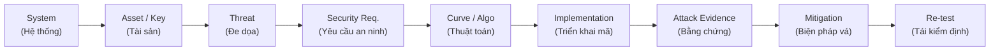
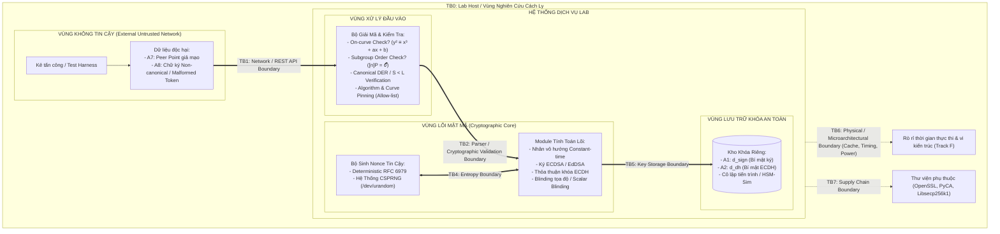
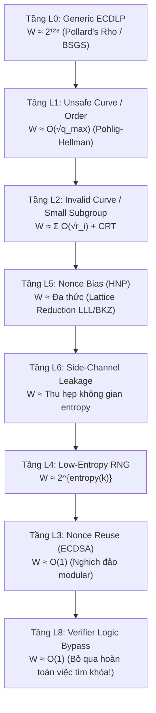

# Threat Model & Search Space Collapse Analysis
## Topic 14: ECC Cryptanalysis & Implementation Failure Engineering

> [!NOTE]
> **Thông Tin Tổng Quan Tài Liệu**
> - **Chủ đề nghiên cứu:** Topic 14 — Phân tích thám mã đường cong Elliptic (ECC) và các sai hỏng trong triển khai kỹ thuật.
> - **Cấu trúc tài liệu:**
>   - **PHẦN A (Task 1):** Mô hình hóa tài sản hệ thống, ranh giới tin cậy (Trust Boundaries) và mô hình kẻ tấn công.
>   - **PHẦN B (Task 3):** Khung định lượng và các tầng sụp đổ không gian tìm kiếm ($W_{\text{eff}}$ Collapse Hierarchy L0–L8).
> - **Phương pháp luận:** Áp dụng chuỗi liên kết nhân quả xuyên suốt từ tài sản $\to$ đe dọa $\to$ yêu cầu an ninh $\to$ thuật toán $\to$ bằng chứng thực nghiệm $\to$ giải pháp khắc phục $\to$ tái kiểm thử (Re-test).
> - **Đối chiếu tiêu chuẩn:** NIST SP 800-186, RFC 6090, FIPS 186-5, NIST SP 800-56A Rev. 3, RFC 6979, RFC 8032.

---

## Mục Lục
- [PHẦN A — Task 1: Tài Sản Hệ Thống, Ranh Giới Tin Cậy & Mô Hình Kẻ Tấn Công](#phần-a--task-1-tài-sản-hệ-thống-ranh-giới-tin-cậy--mô-hình-kẻ-tấn-công)
  - [A.1 Chuỗi Phân Tích Xuyên Suốt (Causal Analytical Chain)](#a1-chuỗi-phân-tích-xuyên-suốt-causal-analytical-chain)
  - [A.2 Hệ Thống Lab Thực Nghiệm (Systems Under Study)](#a2-hệ-thống-lab-thực-nghiệm-systems-under-study)
  - [A.3 Bảng Kiểm Kê Tài Sản Mật Mã (Asset Inventory)](#a3-bảng-kiểm-kê-tài-sản-mật-mã-asset-inventory)
  - [A.4 Bản Đồ Ranh Giới Tin Cậy (Trust Boundaries Architecture)](#a4-bản-đồ-ranh-giới-tin-cậy-trust-boundaries-architecture)
  - [A.5 Mô Hình Năng Lực Kẻ Tấn Công (Adversary Capabilities)](#a5-mô-hình-năng-lực-kẻ-tấn-công-adversary-capabilities)
  - [A.6 Ma Trận Phân Tích Mối Đe Dọa Theo Tài Sản (STRIDE Matrix)](#a6-ma-trận-phân-tích-mối-đe-dọa-theo-tài-sản-stride-matrix)
  - [A.7 Phạm Vi Ngoài Nghiên Cứu (Out-of-Scope Guardrails)](#a7-phạm-vi-ngoài-nghiên-cứu-out-of-scope-guardrails)
  - [A.8 Nhật Ký Quyết Định Kỹ Thuật & Câu Hỏi Mở](#a8-nhật-ký-quyết-định-kỹ-thuật--câu-hỏi-mở)
- [PHẦN B — Task 3: Các Tầng Sụp Đổ Không Gian Tìm Kiếm](#phần-b--task-3-các-tầng-sụp-đổ-không-gian-tìm-kiếm)
  - [B.1 Khung Định Lượng Độ Phức Tạp Hiệu Dụng $W_{\text{eff}}$](#b1-khung-định-lượng-độ-phức-tạp-hiệu-dụng-w_texteff)
  - [B.2 Bảng Phân Tầng Sụp Đổ Không Gian Tìm Kiếm (L0–L8)](#b2-bảng-phân-tầng-sụp-đổ-không-gian-tìm-kiếm-l0l8)
  - [B.3 Cơ Sở Toán Học Chi Tiết Cho Từng Tầng Sụp Đổ](#b3-cơ-sở-toán-học-chi-tiết-cho-từng-tầng-sụp-đổ)
  - [B.4 Bảng Ánh Xạ Tầng Sụp Đổ $\to$ Lỗ Hổng Thực Tế (CVE Catalog)](#b4-bảng-ánh-xạ-tầng-sụp-đổ--lỗ-hổng-thực-tế-cve-catalog)
  - [B.5 Khung Đánh Giá Thực Nghiệm & Lập Luận An Ninh (Before/After)](#b5-khung-đánh-giá-thực-nghiệm--lập-luận-an-ninh-beforeafter)
  - [B.6 Checklist Kiểm Định Tính Toàn Vẹn Của Mô Hình](#b6-checklist-kiểm-định-tính-toàn-vẹn-của-mô-hình)

---

# PHẦN A — Task 1: Tài Sản Hệ Thống, Ranh Giới Tin Cậy & Mô Hình Kẻ Tấn Công

## A.1 Chuỗi Phân Tích Xuyên Suốt (Causal Analytical Chain)

Mọi lập luận kỹ thuật, kịch bản khai thác và đánh giá rủi ro trong đề tài bắt buộc phải tuân thủ nghiêm ngặt chuỗi liên kết nhân quả 10 mắt xích:

> [!IMPORTANT]
> **Nguyên tắc đối chiếu:** Bất kỳ lỗ hổng hay cơ chế tấn công nào được đề cập trong báo cáo đều phải truy vết được ngược xuôi theo chuỗi trên. Không phân tích một lỗi triển khai (implementation bug) mà thiếu đi ngữ cảnh hệ thống, tài sản bị đe dọa hoặc bằng chứng thực nghiệm đối chứng.

---

## A.2 Hệ Thống Lab Thực Nghiệm (Systems Under Study)

Đề tài thiết lập 4 môi trường lab chuẩn hóa mô phỏng các ứng dụng thực tế của mật mã bất đối xứng dựa trên ECC:

| Mã ID | Ngữ Cảnh Ứng Dụng | Thành Phần Kiến Trúc | Thư Viện & Giao Thức Mật Mã | Đường Cong / Thuật Toán Sử Dụng |
| :---: | :--- | :--- | :--- | :--- |
| **S1** | **JWT / OIDC Service** `system-demos/jwt-es256/` | Token Signer (Issuer), Resource Server (Verifier), JWKS Endpoint | PyJWT, Authlib, JCC, OpenSSL | ECDSA P-256 (ES256), Ed25519 (EdDSA) |
| **S2** | **ECDH Key Exchange API** `system-demos/ecdh-api/` | Static-Key Microservice, Untrusted Client Peer | Custom Python Backend, PyCA Cryptography | Short Weierstrass (Toy & P-256), X25519 |
| **S3** | **Blockchain Node Regtest** `system-demos/blockchain-regtest/` | Local Wallet Signer, Core Node Engine, Mempool Verifier | Bitcoin-Core python-ecdsa, libsecp256k1 | ECDSA secp256k1 (Strict DER, Low-$S$) |
| **S4** | **SSH / Git Commit Signing** *(Mở rộng tuỳ chọn)* | SSH-Agent, Signing Key Storage, Host Auth Daemon | OpenSSH, PuTTY engine | ECDSA P-256 / P-521, Ed25519 |

---

## A.3 Bảng Kiểm Kê Tài Sản Mật Mã (Asset Inventory)

Phân loại cấp độ bảo vệ theo tiêu chuẩn CIA (**C**onfidentiality - Bí mật, **I**ntegrity - Toàn vẹn, **A**vailability - Khả dụng) với thang tác động: **Cao (H)**, **Trung bình (M)**, **Thấp (L)**:

| ID | Tên Tài Sản | Bản Chất Mật Mã | Thuộc Hệ Thống | Yêu Cầu An Toàn | Mức Tác Động Khi Thất Bại | Các Tầng Tấn Công Liên Quan |
| :---: | :--- | :--- | :---: | :---: | :---: | :--- |
| **A1** | **Signing Private Scalar $d_{\text{sign}}$** | Bí mật dài hạn | S1, S3, S4 | **C, I** | **H** — Giả mạo token, giao dịch trái phép, chiếm quyền root | Nonce Reuse (L3), Nonce Bias (L5), Timing (L6), Fault (L7) |
| **A2** | **ECDH Static Private Scalar $d_{\text{dh}}$** | Bí mật dài hạn | S2 | **C** | **H** — Giải mã toàn bộ lưu lượng TLS/VPN, giải mã dữ liệu nhạy cảm | Invalid-Curve (L2), Small-Subgroup Confinement |
| **A3** | **Per-signature Nonce $k$** | Bí mật 1 lần (Ephemeral) | S1, S3, S4 | **C** (Tuyệt đối), Unpredictability | **H** — Chỉ cần lộ 1 nonce $k$ là khôi phục hoàn toàn $d_{\text{sign}}$ | Nonce Reuse (L3), RNG Low Entropy (L4), Bias HNP (L5) |
| **A4** | **Ephemeral ECDH Scalar $r_{\text{eph}}$** | Bí mật tạm thời | S2 | **C** | **M** — Nguy hiểm nếu tái dùng hoặc bộ sinh số ngẫu nhiên dự đoán được | RNG Failure, Cross-session Key Collision |
| **A5** | **Domain Parameters $(p, a, b, G, n, h)$** | Tham số công khai | Tất cả | **I** (Toàn vẹn tuyệt đối) | **H** — Tham số yếu phá hủy độ phức tạp ECDLP từ gốc | Unsafe Curve (L1), Pohlig–Hellman, Anomalous / MOV |
| **A6** | **Public Key / JWK / X.509 Certificate** | Công khai cần xác thực | S1, S2, S3 | **I** | **H** — Thay thế khóa công khai khiến Verifier chấp nhận kẻ mạo danh | Wrong-Curve JWK Injection, Key Confusion Attack |
| **A7** | **Peer Public Point (Đầu vào ECDH)** | Dữ liệu **KHÔNG TIN CẬY** | S2 | Input Validation | **H** — Nguồn gốc trực tiếp của tấn công Invalid-Curve | Điểm không nằm trên curve (On-curve), Điểm bậc nhỏ |
| **A8** | **Signature Payload $(r, s)$ / Token** | Dữ liệu **KHÔNG TIN CẬY** | S1, S3 | Canonical Validation | **H** — Verifier Bypass, Signature Malleability | Non-canonical $S \ge L$ (Ed25519), High-$S$ (secp256k1) |
| **A9** | **Shared Secret & KDF Master Key** | Bí mật phiên | S2 | **C** | **H** — Cho phép giải mã phiên hội thoại hiện tại | All-zero Shared Secret (Curve25519), Small Subgroup |
| **A10** | **Bộ Sinh Số Ngẫu Nhiên (CSPRNG / RFC 6979)** | Thành phần tin cậy hạt nhân | S1, S3, S4 | **I**, Entropy Quality | **H** — Gốc rễ của mọi lỗi lộ khóa chữ ký số | Thiếu entropy lúc khởi động, Bias phân phối bit |
| **A11** | **Metadata Vòng Đời Khóa (`kid`, revocation)** | Dữ liệu cấu hình | S1, S3 | **I, A** | **M–H** — Kẻ tấn công ép hệ thống quay về dùng khóa cũ | Key Confusion, Stale Key Rollback |
| **A12** | **Phản Hồi Lỗi / Độ Trễ API (Side-channel)** | **Kênh Thông Tin Ngầm** | S1, S2 | Uniformity (Đồng nhất) | **M–H** — Trở thành Decryption / Verification Oracle | Timing Oracle, Decryption Feedback (CVE-2019-9155) |
| **A13** | **Corpus D1–D7 & Dấu Vết Thực Nghiệm** | Dữ liệu nghiên cứu | Toàn repo | **I**, Tính tái lập | **L–M** — Sai lệch kết quả dẫn tới kết luận sai | Không chứa khóa bí mật của môi trường Production |
| **A14** | **Chuỗi Cung Ứng Mã Nguồn & Bản Vá Thư Viện** | Nền tảng thực thi | Tất cả | **I** | **M** — Sai lệch version dẫn tới kết luận sai về CVE | Thiếu phiên bản cố định (Pin version), Lỗ hổng upstream |

> [!CAUTION]
> **Quy tắc phân biệt chiến lược:**
> - Nhóm **A1–A3** là "Crown Jewels" (Bảo vật tối thượng) — mục tiêu bảo vệ trọng yếu của toàn bộ hệ thống.
> - Nhóm **A7, A8, A12** không phải dữ liệu bí mật nhưng cấu thành **bề mặt tấn công (Attack Surface)**. Lỗ hổng tại các điểm này làm sụp đổ hoàn toàn mức độ an toàn lý thuyết $W_{\text{eff}} \ll 2^{128}$.

---

## A.4 Bản Đồ Ranh Giới Tin Cậy (Trust Boundaries Architecture)

Sơ đồ dưới đây phân định ranh giới cách ly vật lý, tiến trình và ngữ cảnh xử lý dữ liệu giữa vùng không tin cậy bên ngoài và lõi mật mã bảo mật bên trong:

### Bảng Đặc Tả Chi Tiết 8 Ranh Giới Tin Cậy

| Ranh Giới | Tên Ranh Giới | Phía Không Tin Cậy $\to$ Phía Tin Cậy | Kiểm Soát Kỹ Thuật Bắt Buộc | Lỗ Hổng Tiêu Biểu Khi Vi Phạm | Track Thực Nghiệm |
| :---: | :--- | :--- | :--- | :--- | :---: |
| **TB1** | **Network / API Boundary** | Client ngoài $\to$ Web API endpoint | Rate-limiting, xác thực danh tính, chuẩn hóa thông báo lỗi | Tấn công lặp truy vấn Oracle không giới hạn | **D** |
| **TB2** | **Parser / Validation Boundary** | Byte thô $\to$ Đối tượng điểm / chữ ký | Kiểm tra tọa độ trong trường, phương trình on-curve, cấp subgroup $[n]P = \mathcal{O}$, encoding canonical | **Invalid-curve attack, Verifier signature bypass** | **D, G** |
| **TB3** | **Crypto Core Boundary** | Đối tượng đã validate $\to$ Hàm số học | Triển khai Constant-time, scalar blinding, projective randomization | Side-channel timing leak, Cache attack | **F** |
| **TB4** | **Entropy Boundary** | Hệ điều hành / RNG $\to$ Nonce $k$ | Sử dụng CSPRNG chuẩn hoặc thuật toán tất định RFC 6979 | Nonce reuse, Nonce bias (PuTTY CVE-2024-31497) | **C, E** |
| **TB5** | **Key Storage Boundary** | Bộ nhớ tiến trình khác $\to$ Scalar bí mật | Phân quyền truy cập bộ nhớ (`mlock`), xóa khóa sau khi dùng (`explicit_bzero`) | Đọc trộm bộ nhớ, Dump tiến trình | **S4** |
| **TB6** | **Physical / Microarchitectural** | Luồng tiến trình đồng chia sẻ CPU $\to$ Cache L1/L3 | Cố định CPU core (Core Pinning), khử nhiễu bộ nhớ đệm | Flush+Reload, Prime+Probe, Minerva timing | **F** |
| **TB7** | **Supply Chain Boundary** | Kho gói công cộng $\to$ Mã nhị phân ứng dụng | Khóa chặt version (Pin requirements.txt / lock file), quét SBOM | Nhúng nhầm phiên bản có CVE đã biết | **Tất cả** |

> [!IMPORTANT]
> **Trọng tâm kiến trúc:** Ranh giới **TB2** là trọng tâm tuyệt đối được nhấn mạnh trong hướng dẫn: *Point validation và Subgroup validation là yêu cầu mật mã học tiên quyết (theo NIST SP 800-56A), hoàn toàn không phải chỉ là việc làm sạch dữ liệu đầu vào (input sanitation) thông thường*. Việc ngộ nhận rằng "dữ liệu qua TB2 đã sạch" là nguyên nhân trực tiếp dẫn tới hàng loạt CVE nghiêm trọng: CVE-2015-7940, CVE-2016-9121, và CVE-2026-26007.

---

## A.5 Mô Hình Năng Lực Kẻ Tấn Công (Adversary Capabilities)

| Mã ID | Vị Trí & Phương Thức | Năng Lực Khai Thác | Dữ Liệu Quan Sát Được | Giới Hạn Nghiêm Ngặt (Ngoài Phạm Vi) |
| :---: | :--- | :--- | :--- | :--- |
| **ATK-1** | **Remote, Passive (Thụ động từ xa)** | Nghe lén lưu lượng mạng công khai, thu thập chữ ký số phát hành | Tập hợp các bộ ba $(r_i, s_i, H(m_i))$, token JWT, public key | Không can thiệp đường truyền, không sửa gói tin, không truy cập bộ nhớ |
| **ATK-2** | **Remote, Active (Chủ động tương tác - Oracle)** | Gửi các điểm tọa độ tùy ý, token malformed tới API endpoint | Mã phản hồi HTTP, thông điệp lỗi, thời gian phản hồi (Latency) | Bị cấm tấn công từ chối dịch vụ (DoS), không nhắm vào hệ thống ngoài phòng lab |
| **ATK-3** | **Local Co-tenant (Cùng máy chủ)** | Chạy tiến trình cùng máy chủ ảo/container, đo đạc vi kiến trúc | Phân phối chu kỳ xung nhịp CPU (CPU cycles), tranh chấp cache | Không có quyền root, không can thiệp trực tiếp vào tiến trình mục tiêu |
| **ATK-4** | **Physical / Lab (Vật lý - Tuỳ chọn)** | Gắn probe đo năng lượng hoặc sóng điện từ (EM) trên vi điều khiển | Traces dao động điện thế khi thực thi phép nhân vô hướng | Chỉ thực hiện trên board phần cứng của nhóm nghiên cứu |
| **ATK-5** | **Supply-Chain Auditor** | Đánh giá phân tích mã nguồn và dependency graph | Danh mục CVE, mã nguồn upstream, commit lịch sử | Tuyệt đối không khai thác lỗ hổng 0-day chưa vá trên thực tế |

---

## A.6 Ma Trận Phân Tích Mối Đe Dọa Theo Tài Sản (STRIDE Matrix)

| Tài Sản Mục Tiêu | Mối Đe Dọa (Threat Description) | Phân Loại STRIDE | Yêu Cầu An Toàn Đặt Ra | Biện Pháp Khắc Phục Kỹ Thuật (Mitigation) |
| :---: | :--- | :---: | :--- | :--- |
| **A1** ($d_{\text{sign}}$) | Khôi phục khóa riêng từ các chữ ký số dùng chung nonce | **Information Disclosure** | Nonce $k$ phải duy nhất tuyệt đối và không thể dự đoán | Sử dụng RFC 6979 hoặc CSPRNG chuẩn; cài đặt bộ phát hiện `repeated_r` |
| **A1** ($d_{\text{sign}}$) | Rò rỉ thông tin khóa qua độ lệch thời gian khi ký | **Information Disclosure** | Quá trình tính toán scalar multiplication phải đẳng thời | Lập trình Constant-time kết hợp Projective Coordinate Blinding |
| **A2** ($d_{\text{dh}}$) | Khôi phục thặng dư khóa $d_{\text{dh}} \pmod{r_i}$ qua điểm giả mạo | **Information Disclosure** | Bắt buộc kiểm tra tính hợp lệ của điểm đối tác trước khi tính toán | Kiểm tra phương trình On-curve ($y^2 \equiv x^3+ax+b$) và kiểm tra Subgroup |
| **A5** (Params) | Bị ép sử dụng đường cong tự tạo có cấp trơn hoặc kỳ dị | **Tampering** | Chỉ sử dụng các đường cong đã chuẩn hóa (Named Curves) | Allow-list các đường cong chuẩn (NIST/SECG); kiểm tra $\Delta \not\equiv 0 \pmod p$ |
| **A6** (JWK) | Thay thế public key hoặc tráo đổi đường cong trong token | **Spoofing** | Xác thực nguồn gốc khóa và kiểm tra tương thích đường cong | Khóa cứng thuật toán (`alg` pinning) và đường cong (`crv` pinning) |
| **A8** (Sig/Token) | Chấp nhận chữ ký non-canonical để bypass xác thực | **Spoofing / Repudiation** | Trình xác thực chữ ký phải kiểm tra nghiêm ngặt dạng chuẩn | Ép buộc $S < L$ trong Ed25519 (RFC 8032); ép buộc Low-$S$ trong secp256k1 |
| **A12** (Oracle) | Thông điệp lỗi giải mã tiết lộ tính hợp lệ của điểm mật mã | **Information Disclosure** | Toàn bộ phản hồi lỗi phải đồng nhất và không rò rỉ trạng thái | Chuẩn hóa một mã lỗi duy nhất; thực thi phép toán giả để cân bằng thời gian |
| **A14** (Build) | Triển khai thư viện chứa các CVE chưa được khắc phục | **Elevation of Privilege** | Quản lý phụ thuộc chặt chẽ và cập nhật bản vá bảo mật | Pin chính xác version thư viện; đối chiếu cơ sở dữ liệu SBOM |

---

## A.7 Phạm Vi Ngoài Nghiên Cứu (Out-of-Scope Guardrails)

> [!CAUTION]
> **Nguyên tắc an toàn học thuật và pháp lý:**
> 1. **Không tuyên bố phá vỡ các đường cong tiêu chuẩn:** Đề tài tuyệt đối không tuyên bố "bẻ gãy" các đường cong chuẩn kích thước đầy đủ (NIST P-256, SECG secp256k1, Ed25519). Các đường cong này đóng vai trò là **mẫu đối chứng âm (Negative Controls)** để chứng minh rằng khi triển khai đúng quy chuẩn, hệ thống hoàn toàn an toàn.
> 2. **Cấm tấn công môi trường thực tế:** Nghiêm cấm mọi hành vi thử nghiệm trên mạng blockchain public, các endpoint JWT thương mại ngoài phạm vi lab, hoặc sử dụng khóa riêng của hệ thống production.
> 3. **Loại trừ tấn công lượng tử:** Thuật toán Shor giải quyết ECDLP trong thời gian đa thức trên máy tính lượng tử lý thuyết được ghi nhận là xu hướng tương lai nhưng nằm ngoài phạm vi thực nghiệm kỹ thuật của đề tài này.

---

## A.8 Nhật Ký Quyết Định Kỹ Thuật & Câu Hỏi Mở

- [x] **Chọn ngữ cảnh lab:** Chốt thực hiện tối thiểu 2 ngữ cảnh: **S1 (JWT ES256)** và **S2 (ECDH API)**, kèm mô-đun mở rộng **S3 (Blockchain secp256k1)**.
- [x] **Mô hình cô lập khóa TB5:** Sử dụng tiến trình riêng biệt giả lập HSM thông qua Unix Domain Socket / IPC cục bộ để đảm bảo ranh giới cô lập bộ nhớ rõ ràng.
- [x] **Danh mục CVE:** Chốt danh mục tối thiểu 8 CVE kinh điển bao quát toàn bộ các tầng từ L2 đến L8 (xem chi tiết tại Mục B.4).

---

# PHẦN B — Task 3: Các Tầng Sụp Đổ Không Gian Tìm Kiếm

## B.1 Khung Định Lượng Độ Phức Tạp Hiệu Dụng $W_{\text{eff}}$

Trong mật mã học đường cong Elliptic, bài toán gốc bảo vệ hệ thống là tìm khóa bí mật $d \in \mathbb{Z}_n^*$ từ điểm công khai $Q = [d]G$, trong đó $G$ có cấp nguyên tố $n$.

Khác với quan niệm sai lầm phổ biến cho rằng "độ an toàn bằng độ dài khóa", thuật toán vét cạn tuần tự (Brute Force) không bao giờ là thước đo an toàn thực tế:

$$\begin{aligned}
W_{\text{brute}} &\approx n \quad \left(\text{Kỳ vọng } \frac{n}{2} \text{ phép tính điểm}\right) \\
W_{\text{BSGS}} &\approx \mathcal{O}(\sqrt{n}) \text{ thời gian} + \mathcal{O}(\sqrt{n}) \text{ bộ nhớ} \\
W_{\rho} &\approx \sqrt{\frac{\pi n}{2}} \approx 1.2533 \sqrt{n} = \mathcal{O}(\sqrt{n}) \text{ thời gian}, \quad \mathcal{O}(1) \text{ bộ nhớ}
\end{aligned}$$

Với một đường cong 256-bit chuẩn ($n \approx 2^{256}$):
$$W_{\text{generic}} = W_\rho \approx 2^{128} \text{ phép toán (Mức an toàn 128-bit)}$$

Tuy nhiên, trong một hệ sinh thái triển khai thực tế, độ phức tạp thực sự để kẻ tấn công bẻ gãy hệ thống — gọi là **Độ Phức Tạp Hiệu Dụng ($W_{\text{eff}}$)** — được định nghĩa bởi mắt xích yếu nhất trong chuỗi triển khai:

$$W_{\text{eff}} = \min \left\{ W_{\text{ECDLP}}, W_{\text{curve}}, W_{\text{nonce}}, W_{\text{oracle}}, W_{\text{sidechannel}}, W_{\text{fault}}, W_{\text{verifier}} \right\}$$

Khi một sai hỏng kỹ thuật xuất hiện, $W_{\text{eff}}$ sụp đổ từ mức an toàn $2^{128}$ xuống các mức độ phức tạp rất nhỏ, cho phép kẻ tấn công thu hồi khóa bí mật trong thời gian thực.

---

## B.2 Bảng Phân Tầng Sụp Đổ Không Gian Tìm Kiếm (L0–L8)

| Tầng | Định Danh Tầng | Cơ Chế Thu Hẹp / Phá Vỡ Độ Phức Tạp | Điều Kiện Tiên Quyết Để Khai Thác | Độ Phức Tạp Trước $\to$ Sau Sụp Đổ | Mức Độ Tác Động Thực Tế | Track |
| :---: | :--- | :--- | :--- | :---: | :--- | :---: |
| **L0** | **Generic ECDLP** | Thuật toán Pollard's Rho thay thế quét vét cạn $n$ | Không cần điều kiện (Luôn đúng với mọi nhóm) | $\mathcal{O}(n) \longrightarrow \mathcal{O}(\sqrt{n})$ | Xác lập trần an toàn thiết kế (128-bit an toàn cho curve 256-bit) | **A** |
| **L1** | **Unsafe Curve / Order** | Cấp trơn $\implies$ Pohlig–Hellman; Anomalous $\implies$ Smart; Cấp xoắn yếu $\implies$ Twist attack | Tham số do đối phương tự cấu hình hoặc thư viện legacy | $\mathcal{O}(\sqrt{n}) \longrightarrow \mathcal{O}(\sqrt{q_{\max}})$ hoặc Đa thức $\mathcal{O}(\log^3 p)$ | Phá hủy an toàn mật mã từ **cấp độ tham số toán học** | **B** |
| **L2** | **Invalid-Curve / Small-Subgroup** | Gửi điểm sai đường cong có cấp nhỏ $r_i$, kết hợp CRT khôi phục khóa | Thư viện thiếu validate tại ranh giới TB2; có Oracle phản hồi | $\mathcal{O}(\sqrt{n}) \longrightarrow \sum_{i} \mathcal{O}(\sqrt{r_i}) + \text{CRT}$ | Lộ từng phần khóa bí mật $d_{\text{dh}} \pmod{r_i} \to$ Lộ toàn bộ | **D** |
| **L3** | **ECDSA Nonce Reuse** | Dùng chung một nonce $k$ cho 2 thông điệp khác nhau $\implies$ Giải hệ tuyến tính | Cùng giá trị $r$ xuất hiện trên hai chữ ký (`repeated_r`) | $\mathcal{O}(\sqrt{n}) \longrightarrow \mathcal{O}(1)$ (Vài phép nhân nghịch đảo) | **Khôi phục ngay lập tức khóa riêng $d_{\text{sign}}$** | **C** |
| **L4** | **Low-Entropy Nonce** | Bộ sinh số ngẫu nhiên bị lỗi, không gian nonce $k$ nhỏ | CSPRNG thiếu entropy khởi tạo, seed lỗi thời | $\mathcal{O}(\sqrt{n}) \longrightarrow 2^{\text{entropy}(k)}$ | Vét cạn không gian khóa nonce $\implies$ Lộ khóa riêng | **C** |
| **L5** | **Biased / Partial Nonce (HNP)** | Mỗi chữ ký làm rò rỉ một vài bit của nonce $k \implies$ Quy về Hidden Number Problem | Thu thập đủ $m$ chữ ký có bias bit cao/thấp | $\mathcal{O}(\sqrt{n}) \longrightarrow \text{Đa thức theo } m \text{ (LLL/BKZ)}$ | Khôi phục khóa riêng từ vài chục chữ ký (PuTTY CVE-2024-31497) | **E** |
| **L6** | **Side-Channel Timing** | Thời gian thực thi phụ thuộc vào trọng số Hamming hoặc độ dài của $k, d$ | Khả năng đo đạc độ trễ mạng hoặc cycles cục bộ | Thu hẹp entropy còn $\frac{n}{2^{\text{leak}}}$ | Cung cấp mẫu bias cho tầng L5 (OpenSSL CVE-2024-13176) | **F** |
| **L7** | **Fault Attack** | Kích hoạt lỗi phần cứng trong quá trình tính toán để tạo quan hệ đại số | Khả năng can thiệp vật lý (tia laser, sụt áp) | $\mathcal{O}(\sqrt{n}) \longrightarrow$ Giải phương trình đại số | Thu hồi khóa qua sai phân giữa chữ ký chuẩn và chữ ký lỗi | *(MSc)* |
| **L8** | **Verifier Bug** | Trình xác thực chấp nhận đối tượng chữ ký dị dạng hoặc non-canonical | Lỗ hổng kiểm tra điều kiện biên của parser/verifier | $\mathcal{O}(\sqrt{n}) \longrightarrow \mathcal{O}(1)$ (**Bỏ qua hoàn toàn việc tìm khóa**) | Mạo danh chữ ký hợp lệ mà không cần biết khóa riêng! | **G** |

> [!NOTE]
> **Phân biệt rạch ròi giữa L1 và L2:**
> - **Tầng L1 (Unsafe Parameters):** Bản thân đường cong hoặc điểm cơ sở $G$ được lựa chọn mang cấu trúc toán học suy biến (ước nguyên tố lớn nhất $q_{\max}$ quá nhỏ, hoặc $\Delta \equiv 0$).
> - **Tầng L2 (Implementation Validation Failure):** Bản thân đường cong mục tiêu (như NIST P-256) là hoàn toàn an toàn và vững chắc, nhưng **mã nguồn triển khai của thư viện bỏ qua khâu kiểm tra điểm** tại ranh giới TB2, cho phép đối phương ép thiết bị tính toán trên một đường cong ngoại lai $E'$. Đường cong chuẩn không hề bị yếu đi.

---

## B.3 Cơ Sở Toán Học Chi Tiết Cho Từng Tầng Sụp Đổ

### B.3.1 Tầng L0 — Generic Search (Baseline đối chứng)
- Thuật toán Pollard's Rho phân hoạch nhóm thành 3 tập con và sử dụng hàm bước đi giả ngẫu nhiên.
- Mối quan hệ giữa số phép toán thực nghiệm $N_{\text{ops}}$ và cấp nhóm $n$ trên hệ tọa độ Log-Log biểu diễn qua độ dốc lý thuyết:
  $$\text{Slope} = \frac{\Delta \log_2 (N_{\text{ops}})}{\Delta \log_2 (n)} \approx 0.5 \quad \text{(So với Exhaustive Search có Slope } \approx 1.0\text{)}$$

### B.3.2 Tầng L1 — Unsafe Order (Thuật toán Pohlig–Hellman)
Giả sử cấp của điểm cơ sở $n = \operatorname{ord}(G)$ bị phân rã hoàn toàn thành các thừa số nguyên tố nhỏ:
$$n = \prod_{i=1}^k q_i^{e_i}$$

Thuật toán Pohlig–Hellman rút gọn việc giải ECDLP trên nhóm cấp $n$ về việc giải các bài toán cục bộ trên các nhóm con cấp nguyên tố $q_i$:
$$W_{\text{PH}} \approx \sum_{i=1}^k e_i \left( \log_2 n + \sqrt{q_i} \right) \implies W_{\text{eff}} \approx \mathcal{O}\left(\sqrt{q_{\max}}\right)$$

Khi một đường cong có $q_{\max} \le 2^{40}$, việc bẻ gãy khóa riêng diễn ra trong vài giây, bất kể tổng độ dài $n$ có thể lên tới 256 bit.

### B.3.3 Tầng L2 — Invalid-Curve / Small-Subgroup
Xét công thức cộng và nhân đôi điểm trên dạng Short Weierstrass:
$$\lambda = \frac{y_2 - y_1}{x_2 - x_1} \pmod p \quad \text{hoặc} \quad \lambda = \frac{3x_1^2 + a}{2y_1} \pmod p$$
$$x_3 = \lambda^2 - x_1 - x_2 \pmod p, \quad y_3 = \lambda(x_1 - x_3) - y_1 \pmod p$$

Do công thức **hoàn toàn độc lập với hệ số $b$**, nếu một điểm $P' = (x', y')$ thỏa mãn $y'^2 \equiv x'^3 + ax' + b' \pmod p$ với $b' \neq b$, phép tính nhân vô hướng $[d]P'$ sẽ diễn ra hoàn toàn trên đường cong $E': y^2 = x^3 + ax + b'$.

Kẻ tấn công chọn các đường cong $E'$ có cấp chứa các thừa số nguyên tố nhỏ $r_1, r_2, \dots, r_m$:
1. Gửi điểm $P_i \in E'(\mathbb{F}_p)$ có cấp đúng bằng $r_i$ ($[r_i]P_i = \mathcal{O}$).
2. Máy chủ tính và phản hồi kết quả $S_i = [d_{\text{dh}}]P_i = [d_{\text{dh}} \bmod r_i]P_i$.
3. Kẻ tấn công vét cạn trong phạm vi $j \in [0, r_i - 1]$ để tìm nghiệm:
   $$d_{\text{dh}} \equiv d_i \pmod{r_i}$$
4. Sau khi thu thập đủ các số dư với $\prod_{i=1}^m r_i \ge n$, áp dụng Định lý Số Dư Trung Hoa (CRT):
   $$d_{\text{dh}} \equiv \sum_{i=1}^m d_i M_i \left(M_i^{-1} \bmod r_i\right) \pmod{\prod_{i=1}^m r_i}, \quad \text{với } M_i = \frac{\prod_{j=1}^m r_j}{r_i}$$

Tổng chi phí truy vấn chỉ là:
$$\text{Total Queries} \approx \sum_{i=1}^m r_i \ll n$$

---

### B.3.4 Tầng L3 — Nonce Reuse trong ECDSA (Sụp đổ đại số tức thì)

Quy trình ký ECDSA chuẩn cho thông điệp $m$ với hàm băm $H$:
1. Chọn nonce ngẫu nhiên $k \in_R \mathbb{Z}_n^*$.
2. Tính điểm $R = [k]G = (x_R, y_R)$ và lấy tọa độ $r \equiv x_R \pmod n$.
3. Tính chữ ký $s \equiv k^{-1}\left(H(m) + d_{\text{sign}} \cdot r\right) \pmod n$.

**Kịch bản sự cố:** Nếu cùng một nonce $k$ được dùng lại để ký hai thông điệp khác nhau $m_1$ và $m_2$ ($H_1 \not\equiv H_2 \pmod n$):
Do cùng $k$, hai chữ ký sẽ có **cùng thành phần $r$**:
$$s_1 \equiv k^{-1}\left(H_1 + d_{\text{sign}} \cdot r\right) \pmod n$$
$$s_2 \equiv k^{-1}\left(H_2 + d_{\text{sign}} \cdot r\right) \pmod n$$

Trừ hai phương trình vế theo vế:
$$s_1 - s_2 \equiv k^{-1}\left(H_1 - H_2\right) \pmod n$$

Giả sử $s_1 \not\equiv s_2 \pmod n$, kẻ tấn công khôi phục ngay lập tức nonce $k$:
$$k \equiv \left(H_1 - H_2\right) \cdot \left(s_1 - s_2\right)^{-1} \pmod n$$

Sau khi đã có $k$, khóa riêng $d_{\text{sign}}$ được tính trực tiếp từ chữ ký thứ nhất:
$$d_{\text{sign}} \equiv \left(s_1 \cdot k - H_1\right) \cdot r^{-1} \pmod n$$

> [!WARNING]
> Độ phức tạp của cuộc tấn công này là $\mathcal{O}(1)$ — chỉ bao gồm 2 phép nghịch đảo modular và vài phép nhân cộng cơ bản trên $\mathbb{Z}_n$. Toàn bộ hệ thống sụp đổ trong chưa đầy 1 mili-giây.

---

### B.3.5 Tầng L5 — Biased Nonce & Hidden Number Problem (HNP)

Nếu nonce $k_i$ không bị trùng lặp hoàn toàn nhưng bị thiên lệch (bias), ví dụ $\ell$ bit cao nhất luôn bằng $0$ (tức $k_i < 2^{256 - \ell}$):

Từ phương trình chữ ký:
$$s_i \equiv k_i^{-1} \left(H_i + d \cdot r_i\right) \pmod n \iff k_i \equiv s_i^{-1} H_i + s_i^{-1} r_i \cdot d \pmod n$$

Đặt $t_i \equiv -s_i^{-1} H_i \pmod n$ và $u_i \equiv s_i^{-1} r_i \pmod n$, ta có hệ đồng dư:
$$u_i \cdot d - k_i \equiv t_i \pmod n, \quad \text{với } |k_i| < 2^{256 - \ell}$$

Đây chính là bài toán **Hidden Number Problem (HNP)** do Boneh và Venkatesan đề xuất. Kẻ tấn công thu thập $m$ chữ ký và dựng một lưới đại số (lattice) kích thước $(m+1) \times (m+1)$:

$$\mathbf{B} = \begin{pmatrix}
n & 0 & \dots & 0 & 0 \\
0 & n & \dots & 0 & 0 \\
\vdots & \vdots & \ddots & \vdots & \vdots \\
0 & 0 & \dots & n & 0 \\
u_1 & u_2 & \dots & u_m & \frac{2^{256-\ell}}{n}
\end{pmatrix}$$

Bằng cách áp dụng các thuật toán rút gọn cơ sở lưới như **LLL (Lenstra–Lenstra–Lovász)** hoặc **BKZ (Block Korkine–Zolotarev)**, vector chứa khóa riêng $d$ sẽ xuất hiện dưới dạng một vector ngắn (Shortest Vector Problem - SVP) hoặc giải bài toán vector gần nhất (Closest Vector Problem - CVP).

Số lượng chữ ký tối thiểu cần thiết để khôi phục khóa xấp xỉ:
$$m \gtrsim \frac{\log_2 n}{\ell}$$

*Minh chứng thực tế:* Lỗ hổng PuTTY P-521 (CVE-2024-31497) có bias $\ell = 9$ bit (do bộ sinh số ngẫu nhiên chỉ sinh 512 bit cho đường cong 521 bit). Kẻ tấn công chỉ cần khoảng 60 chữ ký để khôi phục 100% khóa riêng P-521.

---

### B.3.6 Tầng L8 — Verifier & Canonical Bypass

Tại tầng này, kẻ tấn công **hoàn toàn không cần tìm khóa riêng $d$**. Thay vào đó, lợi dụng sai sót trong logic kiểm tra của bộ xác thực chữ ký (verifier), kẻ tấn công tạo dựng trực tiếp một đối tượng chữ ký giả mạo được chấp nhận:

1. **Lỗ hổng Non-canonical Ed25519 ($S \ge L$):**
   - Theo chuẩn RFC 8032, chữ ký Ed25519 là cặp $(R, S)$ với $S$ bắt buộc phải thỏa mãn:
     $$0 \le S < L, \quad \text{với } L = 2^{252} + 27742317777372353535851937790883648493$$
   - Khi thư viện kiểm tra lỏng lẻo bỏ qua bước kiểm tra $S < L$, chữ ký giả mạo $S' = S + k \cdot L$ vẫn được xác thực thành công.
2. **Tính dễ uốn của ECDSA (Signature Malleability - High-$S$):**
   - Điểm đối trên đường cong có tính chất: $[-s]R = -[s]R$. Do đó nếu $(r, s)$ là chữ ký hợp lệ thì $(r, n - s)$ cũng là chữ ký hợp lệ cho cùng thông điệp.
   - Các hệ thống tài chính/blockchain bắt buộc phải áp dụng luật **Low-$S$**:
     $$s \le \left\lfloor \frac{n - 1}{2} \right\rfloor$$
   - Thư viện không kiểm tra điều kiện này cho phép kẻ tấn công sửa đổi mã băm của giao dịch (txid malleability) mà không cần phá vỡ chữ ký.

---

## B.4 Bảng Ánh Xạ Tầng Sụp Đổ $\to$ Lỗ Hổng Thực Tế (CVE Catalog)

| Tầng | Mã Lỗ Hổng (CVE) | Gói Phần Mềm Bị Ảnh Hưởng | Phiên Bản Ảnh Hưởng / Bản Vá | Điều Kiện Tiên Quyết Khai Thác | Bằng Chứng Thực Nghiệm Thu Thập | Biện Pháp Khắc Phục (Mitigation) |
| :---: | :--- | :--- | :--- | :--- | :--- | :--- |
| **L2** | **CVE-2015-7940** | Bouncy Castle Java | `< 1.51` / Vá tại `1.51` | Giao thức thỏa thuận ECDH không kiểm tra điểm nằm trên curve | Số truy vấn Oracle, log tái tạo thặng dư khóa $d_{\text{dh}} \pmod{r_i}$ | Thêm On-curve validation & Subgroup check trước khi nhân scalar |
| **L2** | **CVE-2016-9121** | go-jose (JWE ECDH-ES) | `< 1.0.4` / Vá tại `1.0.4` | JWE ECDH-ES nhận JWK chứa đường cong khác với cấu hình | Gửi điểm đường cong lạ, quan sát phản hồi giải mã | Kiểm tra đồng nhất đường cong (Same-curve enforcement) |
| **L2** | **CVE-2019-9155** | OpenPGP.js | `< 4.4.7` / Vá tại `4.4.7` | Phản hồi lỗi giải mã chi tiết trở thành decryption oracle | Oracle thu hồi thặng dư khóa bí mật qua phản hồi lỗi | Chuẩn hóa thông điệp lỗi (Uniform error handling) |
| **L2** | **CVE-2026-26007** | pyca/cryptography | `< 46.0.5` / Vá tại `46.0.5` | Đường cong nhị phân SECT thiếu kiểm tra prime-order subgroup | Khôi phục thặng dư trên nhóm con nhỏ; giả mạo chữ ký | Bổ sung kiểm tra nhóm con cấp nguyên tố nghiêm ngặt |
| **L5** | **CVE-2024-31497** | PuTTY SSH Client | `0.68 – 0.80` / Vá tại `0.81` | Dùng P-521 nhưng sinh nonce $k$ 512 bit $\implies$ Rò rỉ 9 bit bias | Thu thập ~60 chữ ký SSH $\implies$ Giải lưới LLL khôi phục key | Chuyển sang thuật toán sinh nonce tất định RFC 6979 |
| **L5** | **CVE-2024-1544** | wolfSSL | `< 5.6.6` / Vá tại `5.7.0` | Nhánh rẽ điều khiển rò rỉ bias của nonce khi ký DSA/ECDSA | Phân tích phân phối bit nonce; dựng ma trận lưới | Loại bỏ hoàn toàn câu lệnh điều kiện phụ thuộc secret |
| **L6** | **CVE-2024-13176** | OpenSSL | `3.0.0 – 3.0.15`, `3.1.x`, `3.2.x` / Vá tại `3.0.16` | Thuật toán nghịch đảo modular của nonce không constant-time | Phân phối chu kỳ CPU cycles đo bằng RDTSC tách biệt rõ rệt | Sử dụng giải thuật nghịch đảo Montgomery đẳng thời |
| **L8** | **CVE-2026-33895** | node-forge | Bản chưa vá / Bản sửa lỗi | Trình xác thực Ed25519 không kiểm tra ràng buộc $S < L$ | Ma trận Accept/Reject cho chữ ký mang giá trị $S \ge L$ | Bổ sung điều kiện kiểm tra $S < L$ theo chuẩn RFC 8032 |

---

## B.5 Khung Đánh Giá Thực Nghiệm & Lập Luận An Ninh (Before/After)

Để đảm bảo tính khoa học chặt chẽ, với mỗi tầng sụp đổ được lựa chọn trong lab thực nghiệm, báo cáo yêu cầu ghi nhận đầy đủ 3 yếu tố:

1. **Đo lường đường cơ sở có lỗ hổng (Vulnerable Baseline):** Ghi nhận chính xác chi phí tính toán thực nghiệm, thời gian hoặc số mẫu cần thiết để bẻ gãy hệ thống.
2. **Tái kiểm thử trên bản vá (Identical Re-test):** Chạy lại **chính xác bộ test case và kịch bản khai thác** trên phiên bản đã áp dụng giải pháp khắc phục; xác nhận cuộc tấn công thất bại hoàn toàn.
3. **Phân tích rủi ro còn dư (Residual Risk Analysis):** Xác định rõ các giả định an ninh còn lại (ví dụ: vá lỗi nonce reuse nhưng vẫn còn nguy cơ rò rỉ kênh kề thời gian; vá on-curve check nhưng nếu API vẫn rò rỉ latency thì vẫn có thể tồn tại timing oracle).

### Danh Mục Thước Đo Thực Nghiệm Chuẩn Hóa

| Thước Đo Thực Nghiệm | Đơn Vị Đo Lường | Áp Dụng Cho Tầng | Mô Tả Ý Nghĩa Thống Kê |
| :--- | :---: | :---: | :--- |
| **Kích thước không gian ứng viên** | bit / số phần tử | **L0, L1** | Số lượng khóa mà kẻ tấn công buộc phải quét |
| **Số lượng phép tính nhóm (Group Ops)** | Số phép cộng/nhân đôi | **L0, L1** | Số lượng phép toán điểm thực thi trước khi chạm mốc va chạm |
| **Số truy vấn Oracle (Oracle Queries)** | Số lượt gửi payload | **L2** | Số lần kẻ tấn công phải tương tác với API mục tiêu |
| **Số lượng chữ ký thu thập ($m$)** | Số mẫu chữ ký | **L3, L5** | Kích thước tập dữ liệu mẫu cần thiết để giải đại số/lưới |
| **Chu kỳ xung nhịp CPU (CPU Cycles)** | Cycles (RDTSC) | **L6** | Độ phân tán thời gian thực thi (Mean, Median, Standard Deviation) |
| **Ma trận Chấp nhận / Từ chối** | Boolean Matrix | **L8** | Tỷ lệ chấp nhận các payload non-canonical giữa bản lỗi và bản vá |
| **Thời gian khôi phục khóa (Wall-clock Time)** | Giây (s) / Phút | **Tất cả** | Thời gian thực tế để chương trình khai thác giải mã thành công |

---

## B.6 Checklist Kiểm Định Tính Toàn Vẹn Của Mô Hình

- [x] **Phân biệt rõ ràng:** Đã tách bạch rạch ròi giữa Vét cạn (Brute force) $\neq$ Generic ECDLP $\neq$ Sụp đổ triển khai (Implementation collapse).
- [x] **Tính khả chứng:** Mỗi tầng trong bảng L0–L8 đều có công thức toán học minh chứng, thuật toán giải và liên kết trực tiếp tới các CVE thực tế.
- [x] **Nguyên tắc Negative Control:** Đã khẳng định rõ việc thử nghiệm trên P-256 hoặc Ed25519 bản chuẩn là để chứng minh tính an toàn vững chắc khi không có lỗi triển khai.
- [x] **Tính tái lập:** Các tham số toy curve, kịch bản khai thác nonce reuse và invalid curve đều đi kèm mã nguồn kiểm thử và dữ liệu log đối chứng.