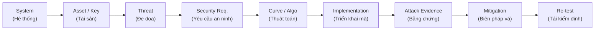
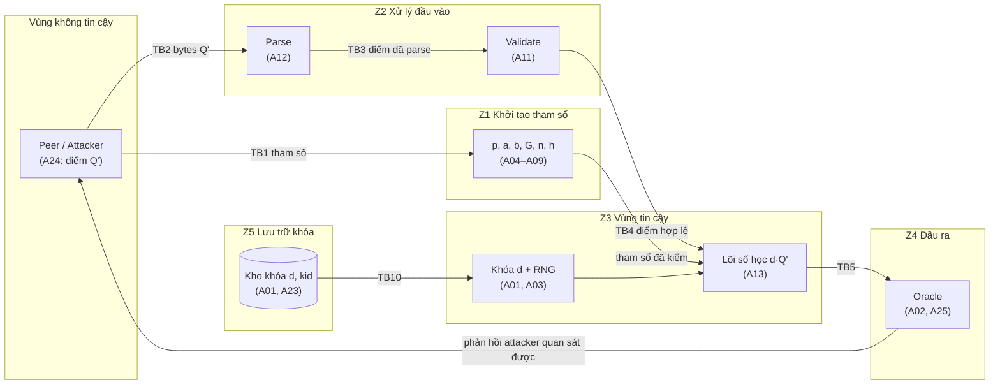
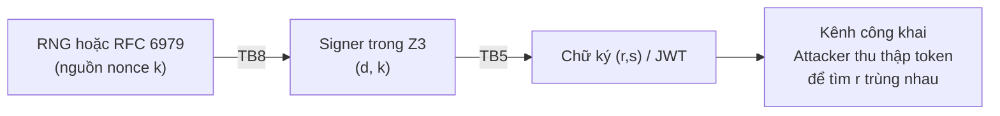
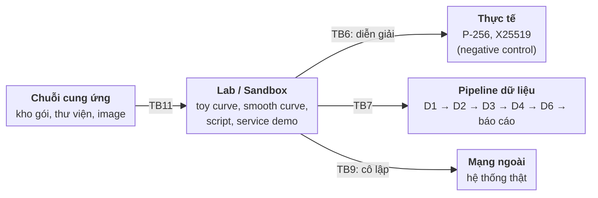
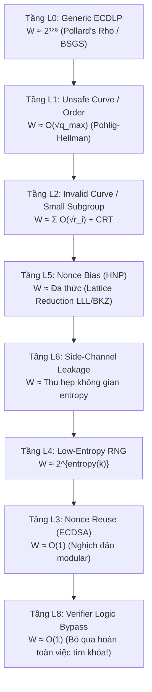

# Threat Model & Search Space Collapse Analysis
## Topic 14: ECC Cryptanalysis & Implementation Failure Engineering

> [!NOTE]
> **Thông Tin Tổng Quan Tài Liệu**
> - **Chủ đề nghiên cứu:** Topic 14 — Phân tích thám mã đường cong Elliptic (ECC) và các sai hỏng trong triển khai kỹ thuật.
> - **Cấu trúc tài liệu:**
>   - **PHẦN A (Task 1):** Mô hình hóa tài sản hệ thống, ranh giới tin cậy (Trust Boundaries) và mô hình kẻ tấn công.
>   - **PHẦN B (Task 3):** Khung định lượng và các tầng sụp đổ không gian tìm kiếm ($W_{\text{eff}}$ Collapse Hierarchy L0–L8).
> - **Phương pháp luận:** Áp dụng chuỗi liên kết nhân quả xuyên suốt từ tài sản $\to$ đe dọa $\to$ yêu cầu an ninh $\to$ thuật toán $\to$ bằng chứng thực nghiệm $\to$ giải pháp khắc phục $\to$ tái kiểm thử (Re-test).
> - **Đối chiếu tiêu chuẩn:** NIST SP 800-186, RFC 6090, FIPS 186-5, NIST SP 800-56A Rev. 3, RFC 6979, RFC 8032.

---

## Mục Lục
- [PHẦN A — Task 1: Tài Sản Hệ Thống, Ranh Giới Tin Cậy & Mô Hình Kẻ Tấn Công](#phần-a--task-1-tài-sản-hệ-thống-ranh-giới-tin-cậy--mô-hình-kẻ-tấn-công)
  - [A.1 Chuỗi Phân Tích Xuyên Suốt (Causal Analytical Chain)](#a1-chuỗi-phân-tích-xuyên-suốt-causal-analytical-chain)
  - [A.2 Hệ Thống Lab Thực Nghiệm (Systems Under Study)](#a2-hệ-thống-lab-thực-nghiệm-systems-under-study)
  - [A.3 Bảng Kiểm Kê Tài Sản Mật Mã (Asset Inventory)](#a3-bảng-kiểm-kê-tài-sản-mật-mã-asset-inventory)
  - [A.4 Bản Đồ Ranh Giới Tin Cậy (Trust Boundaries Architecture)](#a4-bản-đồ-ranh-giới-tin-cậy-trust-boundaries-architecture)
  - [A.5 Mô Hình Năng Lực Kẻ Tấn Công (Adversary Capabilities)](#a5-mô-hình-năng-lực-kẻ-tấn-công-adversary-capabilities)
  - [A.6 Ma Trận Phân Tích Mối Đe Dọa Theo Tài Sản (STRIDE Matrix)](#a6-ma-trận-phân-tích-mối-đe-dọa-theo-tài-sản-stride-matrix)
  - [A.7 Phạm Vi Ngoài Nghiên Cứu (Out-of-Scope Guardrails)](#a7-phạm-vi-ngoài-nghiên-cứu-out-of-scope-guardrails)
  - [A.8 Nhật Ký Quyết Định Kỹ Thuật & Câu Hỏi Mở](#a8-nhật-ký-quyết-định-kỹ-thuật--câu-hỏi-mở)
- [PHẦN B — Task 3: Các Tầng Sụp Đổ Không Gian Tìm Kiếm](#phần-b--task-3-các-tầng-sụp-đổ-không-gian-tìm-kiếm)
  - [B.1 Khung Định Lượng Độ Phức Tạp Hiệu Dụng $W_{\text{eff}}$](#b1-khung-định-lượng-độ-phức-tạp-hiệu-dụng-w_texteff)
  - [B.2 Bảng Phân Tầng Sụp Đổ Không Gian Tìm Kiếm (L0–L8)](#b2-bảng-phân-tầng-sụp-đổ-không-gian-tìm-kiếm-l0l8)
  - [B.3 Cơ Sở Toán Học Chi Tiết Cho Từng Tầng Sụp Đổ](#b3-cơ-sở-toán-học-chi-tiết-cho-từng-tầng-sụp-đổ)
  - [B.4 Bảng Ánh Xạ Tầng Sụp Đổ $\to$ Lỗ Hổng Thực Tế (CVE Catalog)](#b4-bảng-ánh-xạ-tầng-sụp-đổ--lỗ-hổng-thực-tế-cve-catalog)
  - [B.5 Khung Đánh Giá Thực Nghiệm & Lập Luận An Ninh (Before/After)](#b5-khung-đánh-giá-thực-nghiệm--lập-luận-an-ninh-beforeafter)
  - [B.6 Checklist Kiểm Định Tính Toàn Vẹn Của Mô Hình](#b6-checklist-kiểm-định-tính-toàn-vẹn-của-mô-hình)

---

# PHẦN A — Task 1: Tài Sản Hệ Thống, Ranh Giới Tin Cậy & Mô Hình Kẻ Tấn Công

## A.1 Chuỗi Phân Tích Xuyên Suốt (Causal Analytical Chain)

Mọi lập luận kỹ thuật, kịch bản khai thác và đánh giá rủi ro trong đề tài bắt buộc phải tuân thủ nghiêm ngặt chuỗi liên kết nhân quả 10 mắt xích:

> [!IMPORTANT]
> **Nguyên tắc đối chiếu:** Bất kỳ lỗ hổng hay cơ chế tấn công nào được đề cập trong báo cáo đều phải truy vết được ngược xuôi theo chuỗi trên. Không phân tích một lỗi triển khai (implementation bug) mà thiếu đi ngữ cảnh hệ thống, tài sản bị đe dọa hoặc bằng chứng thực nghiệm đối chứng.

---

## A.2 Hệ Thống Lab Thực Nghiệm (Systems Under Study)

Đề tài thiết lập 4 môi trường lab chuẩn hóa mô phỏng các ứng dụng thực tế của mật mã bất đối xứng dựa trên ECC:

| Mã ID | Ngữ Cảnh Ứng Dụng | Thành Phần Kiến Trúc | Thư Viện & Giao Thức Mật Mã | Đường Cong / Thuật Toán Sử Dụng |
| :---: | :--- | :--- | :--- | :--- |
| **S1** | **JWT / OIDC Service** `system-demos/jwt-es256/` | Token Signer (Issuer), Resource Server (Verifier), JWKS Endpoint | PyJWT, Authlib, JCC, OpenSSL | ECDSA P-256 (ES256), Ed25519 (EdDSA) |
| **S2** | **ECDH Key Exchange API** `system-demos/ecdh-api/` | Static-Key Microservice, Untrusted Client Peer | Custom Python Backend, PyCA Cryptography | Short Weierstrass (Toy & P-256), X25519 |
| **S3** | **Blockchain Node Regtest** `system-demos/blockchain-regtest/` | Local Wallet Signer, Core Node Engine, Mempool Verifier | Bitcoin-Core python-ecdsa, libsecp256k1 | ECDSA secp256k1 (Strict DER, Low-$S$) |
| **S4** | **SSH / Git Commit Signing** *(Mở rộng tuỳ chọn)* | SSH-Agent, Signing Key Storage, Host Auth Daemon | OpenSSH, PuTTY engine | ECDSA P-256 / P-521, Ed25519 |

---

## A.3 ASSETS

> [!NOTE]
> ***Liệt kê, phân nhóm và đánh giá mức độ ưu tiên của tài sản***

### Ký hiệu

| Ký hiệu | Công thức / Tính chất | Ý nghĩa |
|:-:|:-:|---|
| `p` | số nguyên tố   `p > 3` | Kích thước trường hữu hạn Fp |
| `a, b` | `y² = x³ + ax + b` | Hệ số đường cong |
| `G` | | Điểm sinh (base point) |
| `n` | số nguyên tố | Bậc của `G` |
| `#E` | `#E = p + 1 − t, \|t\| ≤ 2√p` | Số điểm của đường cong |
| `h` | `h = #E / n` | Cofactor |
| `O` | | Điểm vô cùng (phần tử đơn vị) |
| `d` | | Khóa bí mật |
| `Q` | `Q = d·G` | Khóa công khai |
| `Q'` | | Điểm do peer/attacker gửi tới, chưa được tin cậy |
| `rᵢ` | nguyên tố nhỏ | Ước nhỏ của bậc điểm (của `#E'` hoặc của `h`) |
| `k` | | Nonce của ECDSA |
| `(r, s)` | `r = x(k·G) mod n` | Chữ ký ECDSA |

### Thuộc tính cần bảo vệ

- **C** – Confidentiality (bí mật)
- **I** – Integrity (toàn vẹn)
- **A** – Availability (sẵn sàng; với dữ liệu thực nghiệm hiểu là *tái lập được và dùng được*)

### Bảng tài sản

| ID | Nhóm | Tài sản | Mô tả | C | I | A | Mức |
|---|---|---|---|:-:|:-:|:-:|:-:|
| A01 | Bí mật | Khóa bí mật `d` | Trong `Q = d·G`, là mục tiêu chính tấn công. Ở demo: khóa ký `d_sign` của service JWT (S1), khóa ECDH tĩnh `d_dh` của API server (S2) | ✔ | ✔ |  | Rất cao |
| A02 | Bí mật | Shared secret `d·Q'` và khóa phiên dẫn xuất | Kết quả ECDH, là thứ bị rò rỉ trong invalid-curve / small-subgroup attack. Với X25519, kết quả toàn 0 là dấu hiệu điểm bậc thấp, cần từ chối | ✔ | ✔ |  | Cao |
| A03 | Bí mật | Nguồn ngẫu nhiên (RNG) sinh `d`, ephemeral key và nonce `k` | RNG yếu thì đoán được `d` hoặc `k` mà không cần giải ECDLP. RFC 6979 là phương án xác định thay thế cho nonce ngẫu nhiên | ✔ | ✔ |  | Cao |
| A04 | Tham số | Số nguyên tố `p` | Phải là nguyên tố, `p > 3` |  | ✔ |  | Cao |
| A05 | Tham số | Hệ số `a, b`   Điều kiện   `4a³ + 27b² ≢ 0 (mod p)` | Đường cong không suy biến, kiểm tra trong Fp, không phải trên số thực |  | ✔ |  | Cao |
| A06 | Tham số | `#E` | Số điểm, kiểm tra theo định lý Hasse |  | ✔ |  | Cao |
| A07 | Tham số | Bậc `n` của `G` | Phải nguyên tố, `nG = O`, quyết định chi phí tấn công (`O(n)`, `O(√n)`) |  | ✔ |  | Cao |
| A08 | Tham số | Cofactor   `h = #E / n` | `h > 1` thì tồn tại nhóm con nhỏ, là điều kiện của small-subgroup attack |  | ✔ |  | Cao |
| A09 | Tham số | Điểm sinh `G` | Phải nằm trên đường cong và có bậc đúng bằng `n` |  | ✔ |  | Cao |
| A10 | Công khai | Khóa công khai   `Q = d·G` (kể cả dạng JWK) | Đầu vào của mọi tấn công ECDLP (cùng `G, n`), cần đảm bảo tính toàn vẹn. Với JWK: nếu `crv` hoặc khóa bị thay thế, verifier chấp nhận khóa của kẻ mạo danh |  | ✔ |  | Trung bình |
| A11 | Logic phòng thủ | Hàm validate điểm | Kiểm tra: tọa độ trong `[0, p)`, thuộc đường cong, khác `O`, `n·Q' = O`, xử lý cofactor |  | ✔ |  | Rất cao |
| A12 | Logic phòng thủ | Hàm parse điểm và đổi Affine ↔ Jacobian | Biên nhận dữ liệu từ ngoài, một điểm có nhiều biểu diễn   `(λ²X, λ³Y, λZ)`; `Z ≠ 0` |  | ✔ |  | Cao |
| A13 | Logic phòng thủ | Lõi số học (add / double / inverse / double-and-add) | Công thức cộng không dùng `b`, cần xử lý `P = Q`, `P = −P`, `P + O`, `y = 0` | ✔ | ✔ |  | Cao |
| A14 | Dữ liệu thực nghiệm | D1 – tập toy curve (n 16..40 bit) | `data/D1_curves.csv`, đầu vào chung cho các tấn công ECDLP |  | ✔ | ✔ | Trung bình |
| A15 | Dữ liệu thực nghiệm | D2 – benchmark ECDLP | `data/D2_ecdlp_benchmarks.csv` (ops, cycles, memory) của exhaustive / BSGS / Rho / PH, cần nhất quán để kết luận độ phức tạp |  | ✔ | ✔ | Trung bình |
| A16 | Dữ liệu thực nghiệm | D3, D4, D6 và `schema_definition.json` | D3 = `D3_signatures.csv`, D4 = `D4_validation.csv`, D6 = `D6_timing.csv`. Schema thống nhất giữa các thành viên |  | ✔ | ✔ | Trung bình |
| A17 | Dữ liệu thực nghiệm | Ground-truth `d` của toy curve | Khóa bí mật giả lập, chỉ dùng để kiểm chứng kết quả tấn công | ✔ | ✔ |  | Trung bình |
| A18 | Mã nguồn / môi trường | Script tấn công, seed, môi trường đo, phiên bản thư viện | Seed cố định, ghi và cố định (pin) phiên bản thư viện, image Docker, đo trong điều kiện nhất quán. BSGS tốn bộ nhớ `O(√n)` nên cần ghi RAM khi đo |  | ✔ | ✔ | Trung bình |
| A19 | Đối chứng | Tham số P-256 và X25519 (negative control) | P-256: `h = 1`, dạng Weierstrass. X25519: dạng Montgomery, cofactor 8, chỉ dùng tọa độ `x`, khác cách phòng thủ của Weierstrass |  | ✔ |  | Trung bình |
| A20 | Bí mật | Nonce `k` của ECDSA | `k` lặp hoặc đoán được thì khôi phục được `d` từ chữ ký. Tài sản trung tâm của Track C | ✔ | ✔ |  | Rất cao |
| A21 | Công khai | Chữ ký `(r, s)` và JWT token | Công khai nhưng là đầu vào của tấn công nonce reuse, cần đảm bảo tính nguyên vẹn. Verifier phải kiểm tra định dạng chuẩn của chữ ký |  | ✔ |  | Trung bình |
| A22 | Hệ thống demo | Service demo `jwt-es256`, `ecdh-api` (bản lỗi và bản vá) | Bản lỗi cố ý chứa lỗ hổng, chỉ chạy trong sandbox, bản vá là đối chứng |  | ✔ | ✔ | Trung bình |
| A23 | Quản lý khóa | Metadata vòng đời khóa (`kid`, thu hồi, key rotation) | Cấu hình quyết định verifier tin khóa nào. Nếu bị ép quay về khóa cũ hoặc khóa đã lộ thì khóa đó vẫn dùng được để giả mạo. Liên quan bản vá "RFC 6979 + Key Rotation" của S1 |  | ✔ | ✔ | Trung bình |
| A24 | Bề mặt tấn công | Dữ liệu đầu vào từ peer (điểm `Q'`) | Không phải bí mật nhưng là nguồn trực tiếp của invalid-curve và small-subgroup attack; mọi tính an toàn phụ thuộc việc xử lý đúng tại TB2, TB3 |  | ✔ |  | Cao |
| A25 | Bề mặt tấn công | Phản hồi lỗi của API (oracle) | Mã lỗi, thông báo lỗi, kết quả thành công/thất bại. Nếu phân biệt được bước validate bị vượt qua thì trở thành oracle. Thời gian phản hồi ngoài phạm vi (mục 7) |  | ✔ |  | Cao |

> [!attention]
> **Phân biệt chiến lược:**
> - **A01, A20** là "Crown Jewels" (bảo vật tối thượng): mục tiêu bảo vệ trọng yếu của toàn hệ thống.
> - **A21, A24, A25** không phải dữ liệu bí mật nhưng cấu thành **bề mặt tấn công**. Lỗ hổng tại các điểm này làm độ an toàn thực tế tụt xa so với mức lý thuyết của đường cong.

### Tài sản theo track

| Track | Tài sản chính |
|---|---|
| A – ECDLP | A04–A09, A10, A14, A15, A17, A18 |
| C – ECDSA nonce reuse | A01, A03, A20, A21, A23, A16 (D3), A22 (JWT) |
| D – Invalid-curve / subgroup | A01, A02, A08, A11, A12, A13, A24, A25, A16 (D4), A22 (ECDH API) |
| Đối chứng | A19 |

### Tài sản theo mức ưu tiên

| Mức | Tài sản |
|---|---|
| Rất cao | A01 (`d`), A11 (validate), A20 (nonce `k`) |
| Cao | A02, A03, A04, A05, A06, A07, A08, A09, A12, A13, A24, A25 |
| Trung bình | A10, A14, A15, A16, A17, A18, A19, A21, A22, A23 |

---

## A.4 Bản Đồ Ranh Giới Tin Cậy (Trust Boundaries Architecture)

> [!note]
> ***Xác định vùng, ranh giới và tài sản đi qua từng ranh giới***

### 1. Sơ đồ tổng thể

#### 1.1. Luồng chính (runtime)

#### 1.2. Luồng ký ECDSA (Track C)

#### 1.3. Vùng thực nghiệm (ngoài runtime)

### 2. Các vùng (zone)

| Vùng | Tên | Mức tin cậy | Chứa | Tài sản chính |
|---|---|---|---|---|
| U | Không tin cậy | Không tin | Peer, attacker, mạng, mọi dữ liệu đến từ ngoài | (không có, là nguồn mối đe dọa) |
| Z1 | Khởi tạo tham số | Tin có điều kiện (nếu tham số được kiểm hoặc cố định) | `p, a, b, G, n, h` | A04–A09 |
| Z2 | Xử lý đầu vào | Trung gian (biến dữ liệu chưa tin thành đã tin) | Parse, validate | A11, A12, A24 (đi qua) |
| Z3 | Vùng tin cậy | Cao nhất | `d`, RNG, nonce `k`, lõi số học | A01, A03, A13, A20 |
| Z4 | Đầu ra | Không tin (mọi thứ ra khỏi đây attacker đều thấy) | Shared secret, MAC, thông báo lỗi, thời gian, chữ ký `(r,s)` | A02 (khi lộ), A21, A25 |
| Z5 | Lưu trữ khóa | Tin cao, cần cô lập khỏi tiến trình khác | Kho khóa `d`, metadata `kid`, thông tin xoay khóa | A01 (lưu trữ), A23 |
| Lab | Phòng thí nghiệm / sandbox | Tin nội bộ, cô lập khỏi mạng ngoài | Toy curve, script, dữ liệu, service demo | A14–A19, A22 |

### 3. Phân tích từng ranh giới

- #### TB1: Tham số đường cong đi vào hệ thống (U → Z1)

**Mô tả:** Mọi tính chất an toàn suy ra từ `p, a, b, G, n, h`. Nếu attacker đề xuất hoặc sửa được tham số, họ chọn sẵn một đường cong yếu mà không cần phá thuật toán nào.

| Yếu tố | Vấn đề | Hệ quả |
|---|---|---|
| Nguồn tham số | Peer tự chọn curve (kể cả trường `crv` trong JWK/token), hoặc tham số bị sửa trên đường truyền | Ép sang curve yếu |
| `p` | Không phải số nguyên tố | Phép chia modulo không còn là trường, nhóm điểm mất cấu trúc |
| `Δ = 4a³ + 27b²` | `Δ ≡ 0 (mod p)`, kiểm trên Fp chứ không phải số thực | Đường cong suy biến, ECDLP dễ hơn nhiều |
| `#E` | Không khớp Hasse `\|#E − (p+1)\| ≤ 2√p`; hoặc có nhiều ước nguyên tố nhỏ (smooth) | Pohlig–Hellman giải theo từng ước nhỏ |
| `n`, `G` | `n` không nguyên tố; `nG ≠ O`; `G` có bậc nhỏ hơn `n` công bố | Kiểm subgroup ở TB3 sai theo |
| `h` | Bị khai thấp hơn thực tế | Nhóm con nhỏ lọt qua |

**Tài sản cần bảo vệ:** A04, A05, A06, A07, A08, A09 (toàn vẹn); A10 (gián tiếp, qua `crv` trong JWK)

**Biện pháp:** Dùng tham số cố định từ chuẩn (allow-list đường cong có tên, ghim `alg` và `crv`).
Nếu nhận tham số thì kiểm đủ:
- `p` nguyên tố
- `Δ ≢ 0`
- Hasse
- `n` nguyên tố
- `nG = O`
- `h = #E/n`

> [!attention]
> **Lưu ý:** Biên này **cố ý để hở** ở toy curve và smooth curve (yếu có chủ đích, phục vụ Track A)

---

- #### TB2: Bytes từ peer chuyển thành điểm (U → Parse)

**Mô tả:** Bytes nhận từ ngoài chưa phải là điểm. Đây là nơi lỗi biểu diễn xuất hiện, đặc biệt với Jacobian.

| Yếu tố | Vấn đề | Hệ quả |
|---|---|---|
| Khoảng giá trị | `x, y ∉ [0, p)` | Điểm không thuộc Fp, phép tính cho kết quả vô nghĩa |
| Mã hóa | Hai chuỗi bytes khác nhau cùng ánh xạ một điểm | So sánh, lọc điểm sai |
| Jacobian | Một điểm có nhiều biểu diễn `(λ²X, λ³Y, λZ)` | So từng thành phần cho kết quả sai |
| `Z = 0` | Điểm vô cùng `(λ², λ³, 0)` lọt qua | Chia cho `Z²` hỏng, hoặc nhận `O` làm khóa của peer |
| Chuyển đổi | Affine ↔ Jacobian sai (`x = X/Z²`, `y = Y/Z³`) | Điểm sau chuyển đổi lệch khỏi điểm gốc |

**Tài sản cần bảo vệ:**
- A12 (tính đúng của parse)
- A24 (dữ liệu đi qua biên này)
- A11 (gián tiếp, vì validate nhận đầu ra của parse)

**Biện pháp:**
- Kiểm range
- Mã hóa chuẩn duy nhất
- Từ chối hoặc xử lý riêng `Z = 0`
- Chuẩn hóa về Affine trước khi validate
- Từ chối `O` làm khóa công khai của peer

> [!tip]
**Test case gợi ý:** `x = p + 1`; `Z = 0`; `y = 0`; `−P` với `y = 0` (phải ra `(x, 0)`, không phải `(x, p)`).

---

- #### TB3: Validate điểm (Parse → Validate) — biên quan trọng nhất

**Mô tả:** Là chốt chặn duy nhất giữa dữ liệu không tin cậy và phép nhân với `d`. Công thức cộng và nhân đôi **không dùng `b`**: máy tính vẫn tính `d·Q'` trơn tru với điểm của đường cong `y² = x³ + ax + b'` bất kỳ, không báo lỗi.

| Tiêu chí | Invalid-curve attack | Small-subgroup attack |
|---|---|---|
| `Q'` nằm trên | Đường cong **khác** (cùng `a`, khác `b'`) | Đúng đường cong của bạn |
| Điều kiện cần | Validate thiếu kiểm phương trình | `h > 1` |
| `Q'` có bậc | `rᵢ` nhỏ, ước của `#E'` | `rᵢ` nhỏ, ước của `h` |
| Chặn bằng | Kiểm `y² ≡ x³ + ax + b (mod p)` | Kiểm `n·Q' = O`, hoặc nhân với `h` |

**Tóm tắt cơ chế:** Tính `d·Q'` với `Q'` bậc `rᵢ` nhỏ nên kết quả chỉ phụ thuộc `d mod rᵢ` → ghép nhiều `rᵢ` bằng CRT thì khôi phục `d`.

**Điểm tinh tế:** Kiểm on-curve chặn invalid-curve nhưng **không** chặn small-subgroup, vì điểm đó vẫn on-curve. Nếu `h = 1` thì mọi điểm on-curve đã thuộc nhóm bậc `n`, không còn nhóm con nhỏ.

> [!important]
> **Trọng tâm kiến trúc:** point validation và subgroup validation là **yêu cầu mật mã** (NIST SP 800-56A), không phải việc làm sạch đầu vào thông thường. Việc ngộ nhận "dữ liệu qua biên này đã sạch" là nguyên nhân của nhiều CVE, ví dụ CVE-2015-7940 (Bouncy Castle) và CVE-2016-9121 (go-jose). Danh mục đầy đủ xem Phần B (B.4).

**Tài sản cần bảo vệ:** A01, A02, A11, cùng A07 và A08 (`n`, `h` là đầu vào của bước kiểm).

**Biện pháp:**
Kiểm đủ chuỗi:
range → on-curve → khác `O` → `n·Q' = O` (hoặc nhân cofactor).
> [!important]
***Từ chối điểm sai thay vì "sửa".***

---

- #### TB4: Điểm đã hợp lệ đi vào lõi số học (Validate → Z3)

**Mô tả:** Sau validate, điểm được tin và nhân với `d`. Biên này bảo vệ độ đúng của lõi và tính bí mật của `d` trong lúc tính.

| Yếu tố | Vấn đề | Hệ quả |
|---|---|---|
| Công thức cộng | Quên rẽ nhánh `P = Q` (phải dùng công thức tiếp tuyến) | Chia cho 0 hoặc kết quả sai |
| Trường hợp biên | `P + (−P)`, `2P` với `y = 0` phải ra `O`; `P + O = P` | Kết quả sai ở các điểm đặc biệt |
| Nghịch đảo | `−P = (x, p − y)` sai khi `y = 0` | Ra giá trị `p` ngoài range |
| Double-and-add | Rẽ nhánh theo bit của `d` | Thời gian chạy lộ thông tin về `d` (side-channel, ngoài phạm vi, xem mục 7) |
| RNG | `d` hoặc ephemeral key không đủ ngẫu nhiên | Đoán được `d` mà không cần giải ECDLP |
| Dữ liệu `d` | `d` nằm trong log, lỗi, hoặc biến debug | Lộ trực tiếp |

**Tài sản cần bảo vệ:** A01, A03, A13.

**Biện pháp:**
- Xử lý mọi trường hợp biên
- Kiểm thử đối chiếu độc lập
- Không ghi `d` ra log

---

- #### TB5: Kết quả trả ra ngoài (Z3 → Oracle → Attacker)

**Mô tả:** Oracle là phần kết quả mà attacker quan sát được, là biến điều khiển lớn nhất của các thí nghiệm kiểm thử điểm invalid và small-subgroup. Với Track C, đây cũng là nơi chữ ký lộ ra ngoài.

| Oracle trả về | Thông tin mỗi lượt | Hệ quả |
|---|---|---|
| Shared secret `d·Q'` đầy đủ | `d mod rᵢ` trực tiếp | Mạnh nhất, tấn công nhanh nhất |
| MAC hoặc ciphertext | Dùng để kiểm một giá trị đoán `d mod rᵢ` | Thử tối đa `rᵢ` khả năng, vẫn khả thi |
| Chỉ thành công/thất bại hoặc mã lỗi | Khoảng 1 bit | Cần nhiều truy vấn hơn |
| Thông báo lỗi phân biệt (sai range / sai curve / sai bậc) | Cho attacker biết bước validate nào bị vượt qua | Giúp dò logic phòng thủ |
| Thời gian phản hồi | Phụ thuộc cài đặt | Side-channel, ngoài phạm vi |
| Chữ ký `(r, s)` / JWT | Hai chữ ký có cùng `r` thì lộ `k`, rồi lộ `d` | Khôi phục khóa ký (Track C) |
| Số truy vấn không bị giới hạn | Attacker gửi lặp không bị chặn | Thu đủ thặng số `d mod rᵢ`; số truy vấn là thước đo ghi vào D6 |

**Tài sản cần bảo vệ:** A01, A02, A21, A25.

**Biện pháp:**
- Trả lỗi đồng nhất (một mã lỗi duy nhất cho mọi trường hợp validate thất bại)
- Không lộ raw shared secret
- Dùng khóa ephemeral hoặc từ chối khi validate thất bại
- Giới hạn tốc độ và số truy vấn trên mỗi khách (làm chậm tấn công, không thay thế validate)

---

- #### TB6: Toy curve và curve chuẩn (Lab ↔ Thực tế)

**Mô tả:** Không phải biên kỹ thuật mà là biên **diễn giải kết quả**. Toy curve và smooth curve yếu có chủ đích; P-256 và X25519 là mức an toàn thực.

| Yếu tố | Vấn đề | Hệ quả |
|---|---|---|
| Phạm vi kết luận | Báo cáo không tách toy khỏi chuẩn | Bị hiểu thành "ECC không an toàn" |
| Negative control | Chỉ chạy tấn công mà không chạy đối chứng | Không chứng minh được lỗ hổng nằm ở triển khai |
| P-256 | `h = 1`, nên kiểm on-curve và `n·Q' = O` là đủ | Dùng làm đối chứng cho Weierstrass |
| X25519 | Montgomery, cofactor 8, chỉ trao đổi tọa độ `x` | Cách phòng thủ khác Weierstrass (clamping khóa, xử lý điểm bậc thấp, twist) |

**Tài sản cần bảo vệ:** A19 (tham số curve chuẩn, toàn vẹn), và tính đúng đắn của kết luận.

> [!Attention]
**Lưu ý:** Tấn công thành công là do curve yếu có chủ đích, triển khai thiếu validate; negative control cho thấy triển khai đúng thì không rò rỉ.

---

- #### TB7: Pipeline dữ liệu (Lab nội bộ)

**Mô tả:** Liên quan **tái lập kết quả**, không liên quan bí mật. Luồng theo checklist: D1 (toy curve) → D2 (benchmark) → D3 → D4 → D6 → báo cáo. Schema chung chốt ở T2.

| Yếu tố | Vấn đề | Hệ quả |
|---|---|---|
| Seed | Không cố định khi sinh toy curve | Không tái lập được D1 |
| Môi trường đo | Phần cứng, tải máy, phiên bản thay đổi | Nhiễu làm lẫn `O(n)` và `O(√n)` |
| Số lần đo | Đo một lần | Kết luận độ phức tạp thiếu tin cậy |
| Schema | Cột, kiểu dữ liệu không thống nhất | Phân tích sai |
| Ground-truth `d` | Lẫn vào dữ liệu công khai khi chạy tấn công | Tấn công "nhìn thấy" đáp án |

**Tài sản cần bảo vệ:** A14, A15, A16, A17, A18.

**Biện pháp:**
- Cố định seed, ghi phiên bản thư viện và phần cứng
- Đo nhiều lần lấy trung vị
- Tách ground-truth khỏi dữ liệu đưa cho script tấn công
- Dữ liệu khớp `schema_definition.json`

---

- #### TB8: Nguồn nonce vào Signer (RNG / RFC 6979 → Z3)

**Mô tả:** Ranh giới riêng của Track C: bí mật `d` không bị phá bằng ECDLP mà bằng việc `k` lặp hoặc đoán được.

| Yếu tố | Vấn đề | Hệ quả |
|---|---|---|
| `k` cố định hoặc lặp | Hai chữ ký cùng `k` thì cùng `r` | Giải được `k`, rồi `d` |
| RNG yếu | `k` đoán được | Khôi phục `d` từ một chữ ký |
| RFC 6979 | Nonce xác định từ `d` và thông điệp | Không lặp với thông điệp khác nhau; là bản vá |
| Signer thí nghiệm | Cố ý đặt `k` cố định để minh họa lỗ hổng | Phải đánh dấu rõ là lỗ hổng có chủ đích |

**Tài sản cần bảo vệ:** A20, A03, A01.

**Biện pháp:**
- Dùng RFC 6979 hoặc CSPRNG
- Không ghi `k` ra log
- Có bước phát hiện `r` trùng nhau trên tập chữ ký

---

- #### TB9: Sandbox demo ↔ môi trường ngoài (Lab → Mạng ngoài)

**Mô tả:** Biên cô lập và đạo đức: hai service demo cố ý có lỗ hổng, không được ảnh hưởng hệ thống thật.

| Yếu tố | Vấn đề | Hệ quả |
|---|---|---|
| Phơi service lỗi ra mạng | `ecdh-api`, `jwt-es256` bản lỗi truy cập được từ ngoài | Bị khai thác thật |
| Tái dùng khóa | Khóa/token demo trùng khóa ở hệ thống thật | Lộ khóa thật |
| Đích của script tấn công | Script trỏ nhầm sang hệ thống không thuộc nhóm | Vi phạm phạm vi cho phép |
| Bản vá | Bản vá không được re-test | Kết luận "đã vá" không có bằng chứng |

**Tài sản cần bảo vệ:** A22, A01 (khóa demo), A18.

**Biện pháp:**
- Chạy trong Docker/sandbox, bind `localhost`
- Khóa demo sinh riêng
- Script chỉ nhắm đích cấu hình sẵn
- Re-test bản vá

---

- #### TB10: Lưu trữ và vòng đời khóa (Z3 ↔ Z5)

**Mô tả:** Biên giữa lõi mật mã và nơi giữ khóa dài hạn (tệp, biến môi trường, tiến trình khác), cùng vòng đời khóa (`kid`, thu hồi, xoay khóa). Khóa nằm sai chỗ thì kẻ tấn công lấy được mà không cần tấn công mật mã.

| Yếu tố | Vấn đề | Hệ quả |
|---|---|---|
| Nơi lưu khóa | `d` nằm trong mã nguồn, tệp cấu hình hoặc biến môi trường dễ đọc | Lộ trực tiếp |
| Bộ nhớ tiến trình | Khóa, nonce còn trong bộ nhớ sau khi dùng; tiến trình khác đọc được | Đọc trộm, dump tiến trình |
| Log và debug | `d`, `k` ghi ra log hoặc thông báo lỗi | Lộ trực tiếp |
| Vòng đời khóa | Verifier vẫn chấp nhận khóa cũ hoặc đã lộ; `kid` không được ghim | Khóa đã lộ vẫn dùng để giả mạo; bị ép quay về khóa cũ |

**Tài sản cần bảo vệ:** A01, A23 (chính); A02, A20 (gián tiếp, vì nằm trong bộ nhớ tiến trình).

**Biện pháp:**
- Tách khóa khỏi mã nguồn, không commit khóa demo
- Không ghi `d`, `k` ra log
- Xoay khóa (key rotation) và ghim `kid` ở bản vá
- Đề xuất theo file mẫu: giả lập HSM bằng tiến trình riêng qua Unix Domain Socket (cần xác nhận)

> [!attention]
> **Lưu ý:** Python không đảm bảo xóa khóa khỏi bộ nhớ sau khi dùng; ghi nhận là rủi ro còn dư.

---

- #### TB11: Chuỗi cung ứng (Kho gói công cộng → Lab)

**Mô tả:** Thư viện và image đi vào môi trường lab. Biên này ảnh hưởng **tái lập** và **tính đúng của kết luận**, vì nhiều lỗ hổng chỉ tồn tại ở một số phiên bản.

| Yếu tố | Vấn đề | Hệ quả |
|---|---|---|
| Phiên bản thư viện | Không cố định (pin) | Kết quả khác nhau giữa các lần cài; kết luận về lỗ hổng sai |
| Thư viện có lỗi đã biết | Bản lab vô tình dùng thư viện có CVE chưa vá | Lỗ hổng ngoài ý muốn lẫn với lỗ hổng cố ý |
| Image nền | Image Docker thay đổi theo thời gian | Không tái lập được trên môi trường sạch |

**Tài sản cần bảo vệ:** A18 (chính); A22 (gián tiếp).

**Biện pháp:**
- Pin phiên bản (requirements/lock file), cố định image Docker
- Ghi phiên bản thư viện vào kết quả đo
- Đối chiếu CVE của thư viện trước khi dùng cho negative control

### 4. Ma trận tài sản × ranh giới

● = Bảo vệ chính tại biên đó
○ = Liên quan gián tiếp

| Tài sản | TB1 | TB2 | TB3 | TB4 | TB5 | TB6 | TB7 | TB8 | TB9 | TB10 | TB11 |
|---|:-:|:-:|:-:|:-:|:-:|:-:|:-:|:-:|:-:|:-:|:-:|
| A01 Khóa bí mật `d` | | | ● | ● | ● | | | ○ | ○ | ● | |
| A02 Shared secret / khóa phiên | | | ● | ○ | ● | | | | | ○ | |
| A03 RNG | | | | ● | | | | ● | | | |
| A04 `p` | ● | | | | | | | | | | |
| A05 `a, b`, điều kiện `Δ` | ● | | ○ | | | | | | | | |
| A06 `#E` | ● | | | | | | | | | | |
| A07 `n` | ● | | ○ | | | | | | | | |
| A08 `h` | ● | | ○ | | | | | | | | |
| A09 `G` | ● | | | | | | | | | | |
| A10 `Q` công khai / JWK | ○ | ○ | | | | | | | | | |
| A11 Hàm validate | | ○ | ● | | | | | | | | |
| A12 Parse / Affine ↔ Jacobian | | ● | ○ | | | | | | | | |
| A13 Lõi số học | | | | ● | | | | | | | |
| A14 D1 | | | | | | | ● | | | | |
| A15 D2 | | | | | | | ● | | | | |
| A16 D3, D4, D6, schema | | | | | | | ● | | | | |
| A17 Ground-truth `d` | | | | | ○ | | ● | | | | |
| A18 Script, seed, môi trường | | | | | | | ● | | ○ | | ● |
| A19 Curve chuẩn (đối chứng) | | | | | | ● | | | | | |
| A20 Nonce `k` | | | | ○ | ○ | | | ● | | ○ | |
| A21 Chữ ký `(r,s)`, JWT | | | | | ● | | ○ | ○ | | | |
| A22 Service demo | | | | | ○ | | | | ● | | ○ |
| A23 Metadata vòng đời khóa | | | | | | | | | | ● | |
| A24 Điểm `Q'` từ peer | | ● | ○ | | | | | | | | |
| A25 Phản hồi lỗi (oracle) | | | | | ● | | | | | | |

**Nhận xét:**
- `d` (A01) được bảo vệ tại ba biên liên tiếp TB3, TB4, TB5, tại TB10 (nơi lưu trữ) và gián tiếp tại TB8 (qua nonce); chỉ cần một biên hỏng là khóa có thể lộ, nên cần "phòng thủ nhiều lớp".
- TB3 có nhiều tài sản phụ thuộc nhất (A01, A02, A05, A07, A08, A11, A12, A24), nên lỗi ở đây ảnh hưởng lớn nhất.
- TB1 phụ thuộc việc tham số có được kiểm hay không; ở toy curve biên này bị bỏ ngỏ có chủ đích.
- TB7, TB9 và TB11 không bảo vệ bí mật mà bảo vệ độ tin cậy của kết luận và an toàn khi trình diễn.

### 5. Mô hình kẻ tấn công (Adversary)

| Mã | Vị trí và phương thức | Năng lực | Dữ liệu quan sát được | Ranh giới liên quan | Phạm vi |
|:-:|---|---|---|---|:-:|
| **ATK-1** | Remote, thụ động | Nghe lén lưu lượng công khai, thu thập chữ ký số phát hành | Các bộ `(rᵢ, sᵢ, H(mᵢ))`, token JWT, public key | TB5, TB8 | Trong |
| **ATK-2** | Remote, chủ động (oracle) | Gửi điểm tùy ý hoặc token sai định dạng tới API | Mã phản hồi, thông điệp lỗi (thời gian phản hồi: ngoài phạm vi) | TB1, TB2, TB3, TB5 | Trong |
| **ATK-3** | Local co-tenant | Chạy tiến trình cùng máy, đo vi kiến trúc (cache, cycles) | Phân phối chu kỳ CPU, tranh chấp cache | TB4 | Ngoài |
| **ATK-4** | Vật lý (tùy chọn) | Đo năng lượng hoặc sóng điện từ trên vi điều khiển | Dấu vết điện thế khi nhân vô hướng | TB4 | Ngoài |
| **ATK-5** | Kiểm toán chuỗi cung ứng | Phân tích mã nguồn và đồ thị phụ thuộc | Danh mục CVE, mã nguồn upstream, lịch sử commit | TB11 | Trong (chỉ phân tích) |

**Giới hạn của từng kẻ tấn công:**
- ATK-1: không can thiệp đường truyền, không sửa gói tin, không truy cập bộ nhớ.
- ATK-2: không tấn công từ chối dịch vụ (DoS), không nhắm vào hệ thống ngoài phòng lab.
- ATK-5: không khai thác lỗ hổng 0-day chưa vá trên thực tế.

### 6. Ma trận mối đe dọa theo tài sản (STRIDE)

| Tài sản | Mối đe dọa | STRIDE | Yêu cầu an toàn | Biện pháp |
|:-:|---|:-:|---|---|
| A01, A20 | Khôi phục khóa riêng từ các chữ ký dùng chung nonce | Information Disclosure | Nonce `k` duy nhất và không đoán được | RFC 6979 hoặc CSPRNG; bộ phát hiện `r` trùng nhau |
| A01 | Dùng khóa đã khôi phục để giả mạo JWT admin | Spoofing | Khóa ký chỉ do server nắm giữ | Xoay khóa, thu hồi khóa cũ, re-test bản vá |
| A01, A02 | Khôi phục `d mod rᵢ` qua điểm giả mạo (invalid-curve) | Information Disclosure | Kiểm tra điểm của peer trước khi tính | Kiểm on-curve và subgroup, từ chối điểm sai |
| A04–A09 | Bị ép dùng đường cong tự tạo có cấp trơn hoặc kỳ dị | Tampering | Chỉ dùng đường cong chuẩn có tên | Allow-list đường cong; kiểm `Δ ≢ 0 (mod p)` |
| A10 | Thay khóa công khai hoặc đổi `crv` trong token | Spoofing | Xác thực nguồn khóa và tương thích đường cong | Ghim `alg` và `crv` |
| A23 | Ép hệ thống quay về dùng khóa cũ hoặc đã lộ | Tampering | Verifier chỉ tin khóa còn hiệu lực | Ghim `kid`, thu hồi khóa, key rotation |
| A25 | Thông điệp lỗi tiết lộ bước validate nào bị vượt qua | Information Disclosure | Phản hồi lỗi đồng nhất, không rò rỉ trạng thái | Một mã lỗi duy nhất, giới hạn số truy vấn |
| A18 | Triển khai thư viện chứa CVE chưa được khắc phục | Elevation of Privilege | Quản lý phụ thuộc chặt chẽ | Pin phiên bản, đối chiếu CVE, Docker cố định |

STRIDE: **S**poofing, **T**ampering, **R**epudiation, **I**nformation Disclosure, **D**enial of Service, **E**levation of Privilege. Hai loại Repudiation và DoS chưa có dòng nào vì không thuộc Track A, C, D.

### 7. Các vấn đề ngoài phạm vi

> [!Attention]
> - Side-channel thời gian và cache (liên quan đến constant-time; tương ứng ATK-3, ATK-4).
> - Tấn công vật lý, tấn công lên hạ tầng mạng/TLS, lỗi nội tại của thư viện chuẩn (chỉ ghi nhận và cố định phiên bản, xem TB11).
> - Hiệu năng tuyệt đối trên phần cứng thật (chỉ đo lường tương đối trên cùng cấu hình).
> - **Không tuyên bố phá các đường cong chuẩn** (P-256, X25519, secp256k1): chúng là mẫu đối chứng âm (negative control) để cho thấy triển khai đúng thì an toàn.
> - **Không tấn công môi trường thực tế:** không thử nghiệm trên mạng công khai, endpoint JWT thương mại hoặc khóa production; script chỉ nhắm đích lab đã cấu hình sẵn.
> - **Không tấn công từ chối dịch vụ (DoS)** lên service demo.
> - **Không khai thác 0-day chưa vá** trên thực tế.
> - **Tấn công lượng tử** (thuật toán Shor giải ECDLP trong thời gian đa thức trên máy lượng tử lý thuyết) được ghi nhận là xu hướng tương lai, nằm ngoài thực nghiệm của đề tài.

---

## A.8 Nhật Ký Quyết Định Kỹ Thuật & Câu Hỏi Mở

- [x] **Chọn ngữ cảnh lab:** Chốt thực hiện tối thiểu 2 ngữ cảnh: **S1 (JWT ES256)** và **S2 (ECDH API)**, kèm mô-đun mở rộng **S3 (Blockchain secp256k1)**.
- [x] **Mô hình cô lập khóa TB5:** Sử dụng tiến trình riêng biệt giả lập HSM thông qua Unix Domain Socket / IPC cục bộ để đảm bảo ranh giới cô lập bộ nhớ rõ ràng.
- [x] **Danh mục CVE:** Chốt danh mục tối thiểu 8 CVE kinh điển bao quát toàn bộ các tầng từ L2 đến L8 (xem chi tiết tại Mục B.4).

---

# PHẦN B — Task 3: Các Tầng Sụp Đổ Không Gian Tìm Kiếm

## B.1 Khung Định Lượng Độ Phức Tạp Hiệu Dụng $W_{\text{eff}}$

Trong mật mã học đường cong Elliptic, bài toán gốc bảo vệ hệ thống là tìm khóa bí mật $d \in \mathbb{Z}_n^*$ từ điểm công khai $Q = [d]G$, trong đó $G$ có cấp nguyên tố $n$.

Khác với quan niệm sai lầm phổ biến cho rằng "độ an toàn bằng độ dài khóa", thuật toán vét cạn tuần tự (Brute Force) không bao giờ là thước đo an toàn thực tế:

$$\begin{aligned}
W_{\text{brute}} &\approx n \quad \left(\text{Kỳ vọng } \frac{n}{2} \text{ phép tính điểm}\right) \\
W_{\text{BSGS}} &\approx \mathcal{O}(\sqrt{n}) \text{ thời gian} + \mathcal{O}(\sqrt{n}) \text{ bộ nhớ} \\
W_{\rho} &\approx \sqrt{\frac{\pi n}{2}} \approx 1.2533 \sqrt{n} = \mathcal{O}(\sqrt{n}) \text{ thời gian}, \quad \mathcal{O}(1) \text{ bộ nhớ}
\end{aligned}$$

Với một đường cong 256-bit chuẩn ($n \approx 2^{256}$):
$$W_{\text{generic}} = W_\rho \approx 2^{128} \text{ phép toán (Mức an toàn 128-bit)}$$

Tuy nhiên, trong một hệ sinh thái triển khai thực tế, độ phức tạp thực sự để kẻ tấn công bẻ gãy hệ thống — gọi là **Độ Phức Tạp Hiệu Dụng ($W_{\text{eff}}$)** — được định nghĩa bởi mắt xích yếu nhất trong chuỗi triển khai:

$$W_{\text{eff}} = \min \left\{ W_{\text{ECDLP}}, W_{\text{curve}}, W_{\text{nonce}}, W_{\text{oracle}}, W_{\text{sidechannel}}, W_{\text{fault}}, W_{\text{verifier}} \right\}$$

Khi một sai hỏng kỹ thuật xuất hiện, $W_{\text{eff}}$ sụp đổ từ mức an toàn $2^{128}$ xuống các mức độ phức tạp rất nhỏ, cho phép kẻ tấn công thu hồi khóa bí mật trong thời gian thực.

---

## B.2 Bảng Phân Tầng Sụp Đổ Không Gian Tìm Kiếm (L0–L8)

| Tầng | Định Danh Tầng | Cơ Chế Thu Hẹp / Phá Vỡ Độ Phức Tạp | Điều Kiện Tiên Quyết Để Khai Thác | Độ Phức Tạp Trước $\to$ Sau Sụp Đổ | Mức Độ Tác Động Thực Tế | Track |
| :---: | :--- | :--- | :--- | :---: | :--- | :---: |
| **L0** | **Generic ECDLP** | Thuật toán Pollard's Rho thay thế quét vét cạn $n$ | Không cần điều kiện (Luôn đúng với mọi nhóm) | $\mathcal{O}(n) \longrightarrow \mathcal{O}(\sqrt{n})$ | Xác lập trần an toàn thiết kế (128-bit an toàn cho curve 256-bit) | **A** |
| **L1** | **Unsafe Curve / Order** | Cấp trơn $\implies$ Pohlig–Hellman; Anomalous $\implies$ Smart; Cấp xoắn yếu $\implies$ Twist attack | Tham số do đối phương tự cấu hình hoặc thư viện legacy | $\mathcal{O}(\sqrt{n}) \longrightarrow \mathcal{O}(\sqrt{q_{\max}})$ hoặc Đa thức $\mathcal{O}(\log^3 p)$ | Phá hủy an toàn mật mã từ **cấp độ tham số toán học** | **B** |
| **L2** | **Invalid-Curve / Small-Subgroup** | Gửi điểm sai đường cong có cấp nhỏ $r_i$, kết hợp CRT khôi phục khóa | Thư viện thiếu validate tại ranh giới TB2; có Oracle phản hồi | $\mathcal{O}(\sqrt{n}) \longrightarrow \sum_{i} \mathcal{O}(\sqrt{r_i}) + \text{CRT}$ | Lộ từng phần khóa bí mật $d_{\text{dh}} \pmod{r_i} \to$ Lộ toàn bộ | **D** |
| **L3** | **ECDSA Nonce Reuse** | Dùng chung một nonce $k$ cho 2 thông điệp khác nhau $\implies$ Giải hệ tuyến tính | Cùng giá trị $r$ xuất hiện trên hai chữ ký (`repeated_r`) | $\mathcal{O}(\sqrt{n}) \longrightarrow \mathcal{O}(1)$ (Vài phép nhân nghịch đảo) | **Khôi phục ngay lập tức khóa riêng $d_{\text{sign}}$** | **C** |
| **L4** | **Low-Entropy Nonce** | Bộ sinh số ngẫu nhiên bị lỗi, không gian nonce $k$ nhỏ | CSPRNG thiếu entropy khởi tạo, seed lỗi thời | $\mathcal{O}(\sqrt{n}) \longrightarrow 2^{\text{entropy}(k)}$ | Vét cạn không gian khóa nonce $\implies$ Lộ khóa riêng | **C** |
| **L5** | **Biased / Partial Nonce (HNP)** | Mỗi chữ ký làm rò rỉ một vài bit của nonce $k \implies$ Quy về Hidden Number Problem | Thu thập đủ $m$ chữ ký có bias bit cao/thấp | $\mathcal{O}(\sqrt{n}) \longrightarrow \text{Đa thức theo } m \text{ (LLL/BKZ)}$ | Khôi phục khóa riêng từ vài chục chữ ký (PuTTY CVE-2024-31497) | **E** |
| **L6** | **Side-Channel Timing** | Thời gian thực thi phụ thuộc vào trọng số Hamming hoặc độ dài của $k, d$ | Khả năng đo đạc độ trễ mạng hoặc cycles cục bộ | Thu hẹp entropy còn $\frac{n}{2^{\text{leak}}}$ | Cung cấp mẫu bias cho tầng L5 (OpenSSL CVE-2024-13176) | **F** |
| **L7** | **Fault Attack** | Kích hoạt lỗi phần cứng trong quá trình tính toán để tạo quan hệ đại số | Khả năng can thiệp vật lý (tia laser, sụt áp) | $\mathcal{O}(\sqrt{n}) \longrightarrow$ Giải phương trình đại số | Thu hồi khóa qua sai phân giữa chữ ký chuẩn và chữ ký lỗi | *(MSc)* |
| **L8** | **Verifier Bug** | Trình xác thực chấp nhận đối tượng chữ ký dị dạng hoặc non-canonical | Lỗ hổng kiểm tra điều kiện biên của parser/verifier | $\mathcal{O}(\sqrt{n}) \longrightarrow \mathcal{O}(1)$ (**Bỏ qua hoàn toàn việc tìm khóa**) | Mạo danh chữ ký hợp lệ mà không cần biết khóa riêng! | **G** |

> [!NOTE]
> **Phân biệt rạch ròi giữa L1 và L2:**
> - **Tầng L1 (Unsafe Parameters):** Bản thân đường cong hoặc điểm cơ sở $G$ được lựa chọn mang cấu trúc toán học suy biến (ước nguyên tố lớn nhất $q_{\max}$ quá nhỏ, hoặc $\Delta \equiv 0$).
> - **Tầng L2 (Implementation Validation Failure):** Bản thân đường cong mục tiêu (như NIST P-256) là hoàn toàn an toàn và vững chắc, nhưng **mã nguồn triển khai của thư viện bỏ qua khâu kiểm tra điểm** tại ranh giới TB2, cho phép đối phương ép thiết bị tính toán trên một đường cong ngoại lai $E'$. Đường cong chuẩn không hề bị yếu đi.

---

## B.3 Cơ Sở Toán Học Chi Tiết Cho Từng Tầng Sụp Đổ

### B.3.1 Tầng L0 — Generic Search (Baseline đối chứng)
- Thuật toán Pollard's Rho phân hoạch nhóm thành 3 tập con và sử dụng hàm bước đi giả ngẫu nhiên.
- Mối quan hệ giữa số phép toán thực nghiệm $N_{\text{ops}}$ và cấp nhóm $n$ trên hệ tọa độ Log-Log biểu diễn qua độ dốc lý thuyết:
  $$\text{Slope} = \frac{\Delta \log_2 (N_{\text{ops}})}{\Delta \log_2 (n)} \approx 0.5 \quad \text{(So với Exhaustive Search có Slope } \approx 1.0\text{)}$$

### B.3.2 Tầng L1 — Unsafe Order (Thuật toán Pohlig–Hellman)
Giả sử cấp của điểm cơ sở $n = \operatorname{ord}(G)$ bị phân rã hoàn toàn thành các thừa số nguyên tố nhỏ:
$$n = \prod_{i=1}^k q_i^{e_i}$$

Thuật toán Pohlig–Hellman rút gọn việc giải ECDLP trên nhóm cấp $n$ về việc giải các bài toán cục bộ trên các nhóm con cấp nguyên tố $q_i$:
$$W_{\text{PH}} \approx \sum_{i=1}^k e_i \left( \log_2 n + \sqrt{q_i} \right) \implies W_{\text{eff}} \approx \mathcal{O}\left(\sqrt{q_{\max}}\right)$$

Khi một đường cong có $q_{\max} \le 2^{40}$, việc bẻ gãy khóa riêng diễn ra trong vài giây, bất kể tổng độ dài $n$ có thể lên tới 256 bit.

### B.3.3 Tầng L2 — Invalid-Curve / Small-Subgroup
Xét công thức cộng và nhân đôi điểm trên dạng Short Weierstrass:
$$\lambda = \frac{y_2 - y_1}{x_2 - x_1} \pmod p \quad \text{hoặc} \quad \lambda = \frac{3x_1^2 + a}{2y_1} \pmod p$$
$$x_3 = \lambda^2 - x_1 - x_2 \pmod p, \quad y_3 = \lambda(x_1 - x_3) - y_1 \pmod p$$

Do công thức **hoàn toàn độc lập với hệ số $b$**, nếu một điểm $P' = (x', y')$ thỏa mãn $y'^2 \equiv x'^3 + ax' + b' \pmod p$ với $b' \neq b$, phép tính nhân vô hướng $[d]P'$ sẽ diễn ra hoàn toàn trên đường cong $E': y^2 = x^3 + ax + b'$.

Kẻ tấn công chọn các đường cong $E'$ có cấp chứa các thừa số nguyên tố nhỏ $r_1, r_2, \dots, r_m$:
1. Gửi điểm $P_i \in E'(\mathbb{F}_p)$ có cấp đúng bằng $r_i$ ($[r_i]P_i = \mathcal{O}$).
2. Máy chủ tính và phản hồi kết quả $S_i = [d_{\text{dh}}]P_i = [d_{\text{dh}} \bmod r_i]P_i$.
3. Kẻ tấn công vét cạn trong phạm vi $j \in [0, r_i - 1]$ để tìm nghiệm:
   $$d_{\text{dh}} \equiv d_i \pmod{r_i}$$
4. Sau khi thu thập đủ các số dư với $\prod_{i=1}^m r_i \ge n$, áp dụng Định lý Số Dư Trung Hoa (CRT):
   $$d_{\text{dh}} \equiv \sum_{i=1}^m d_i M_i \left(M_i^{-1} \bmod r_i\right) \pmod{\prod_{i=1}^m r_i}, \quad \text{với } M_i = \frac{\prod_{j=1}^m r_j}{r_i}$$

Tổng chi phí truy vấn chỉ là:
$$\text{Total Queries} \approx \sum_{i=1}^m r_i \ll n$$

---

### B.3.4 Tầng L3 — Nonce Reuse trong ECDSA (Sụp đổ đại số tức thì)

Quy trình ký ECDSA chuẩn cho thông điệp $m$ với hàm băm $H$:
1. Chọn nonce ngẫu nhiên $k \in_R \mathbb{Z}_n^*$.
2. Tính điểm $R = [k]G = (x_R, y_R)$ và lấy tọa độ $r \equiv x_R \pmod n$.
3. Tính chữ ký $s \equiv k^{-1}\left(H(m) + d_{\text{sign}} \cdot r\right) \pmod n$.

**Kịch bản sự cố:** Nếu cùng một nonce $k$ được dùng lại để ký hai thông điệp khác nhau $m_1$ và $m_2$ ($H_1 \not\equiv H_2 \pmod n$):
Do cùng $k$, hai chữ ký sẽ có **cùng thành phần $r$**:
$$s_1 \equiv k^{-1}\left(H_1 + d_{\text{sign}} \cdot r\right) \pmod n$$
$$s_2 \equiv k^{-1}\left(H_2 + d_{\text{sign}} \cdot r\right) \pmod n$$

Trừ hai phương trình vế theo vế:
$$s_1 - s_2 \equiv k^{-1}\left(H_1 - H_2\right) \pmod n$$

Giả sử $s_1 \not\equiv s_2 \pmod n$, kẻ tấn công khôi phục ngay lập tức nonce $k$:
$$k \equiv \left(H_1 - H_2\right) \cdot \left(s_1 - s_2\right)^{-1} \pmod n$$

Sau khi đã có $k$, khóa riêng $d_{\text{sign}}$ được tính trực tiếp từ chữ ký thứ nhất:
$$d_{\text{sign}} \equiv \left(s_1 \cdot k - H_1\right) \cdot r^{-1} \pmod n$$

> [!WARNING]
> Độ phức tạp của cuộc tấn công này là $\mathcal{O}(1)$ — chỉ bao gồm 2 phép nghịch đảo modular và vài phép nhân cộng cơ bản trên $\mathbb{Z}_n$. Toàn bộ hệ thống sụp đổ trong chưa đầy 1 mili-giây.

---

### B.3.5 Tầng L5 — Biased Nonce & Hidden Number Problem (HNP)

Nếu nonce $k_i$ không bị trùng lặp hoàn toàn nhưng bị thiên lệch (bias), ví dụ $\ell$ bit cao nhất luôn bằng $0$ (tức $k_i < 2^{256 - \ell}$):

Từ phương trình chữ ký:
$$s_i \equiv k_i^{-1} \left(H_i + d \cdot r_i\right) \pmod n \iff k_i \equiv s_i^{-1} H_i + s_i^{-1} r_i \cdot d \pmod n$$

Đặt $t_i \equiv -s_i^{-1} H_i \pmod n$ và $u_i \equiv s_i^{-1} r_i \pmod n$, ta có hệ đồng dư:
$$u_i \cdot d - k_i \equiv t_i \pmod n, \quad \text{với } |k_i| < 2^{256 - \ell}$$

Đây chính là bài toán **Hidden Number Problem (HNP)** do Boneh và Venkatesan đề xuất. Kẻ tấn công thu thập $m$ chữ ký và dựng một lưới đại số (lattice) kích thước $(m+1) \times (m+1)$:

$$\mathbf{B} = \begin{pmatrix}
n & 0 & \dots & 0 & 0 \\
0 & n & \dots & 0 & 0 \\
\vdots & \vdots & \ddots & \vdots & \vdots \\
0 & 0 & \dots & n & 0 \\
u_1 & u_2 & \dots & u_m & \frac{2^{256-\ell}}{n}
\end{pmatrix}$$

Bằng cách áp dụng các thuật toán rút gọn cơ sở lưới như **LLL (Lenstra–Lenstra–Lovász)** hoặc **BKZ (Block Korkine–Zolotarev)**, vector chứa khóa riêng $d$ sẽ xuất hiện dưới dạng một vector ngắn (Shortest Vector Problem - SVP) hoặc giải bài toán vector gần nhất (Closest Vector Problem - CVP).

Số lượng chữ ký tối thiểu cần thiết để khôi phục khóa xấp xỉ:
$$m \gtrsim \frac{\log_2 n}{\ell}$$

*Minh chứng thực tế:* Lỗ hổng PuTTY P-521 (CVE-2024-31497) có bias $\ell = 9$ bit (do bộ sinh số ngẫu nhiên chỉ sinh 512 bit cho đường cong 521 bit). Kẻ tấn công chỉ cần khoảng 60 chữ ký để khôi phục 100% khóa riêng P-521.

---

### B.3.6 Tầng L8 — Verifier & Canonical Bypass

Tại tầng này, kẻ tấn công **hoàn toàn không cần tìm khóa riêng $d$**. Thay vào đó, lợi dụng sai sót trong logic kiểm tra của bộ xác thực chữ ký (verifier), kẻ tấn công tạo dựng trực tiếp một đối tượng chữ ký giả mạo được chấp nhận:

1. **Lỗ hổng Non-canonical Ed25519 ($S \ge L$):**
   - Theo chuẩn RFC 8032, chữ ký Ed25519 là cặp $(R, S)$ với $S$ bắt buộc phải thỏa mãn:
     $$0 \le S < L, \quad \text{với } L = 2^{252} + 27742317777372353535851937790883648493$$
   - Khi thư viện kiểm tra lỏng lẻo bỏ qua bước kiểm tra $S < L$, chữ ký giả mạo $S' = S + k \cdot L$ vẫn được xác thực thành công.
2. **Tính dễ uốn của ECDSA (Signature Malleability - High-$S$):**
   - Điểm đối trên đường cong có tính chất: $[-s]R = -[s]R$. Do đó nếu $(r, s)$ là chữ ký hợp lệ thì $(r, n - s)$ cũng là chữ ký hợp lệ cho cùng thông điệp.
   - Các hệ thống tài chính/blockchain bắt buộc phải áp dụng luật **Low-$S$**:
     $$s \le \left\lfloor \frac{n - 1}{2} \right\rfloor$$
   - Thư viện không kiểm tra điều kiện này cho phép kẻ tấn công sửa đổi mã băm của giao dịch (txid malleability) mà không cần phá vỡ chữ ký.

---

## B.4 Bảng Ánh Xạ Tầng Sụp Đổ $\to$ Lỗ Hổng Thực Tế (CVE Catalog)

| Tầng | Mã Lỗ Hổng (CVE) | Gói Phần Mềm Bị Ảnh Hưởng | Phiên Bản Ảnh Hưởng / Bản Vá | Điều Kiện Tiên Quyết Khai Thác | Bằng Chứng Thực Nghiệm Thu Thập | Biện Pháp Khắc Phục (Mitigation) |
| :---: | :--- | :--- | :--- | :--- | :--- | :--- |
| **L2** | **CVE-2015-7940** | Bouncy Castle Java | `< 1.51` / Vá tại `1.51` | Giao thức thỏa thuận ECDH không kiểm tra điểm nằm trên curve | Số truy vấn Oracle, log tái tạo thặng dư khóa $d_{\text{dh}} \pmod{r_i}$ | Thêm On-curve validation & Subgroup check trước khi nhân scalar |
| **L2** | **CVE-2016-9121** | go-jose (JWE ECDH-ES) | `< 1.0.4` / Vá tại `1.0.4` | JWE ECDH-ES nhận JWK chứa đường cong khác với cấu hình | Gửi điểm đường cong lạ, quan sát phản hồi giải mã | Kiểm tra đồng nhất đường cong (Same-curve enforcement) |
| **L2** | **CVE-2019-9155** | OpenPGP.js | `< 4.4.7` / Vá tại `4.4.7` | Phản hồi lỗi giải mã chi tiết trở thành decryption oracle | Oracle thu hồi thặng dư khóa bí mật qua phản hồi lỗi | Chuẩn hóa thông điệp lỗi (Uniform error handling) |
| **L2** | **CVE-2026-26007** | pyca/cryptography | `< 46.0.5` / Vá tại `46.0.5` | Đường cong nhị phân SECT thiếu kiểm tra prime-order subgroup | Khôi phục thặng dư trên nhóm con nhỏ; giả mạo chữ ký | Bổ sung kiểm tra nhóm con cấp nguyên tố nghiêm ngặt |
| **L5** | **CVE-2024-31497** | PuTTY SSH Client | `0.68 – 0.80` / Vá tại `0.81` | Dùng P-521 nhưng sinh nonce $k$ 512 bit $\implies$ Rò rỉ 9 bit bias | Thu thập ~60 chữ ký SSH $\implies$ Giải lưới LLL khôi phục key | Chuyển sang thuật toán sinh nonce tất định RFC 6979 |
| **L5** | **CVE-2024-1544** | wolfSSL | `< 5.6.6` / Vá tại `5.7.0` | Nhánh rẽ điều khiển rò rỉ bias của nonce khi ký DSA/ECDSA | Phân tích phân phối bit nonce; dựng ma trận lưới | Loại bỏ hoàn toàn câu lệnh điều kiện phụ thuộc secret |
| **L6** | **CVE-2024-13176** | OpenSSL | `3.0.0 – 3.0.15`, `3.1.x`, `3.2.x` / Vá tại `3.0.16` | Thuật toán nghịch đảo modular của nonce không constant-time | Phân phối chu kỳ CPU cycles đo bằng RDTSC tách biệt rõ rệt | Sử dụng giải thuật nghịch đảo Montgomery đẳng thời |
| **L8** | **CVE-2026-33895** | node-forge | Bản chưa vá / Bản sửa lỗi | Trình xác thực Ed25519 không kiểm tra ràng buộc $S < L$ | Ma trận Accept/Reject cho chữ ký mang giá trị $S \ge L$ | Bổ sung điều kiện kiểm tra $S < L$ theo chuẩn RFC 8032 |

---

## B.5 Khung Đánh Giá Thực Nghiệm & Lập Luận An Ninh (Before/After)

Để đảm bảo tính khoa học chặt chẽ, với mỗi tầng sụp đổ được lựa chọn trong lab thực nghiệm, báo cáo yêu cầu ghi nhận đầy đủ 3 yếu tố:

1. **Đo lường đường cơ sở có lỗ hổng (Vulnerable Baseline):** Ghi nhận chính xác chi phí tính toán thực nghiệm, thời gian hoặc số mẫu cần thiết để bẻ gãy hệ thống.
2. **Tái kiểm thử trên bản vá (Identical Re-test):** Chạy lại **chính xác bộ test case và kịch bản khai thác** trên phiên bản đã áp dụng giải pháp khắc phục; xác nhận cuộc tấn công thất bại hoàn toàn.
3. **Phân tích rủi ro còn dư (Residual Risk Analysis):** Xác định rõ các giả định an ninh còn lại (ví dụ: vá lỗi nonce reuse nhưng vẫn còn nguy cơ rò rỉ kênh kề thời gian; vá on-curve check nhưng nếu API vẫn rò rỉ latency thì vẫn có thể tồn tại timing oracle).

### Danh Mục Thước Đo Thực Nghiệm Chuẩn Hóa

| Thước Đo Thực Nghiệm | Đơn Vị Đo Lường | Áp Dụng Cho Tầng | Mô Tả Ý Nghĩa Thống Kê |
| :--- | :---: | :---: | :--- |
| **Kích thước không gian ứng viên** | bit / số phần tử | **L0, L1** | Số lượng khóa mà kẻ tấn công buộc phải quét |
| **Số lượng phép tính nhóm (Group Ops)** | Số phép cộng/nhân đôi | **L0, L1** | Số lượng phép toán điểm thực thi trước khi chạm mốc va chạm |
| **Số truy vấn Oracle (Oracle Queries)** | Số lượt gửi payload | **L2** | Số lần kẻ tấn công phải tương tác với API mục tiêu |
| **Số lượng chữ ký thu thập ($m$)** | Số mẫu chữ ký | **L3, L5** | Kích thước tập dữ liệu mẫu cần thiết để giải đại số/lưới |
| **Chu kỳ xung nhịp CPU (CPU Cycles)** | Cycles (RDTSC) | **L6** | Độ phân tán thời gian thực thi (Mean, Median, Standard Deviation) |
| **Ma trận Chấp nhận / Từ chối** | Boolean Matrix | **L8** | Tỷ lệ chấp nhận các payload non-canonical giữa bản lỗi và bản vá |
| **Thời gian khôi phục khóa (Wall-clock Time)** | Giây (s) / Phút | **Tất cả** | Thời gian thực tế để chương trình khai thác giải mã thành công |

---

## B.6 Checklist Kiểm Định Tính Toàn Vẹn Của Mô Hình

- [x] **Phân biệt rõ ràng:** Đã tách bạch rạch ròi giữa Vét cạn (Brute force) $\neq$ Generic ECDLP $\neq$ Sụp đổ triển khai (Implementation collapse).
- [x] **Tính khả chứng:** Mỗi tầng trong bảng L0–L8 đều có công thức toán học minh chứng, thuật toán giải và liên kết trực tiếp tới các CVE thực tế.
- [x] **Nguyên tắc Negative Control:** Đã khẳng định rõ việc thử nghiệm trên P-256 hoặc Ed25519 bản chuẩn là để chứng minh tính an toàn vững chắc khi không có lỗi triển khai.
- [x] **Tính tái lập:** Các tham số toy curve, kịch bản khai thác nonce reuse và invalid curve đều đi kèm mã nguồn kiểm thử và dữ liệu log đối chứng.